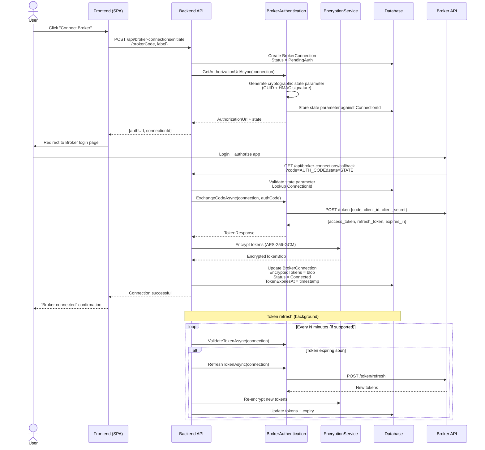
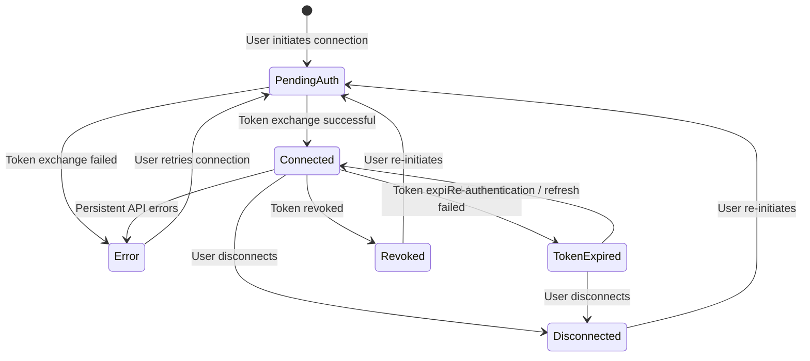

# Broker Integration Architecture

> **Document Version:** 1.0
> **Last Updated:** 2026-11-11
> **Status:** Approved for Implementation
> **Audience:** Backend Engineers, Integration Developers, Security Team

---

## Table of Contents

1. [Overview](#1-overview)
2. [Broker Adapter Architecture](#2-broker-adapter-architecture)
3. [Broker Capability Discovery](#3-broker-capability-discovery)
4. [Upstox Integration Plan](#4-upstox-integration-plan)
5. [Zerodha (Kite Connect) Integration Plan](#5-zerodha-kite-connect-integration-plan)
6. [Authentication Flow](#6-authentication-flow)
7. [Adapter Factory & DI Registration](#7-adapter-factory--di-registration)
8. [Error Handling & Resilience](#8-error-handling--resilience)
9. [Mock Broker Adapter](#9-mock-broker-adapter)
10. [Security Considerations](#10-security-considerations)
11. [Future Broker Addition Guide](#11-future-broker-addition-guide)
12. [Appendix](#12-appendix)

---

## 1. Overview

### 1.1 Design Goals

The broker integration layer is the boundary between our trading platform's domain logic and the external broker APIs. It must satisfy the following invariants:

| Principle | Description |
|---|---|
| **Multi-Broker** | Upstox and Zerodha in Phase 1; Dhan and Angel One in Phase 2 |
| **Multi-Account** | A single user can link multiple accounts with the same broker (e.g., two Zerodha accounts) |
| **Connection Independence** | Each `BrokerConnection` carries its own auth tokens, funds view, positions, and order history |
| **Domain Isolation** | Broker-specific HTTP payloads, error codes, and auth quirks never leak into strategy, risk, or domain code |
| **Testability** | Every integration point is mockable; a `MockBrokerAdapter` enables paper trading with zero real API calls |

### 1.2 Architectural Boundaries

```
┌──────────────────────────────────────────────────────────────────┐
│                      Domain / Strategy Layer                     │
│   (Uses only IBrokerAdapter, OrderRequest, Position, Quote…)     │
├──────────────────────────────────────────────────────────────────┤
│                    Broker Abstraction Layer                       │
│   IBrokerAdapter · IBrokerAuthentication · IMarketDataProvider   │
│   IOrderExecutionService · IPositionProvider · IFundsProvider    │
├──────────────┬──────────────┬──────────────┬─────────────────────┤
│ UpstoxAdapter│ZerodhaAdapter│ MockAdapter  │  (Future Adapters)  │
└──────────────┴──────────────┴──────────────┴─────────────────────┘
```

> [!IMPORTANT]
> Strategy code, risk management, and portfolio services must **never** reference a concrete adapter class. They depend exclusively on the interfaces defined in the abstraction layer.

### 1.3 Key Domain Models

The adapter layer translates broker-specific DTOs into these shared domain models:

| Model | Purpose |
|---|---|
| `BrokerConnection` | Represents a single authenticated link to a broker account (holds encrypted tokens, connection status) |
| `OrderRequest` / `OrderResponse` | Broker-agnostic order placement and acknowledgment |
| `OrderDetails` / `TradeDetail` | Normalized order status and trade execution info |
| `Position` / `Holding` | Current open positions and delivery holdings |
| `Quote` / `Candle` | Real-time and historical market data |
| `Instrument` | Exchange-traded instrument master record |
| `FundsInfo` | Available margin, used margin, cash balances |

---

## 2. Broker Adapter Architecture

### 2.1 Core Interfaces

The adapter pattern provides a unified contract that every broker implementation must fulfill. Each interface represents a distinct capability domain.

#### 2.1.1 IBrokerAdapter — The Root Facade

```csharp
/// <summary>
/// Root facade for all broker interactions. Each BrokerConnection resolves
/// to exactly one IBrokerAdapter instance scoped to that connection's
/// credentials and state.
/// </summary>
public interface IBrokerAdapter : IAsyncDisposable
{
    /// <summary>Unique broker identifier (e.g., "upstox", "zerodha").</summary>
    string BrokerCode { get; }

    /// <summary>Authentication operations for this broker.</summary>
    IBrokerAuthentication Authentication { get; }

    /// <summary>Market data retrieval and streaming.</summary>
    IMarketDataProvider MarketData { get; }

    /// <summary>Order placement, modification, and cancellation.</summary>
    IOrderExecutionService Orders { get; }

    /// <summary>Position and holdings queries.</summary>
    IPositionProvider Positions { get; }

    /// <summary>Funds and margin queries.</summary>
    IFundsProvider Funds { get; }

    /// <summary>Runtime-discoverable capabilities of this broker.</summary>
    BrokerCapabilities GetCapabilities();
}
```

#### 2.1.2 IBrokerAuthentication

```csharp
/// <summary>
/// Handles the full OAuth / login lifecycle for a broker connection.
/// Every method receives the BrokerConnection so the adapter can read
/// the correct API key, secret, and stored tokens.
/// </summary>
public interface IBrokerAuthentication
{
    /// <summary>
    /// Generates the URL the user must visit to authorize the app.
    /// The returned URL includes a cryptographic state parameter for CSRF protection.
    /// </summary>
    Task<AuthorizationUrl> GetAuthorizationUrlAsync(BrokerConnection connection);

    /// <summary>
    /// Exchanges the authorization code received from the broker callback
    /// for an access token (and optionally a refresh token).
    /// </summary>
    Task<TokenResponse> ExchangeCodeAsync(BrokerConnection connection, string authCode);

    /// <summary>
    /// Refreshes an expired access token using the stored refresh token.
    /// Not all brokers support this (e.g., Zerodha requires daily re-login).
    /// </summary>
    Task<TokenResponse> RefreshTokenAsync(BrokerConnection connection);

    /// <summary>
    /// Validates whether the current access token is still usable.
    /// Implementations may call a lightweight broker endpoint (e.g., profile).
    /// </summary>
    Task<bool> ValidateTokenAsync(BrokerConnection connection);

    /// <summary>
    /// Revokes the access token, invalidating the session on the broker side.
    /// </summary>
    Task RevokeTokenAsync(BrokerConnection connection);
}
```

#### 2.1.3 IMarketDataProvider

```csharp
public interface IMarketDataProvider
{
    /// <summary>Fetches the latest quote for an instrument.</summary>
    Task<Quote> GetQuoteAsync(string instrumentToken);

    /// <summary>Fetches historical OHLCV candles for a date range.</summary>
    Task<IEnumerable<Candle>> GetHistoricalCandlesAsync(
        string instrumentToken,
        Timeframe timeframe,
        DateTime from,
        DateTime to);

    /// <summary>Downloads the full instrument master for an exchange.</summary>
    Task<IEnumerable<Instrument>> GetInstrumentsAsync(string exchange);

    /// <summary>
    /// Subscribes to real-time quote updates via WebSocket.
    /// The onQuote callback is invoked on a background thread.
    /// </summary>
    Task SubscribeQuotesAsync(
        IEnumerable<string> instrumentTokens,
        Action<Quote> onQuote);

    /// <summary>Unsubscribes from previously subscribed instruments.</summary>
    Task UnsubscribeQuotesAsync(IEnumerable<string> instrumentTokens);
}
```

#### 2.1.4 IOrderExecutionService

```csharp
public interface IOrderExecutionService
{
    /// <summary>Places a new order. Returns the broker-assigned order ID.</summary>
    Task<OrderResponse> PlaceOrderAsync(OrderRequest order);

    /// <summary>Modifies an open/pending order (price, quantity, trigger).</summary>
    Task<OrderResponse> ModifyOrderAsync(string orderId, ModifyOrderRequest request);

    /// <summary>Cancels a pending order.</summary>
    Task<OrderResponse> CancelOrderAsync(string orderId);

    /// <summary>Queries the current status of a single order.</summary>
    Task<OrderDetails> GetOrderStatusAsync(string orderId);

    /// <summary>Lists all orders for a given trading date (defaults to today).</summary>
    Task<IEnumerable<OrderDetails>> GetOrdersAsync(DateTime? date = null);

    /// <summary>Lists all executed trades for a given trading date.</summary>
    Task<IEnumerable<TradeDetail>> GetTradesAsync(DateTime? date = null);
}
```

#### 2.1.5 IPositionProvider & IFundsProvider

```csharp
public interface IPositionProvider
{
    /// <summary>Returns all intraday and carry-forward positions.</summary>
    Task<IEnumerable<Position>> GetPositionsAsync();

    /// <summary>Returns delivery holdings (T+1 settled stocks).</summary>
    Task<IEnumerable<Holding>> GetHoldingsAsync();
}

public interface IFundsProvider
{
    /// <summary>Returns available cash, used margin, and segment-wise breakdown.</summary>
    Task<FundsInfo> GetFundsAsync();
}
```

### 2.2 Domain Model Contracts

```csharp
public record OrderRequest
{
    public required string InstrumentToken { get; init; }
    public required string Exchange { get; init; }       // NSE, BSE, NFO, MCX
    public required OrderSide Side { get; init; }         // Buy, Sell
    public required OrderType OrderType { get; init; }    // Market, Limit, SL, SL-M
    public required ProductType Product { get; init; }    // CNC, MIS, NRML
    public required int Quantity { get; init; }
    public decimal? Price { get; init; }
    public decimal? TriggerPrice { get; init; }
    public string? Tag { get; init; }                     // Strategy-assigned tag
}

public record OrderResponse
{
    public required string BrokerOrderId { get; init; }
    public required OrderStatus Status { get; init; }
    public string? StatusMessage { get; init; }
    public DateTime Timestamp { get; init; }
}

public record Quote
{
    public required string InstrumentToken { get; init; }
    public decimal LastPrice { get; init; }
    public decimal Open { get; init; }
    public decimal High { get; init; }
    public decimal Low { get; init; }
    public decimal Close { get; init; }
    public long Volume { get; init; }
    public decimal BidPrice { get; init; }
    public decimal AskPrice { get; init; }
    public int BidQuantity { get; init; }
    public int AskQuantity { get; init; }
    public DateTime Timestamp { get; init; }
}

public record FundsInfo
{
    public decimal AvailableCash { get; init; }
    public decimal UsedMargin { get; init; }
    public decimal AvailableMargin { get; init; }
    public decimal OpeningBalance { get; init; }
    public Dictionary<string, decimal> SegmentWise { get; init; } = new();
}
```

### 2.3 Adapter Internal Structure

Each concrete adapter follows a consistent internal layout:

```
src/
  TradingPlatform.Brokers.Upstox/
    ├── UpstoxBrokerAdapter.cs           # IBrokerAdapter implementation
    ├── UpstoxAuthentication.cs          # IBrokerAuthentication
    ├── UpstoxMarketDataProvider.cs      # IMarketDataProvider
    ├── UpstoxOrderExecutionService.cs   # IOrderExecutionService
    ├── UpstoxPositionProvider.cs        # IPositionProvider
    ├── UpstoxFundsProvider.cs           # IFundsProvider
    ├── UpstoxWebSocketClient.cs         # WebSocket streaming internals
    ├── Models/                          # Broker-specific API DTOs
    │   ├── UpstoxOrderResponse.cs
    │   ├── UpstoxQuoteResponse.cs
    │   └── ...
    ├── Mappers/                         # DTO → Domain model mappers
    │   ├── UpstoxOrderMapper.cs
    │   └── UpstoxQuoteMapper.cs
    └── Configuration/
        └── UpstoxOptions.cs             # Typed configuration (base URL, etc.)
```

> [!NOTE]
> The `Models/` directory contains DTOs that exactly mirror the broker's JSON responses. These types are **internal** to the adapter assembly and are never exposed to consuming code. The `Mappers/` directory translates these DTOs into the shared domain models.

---

## 3. Broker Capability Discovery

### 3.1 BrokerCapabilities Model

Not all brokers support the same features. The capability model lets strategy and UI code gracefully degrade or hide unsupported features without conditional broker checks.

```csharp
public class BrokerCapabilities
{
    /// <summary>Whether the broker supports WebSocket-based live streaming.</summary>
    public bool SupportsWebSocket { get; set; }

    /// <summary>Whether historical candle data is available via API.</summary>
    public bool SupportsHistoricalData { get; set; }

    /// <summary>Good-Till-Triggered orders (price alerts that auto-place orders).</summary>
    public bool SupportsGTTOrders { get; set; }

    /// <summary>Bracket orders (entry + stoploss + target in a single order).</summary>
    public bool SupportsBracketOrders { get; set; }

    /// <summary>Cover orders (market/limit + compulsory stoploss).</summary>
    public bool SupportsCoverOrders { get; set; }

    /// <summary>Exchanges this broker provides access to (NSE, BSE, NFO, MCX, CDS, BFO).</summary>
    public IEnumerable<string> SupportedExchanges { get; set; } = Array.Empty<string>();

    /// <summary>Product types: CNC, MIS, NRML, BO, CO, etc.</summary>
    public IEnumerable<string> SupportedProductTypes { get; set; } = Array.Empty<string>();

    /// <summary>Order types: MARKET, LIMIT, SL, SL-M.</summary>
    public IEnumerable<string> SupportedOrderTypes { get; set; } = Array.Empty<string>();

    /// <summary>Broker-imposed rate limits.</summary>
    public RateLimits RateLimits { get; set; } = new();

    /// <summary>Market trading hours for supported exchanges.</summary>
    public TradingHours TradingHours { get; set; } = new();
}

public class RateLimits
{
    /// <summary>Maximum API calls per second.</summary>
    public int RequestsPerSecond { get; set; }

    /// <summary>Maximum API calls per minute.</summary>
    public int RequestsPerMinute { get; set; }

    /// <summary>Maximum orders per second.</summary>
    public int OrdersPerSecond { get; set; }

    /// <summary>Maximum WebSocket subscriptions per connection.</summary>
    public int MaxWebSocketSubscriptions { get; set; }
}

public class TradingHours
{
    public TimeOnly PreMarketOpen { get; set; }    // 09:00
    public TimeOnly MarketOpen { get; set; }        // 09:15
    public TimeOnly MarketClose { get; set; }       // 15:30
    public TimeOnly PostMarketClose { get; set; }   // 16:00
}
```

### 3.2 Capability Usage Pattern

```csharp
public class StrategyExecutionService
{
    public async Task ExecuteAsync(IBrokerAdapter broker, StrategySignal signal)
    {
        var capabilities = broker.GetCapabilities();

        // Validate the order type is supported before placing
        if (signal.OrderType == OrderType.BracketOrder && !capabilities.SupportsBracketOrders)
        {
            throw new UnsupportedFeatureException(
                broker.BrokerCode, "Bracket Orders");
        }

        // Fall back to polling if WebSocket is unavailable
        if (!capabilities.SupportsWebSocket)
        {
            _logger.LogWarning("Broker {Broker} does not support WebSocket. " +
                "Falling back to REST polling for live quotes.", broker.BrokerCode);
        }
    }
}
```

### 3.3 Capability Matrix (Phase 1 Brokers)

| Capability | Upstox | Zerodha | Mock |
|---|:---:|:---:|:---:|
| WebSocket Streaming | ✅ | ✅ | ✅ (simulated) |
| Historical Data | ✅ | ✅ | ✅ (synthetic) |
| GTT Orders | ✅ | ✅ | ✅ |
| Bracket Orders | ❌ | ✅ | ✅ |
| Cover Orders | ❌ | ✅ | ✅ |
| NSE / BSE | ✅ | ✅ | ✅ |
| NFO (F&O) | ✅ | ✅ | ✅ |
| MCX (Commodity) | ✅ | ✅ | ❌ |
| CDS (Currency) | ✅ | ✅ | ❌ |
| Token Refresh | ✅ | ❌ (daily re-login) | N/A |

> [!NOTE]
> The capability values above are approximations for planning purposes. Actual values will be confirmed against each broker's official API documentation during implementation.

---

## 4. Upstox Integration Plan

### 4.1 Overview

Upstox provides API v2 for programmatic trading on NSE, BSE, NFO, MCX, and CDS segments. Integration will be built against the **official Upstox API v2 documentation**, and all endpoint paths, request/response schemas, and behavioral details will be verified at implementation time.

> [!WARNING]
> The endpoint paths, parameter names, and response structures listed below are based on publicly available Upstox API v2 references at the time of writing. They **must be verified** against the official documentation before implementation begins. Do not treat these as authoritative.

### 4.2 OAuth2 Authorization Flow

Upstox uses a standard OAuth2 authorization code flow:

1. **Redirect user** to Upstox authorization URL with `client_id`, `redirect_uri`, and `state`
2. **User logs in** on Upstox and grants access
3. **Upstox redirects** back to our callback URL with an `authorization_code`
4. **Backend exchanges** the code for an `access_token` (and `refresh_token` if supported)
5. **Tokens stored** encrypted in the `BrokerConnections` table

### 4.3 API Endpoints (Planned)

The following endpoint categories will be implemented:

| Category | Operations |
|---|---|
| **Authentication** | Authorization URL generation, code exchange, token refresh, token revocation |
| **Orders** | Place order, modify order, cancel order, get order details, get order book, get trade book |
| **Portfolio** | Get positions (day/net), get holdings, convert position (product type) |
| **Funds** | Get fund limits and margin details |
| **Market Data** | Get quotes (LTP/full/OHLC), get market status |
| **Historical Data** | Intraday candles, daily/weekly/monthly candles |
| **Instruments** | Download instrument master CSV |
| **WebSocket** | Real-time market data streaming via WebSocket |

### 4.4 Rate Limits & Throttling

Upstox enforces rate limits on API calls. Our adapter will:

- Read documented rate limits from official docs and configure them in `BrokerCapabilities`
- Implement a `SemaphoreSlim`-based throttle per `BrokerConnection` to avoid hitting limits
- Queue requests that would exceed the limit and dispatch them as capacity frees up
- Return `BrokerRateLimitException` if the queue overflows (configurable max queue depth)

```csharp
internal class UpstoxRateLimiter
{
    private readonly SemaphoreSlim _semaphore;
    private readonly int _maxRequestsPerSecond;
    private readonly ConcurrentQueue<DateTime> _requestTimestamps = new();

    public async Task<T> ExecuteAsync<T>(Func<Task<T>> apiCall, CancellationToken ct)
    {
        await WaitForCapacityAsync(ct);
        try
        {
            return await apiCall();
        }
        finally
        {
            _requestTimestamps.Enqueue(DateTime.UtcNow);
        }
    }
}
```

### 4.5 Token Refresh Strategy

- Upstox access tokens have a defined expiry (typically end-of-day or a fixed duration)
- The adapter will check token validity before each API call via a lightweight endpoint
- If the token is nearing expiry (within a configurable buffer, e.g., 5 minutes), the adapter proactively refreshes it
- If refresh fails, the connection status is set to `TokenExpired` and the user is notified

### 4.6 Known Considerations

| Consideration | Detail |
|---|---|
| Historical data limits | Upstox may impose limits on how far back historical data goes and how many candles per request |
| WebSocket reconnection | Must handle disconnects with exponential backoff; re-subscribe to instruments on reconnect |
| Instrument token format | Upstox uses its own instrument key format which must be mapped to our normalized `InstrumentToken` |
| Order status polling | WebSocket order updates may not be available; may need to poll order book for status changes |
| Market hours | API behavior outside market hours (e.g., quote staleness, order rejection) must be handled |

### 4.7 Adapter Configuration

```csharp
public class UpstoxOptions
{
    public const string SectionName = "Broker:Upstox";

    public string BaseUrl { get; set; } = "https://api.upstox.com/v2";
    public string AuthorizationUrl { get; set; } = "https://api.upstox.com/v2/login/authorization/dialog";
    public string TokenUrl { get; set; } = "https://api.upstox.com/v2/login/authorization/token";
    public string WebSocketUrl { get; set; } = "wss://api.upstox.com/v2/feed/market-data-feed";
    public string RedirectUri { get; set; } = default!;
    public int HttpTimeoutSeconds { get; set; } = 30;
    public int MaxRetries { get; set; } = 3;
    public int TokenRefreshBufferMinutes { get; set; } = 5;
}
```

> [!IMPORTANT]
> All URL values, endpoint paths, and WebSocket addresses in `UpstoxOptions` are placeholders. They must be updated to match the official Upstox API v2 documentation at implementation time.

---

## 5. Zerodha (Kite Connect) Integration Plan

### 5.1 Overview

Zerodha's Kite Connect API is a widely-used trading API in India. It follows a slightly different authentication model compared to standard OAuth2: the access token is valid only for the current trading day and requires a fresh login each morning.

> [!WARNING]
> As with Upstox, the API details below are based on publicly available Kite Connect documentation at the time of writing and **must be verified** against the official Kite Connect v3 documentation before implementation.

### 5.2 Kite Connect Login Flow

Zerodha uses a two-step login process:

1. **Redirect user** to Kite login URL with `api_key`
2. **User logs in** on Kite and completes 2FA
3. **Kite redirects** back with a `request_token`
4. **Backend generates** a checksum: `SHA256(api_key + request_token + api_secret)`
5. **Backend exchanges** the `request_token` + checksum for an `access_token`
6. **Access token** is valid until the next trading day (~6:00 AM IST)

### 5.3 API Endpoints (Planned)

| Category | Operations |
|---|---|
| **Authentication** | Login URL generation, session token generation, session invalidation |
| **Orders** | Place order (regular, AMO, CO, BO), modify order, cancel order, order history, trade book |
| **Portfolio** | Get positions (day/net), get holdings, position conversion |
| **Margins** | Get margin details (equity, commodity), order margin calculation |
| **Market Data** | Get quote (LTP, OHLC, full), market instruments dump |
| **Historical Data** | Historical candles (minute, day, etc.) via instruments/historical API |
| **WebSocket** | Kite Ticker — binary WebSocket for real-time market data |

### 5.4 Rate Limits

Kite Connect documents specific rate limits:

| Endpoint Type | Documented Limit |
|---|---|
| General API | 3 requests/second per API key |
| Historical data | 3 requests/second |
| Order placement | 10 requests/second per user |
| WebSocket connections | 3 concurrent connections |
| WebSocket instruments | ~3000 instruments per connection |

> [!NOTE]
> Rate limits quoted above are representative values from Kite Connect documentation. Verify the exact numbers from the official API documentation before implementation.

Our adapter will enforce these limits using the same `RateLimiter` infrastructure used by Upstox, configured with Zerodha-specific values.

### 5.5 Token Lifecycle

Zerodha's tokens have a unique lifecycle that differs from standard OAuth2:

```
┌─────────────────────────────────────────────────────────────────┐
│  06:00 AM IST: Previous day's access_token expires              │
│  ↓                                                              │
│  User must re-authenticate via Kite login page                  │
│  ↓                                                              │
│  New access_token issued (valid until next ~06:00 AM IST)       │
│  ↓                                                              │
│  All API calls use this access_token for the trading day        │
│  ↓                                                              │
│  No refresh_token mechanism — daily re-login is required        │
└─────────────────────────────────────────────────────────────────┘
```

**Implications for our platform:**

- The platform must detect token expiry (typically via a 403/401 response) and notify the user that re-authentication is required
- A morning notification system should remind users to re-authenticate before market open (09:15 IST)
- The `IBrokerAuthentication.RefreshTokenAsync()` method will throw `TokenRefreshNotSupportedException` for Zerodha
- Connection status will transition: `Connected` → `TokenExpired` → `Connected` (after re-login)

### 5.6 Known Considerations

| Consideration | Detail |
|---|---|
| Daily re-login | No refresh token; user must authenticate every trading day |
| Binary WebSocket | Kite Ticker uses a custom binary protocol; must implement the binary frame parser |
| Instrument token mapping | Zerodha uses numeric instrument tokens; must maintain a mapping to our normalized tokens |
| Historical data limits | Kite Connect limits the date range and granularity combinations for historical data |
| API key vs. user token | The API key identifies the app; the access token identifies the user session |
| Postback URLs | Kite Connect supports optional postback URLs for order updates; should be evaluated as an alternative to polling |

### 5.7 Adapter Configuration

```csharp
public class ZerodhaOptions
{
    public const string SectionName = "Broker:Zerodha";

    public string BaseUrl { get; set; } = "https://api.kite.trade";
    public string LoginUrl { get; set; } = "https://kite.zerodha.com/connect/login";
    public string RedirectUri { get; set; } = default!;
    public int HttpTimeoutSeconds { get; set; } = 30;
    public int MaxRetries { get; set; } = 3;
    public string TokenExpiryCheckCron { get; set; } = "0 55 5 * * *"; // 5:55 AM IST
}
```

---

## 6. Authentication Flow

### 6.1 Sequence Diagram



### 6.2 State Parameter Security

The `state` parameter prevents CSRF attacks during the OAuth flow:

```csharp
public class OAuthStateService
{
    private readonly IDataProtectionProvider _dataProtection;

    /// <summary>
    /// Generates a tamper-proof state parameter containing the ConnectionId
    /// and a timestamp. The state is encrypted using ASP.NET Data Protection.
    /// </summary>
    public string GenerateState(Guid connectionId)
    {
        var protector = _dataProtection.CreateProtector("BrokerOAuth");
        var payload = JsonSerializer.Serialize(new
        {
            ConnectionId = connectionId,
            Timestamp = DateTimeOffset.UtcNow,
            Nonce = Guid.NewGuid()
        });
        return protector.Protect(payload);
    }

    /// <summary>
    /// Validates and decrypts the state parameter.
    /// Rejects states older than 10 minutes.
    /// </summary>
    public Guid ValidateState(string state)
    {
        var protector = _dataProtection.CreateProtector("BrokerOAuth");
        var payload = JsonSerializer.Deserialize<OAuthState>(protector.Unprotect(state));

        if (DateTimeOffset.UtcNow - payload.Timestamp > TimeSpan.FromMinutes(10))
            throw new SecurityException("OAuth state has expired.");

        return payload.ConnectionId;
    }
}
```

### 6.3 Token Storage Model

```csharp
public class BrokerConnection
{
    public Guid Id { get; set; }
    public Guid UserId { get; set; }
    public string BrokerCode { get; set; } = default!;          // "upstox", "zerodha"
    public string Label { get; set; } = default!;                // User-assigned label
    public string? BrokerClientId { get; set; }                  // Broker-side user ID

    // Encrypted token storage — see Security section
    public byte[] EncryptedAccessToken { get; set; } = default!;
    public byte[] EncryptedRefreshToken { get; set; } = Array.Empty<byte>();
    public byte[] TokenNonce { get; set; } = default!;           // AES-GCM nonce
    public byte[] TokenTag { get; set; } = default!;             // AES-GCM auth tag

    public DateTime? TokenExpiresAt { get; set; }
    public ConnectionStatus Status { get; set; }
    public DateTime CreatedAt { get; set; }
    public DateTime UpdatedAt { get; set; }
    public DateTime? LastUsedAt { get; set; }

    // API credentials reference (not the secret itself)
    public Guid BrokerApiCredentialId { get; set; }
}

public enum ConnectionStatus
{
    PendingAuth,
    Connected,
    TokenExpired,
    Disconnected,
    Error,
    Revoked
}
```

### 6.4 Connection Status Transitions



---

## 7. Adapter Factory & DI Registration

### 7.1 Factory Interface

```csharp
/// <summary>
/// Creates broker adapters scoped to a specific BrokerConnection.
/// The factory resolves the correct adapter implementation based on
/// the connection's BrokerCode.
/// </summary>
public interface IBrokerAdapterFactory
{
    /// <summary>
    /// Creates an IBrokerAdapter configured for the given connection.
    /// The adapter is pre-configured with the connection's decrypted
    /// credentials and ready to make API calls.
    /// </summary>
    IBrokerAdapter CreateAdapter(BrokerConnection connection);

    /// <summary>
    /// Returns all registered broker codes (e.g., "upstox", "zerodha", "mock").
    /// </summary>
    IEnumerable<string> GetRegisteredBrokers();

    /// <summary>
    /// Checks if a broker code has a registered adapter.
    /// </summary>
    bool IsSupported(string brokerCode);
}
```

### 7.2 Factory Implementation

```csharp
public class BrokerAdapterFactory : IBrokerAdapterFactory
{
    private readonly IServiceProvider _serviceProvider;
    private readonly IEncryptionService _encryption;
    private readonly ILogger<BrokerAdapterFactory> _logger;
    private readonly Dictionary<string, Type> _adapterTypes = new(StringComparer.OrdinalIgnoreCase);

    public BrokerAdapterFactory(
        IServiceProvider serviceProvider,
        IEncryptionService encryption,
        ILogger<BrokerAdapterFactory> logger)
    {
        _serviceProvider = serviceProvider;
        _encryption = encryption;
        _logger = logger;
    }

    /// <summary>Registers an adapter type for a broker code.</summary>
    internal void RegisterAdapter<TAdapter>(string brokerCode) where TAdapter : IBrokerAdapter
    {
        _adapterTypes[brokerCode] = typeof(TAdapter);
    }

    public IBrokerAdapter CreateAdapter(BrokerConnection connection)
    {
        if (!_adapterTypes.TryGetValue(connection.BrokerCode, out var adapterType))
        {
            throw new UnsupportedBrokerException(connection.BrokerCode);
        }

        // Resolve the adapter from DI (transient)
        var adapter = (IBrokerAdapter)_serviceProvider.GetRequiredService(adapterType);

        // Initialize with decrypted credentials
        if (adapter is IBrokerAdapterInitializable initializable)
        {
            var credentials = _encryption.DecryptTokens(connection);
            initializable.Initialize(connection, credentials);
        }

        _logger.LogDebug("Created {BrokerCode} adapter for connection {ConnectionId}",
            connection.BrokerCode, connection.Id);

        return adapter;
    }

    public IEnumerable<string> GetRegisteredBrokers() => _adapterTypes.Keys;

    public bool IsSupported(string brokerCode) => _adapterTypes.ContainsKey(brokerCode);
}
```

### 7.3 DI Registration Extensions

```csharp
public static class BrokerServiceCollectionExtensions
{
    /// <summary>
    /// Registers core broker infrastructure: factory, encryption, state management.
    /// </summary>
    public static IServiceCollection AddBrokerInfrastructure(
        this IServiceCollection services,
        IConfiguration configuration)
    {
        services.AddSingleton<IBrokerAdapterFactory, BrokerAdapterFactory>();
        services.AddSingleton<IEncryptionService, AesGcmEncryptionService>();
        services.AddSingleton<OAuthStateService>();
        services.Configure<EncryptionOptions>(configuration.GetSection("Encryption"));

        return services;
    }

    /// <summary>
    /// Registers the Upstox broker adapter and its dependencies.
    /// </summary>
    public static IServiceCollection AddUpstoxBroker(
        this IServiceCollection services,
        IConfiguration configuration)
    {
        services.Configure<UpstoxOptions>(configuration.GetSection(UpstoxOptions.SectionName));

        // Register adapter as transient (new instance per connection)
        services.AddTransient<UpstoxBrokerAdapter>();

        // Register HTTP client with Polly policies
        services.AddHttpClient<UpstoxBrokerAdapter>(client =>
        {
            var options = configuration
                .GetSection(UpstoxOptions.SectionName)
                .Get<UpstoxOptions>()!;
            client.BaseAddress = new Uri(options.BaseUrl);
            client.Timeout = TimeSpan.FromSeconds(options.HttpTimeoutSeconds);
        })
        .AddPolicyHandler(GetRetryPolicy())
        .AddPolicyHandler(GetCircuitBreakerPolicy());

        // Register with factory
        services.AddSingleton<IStartupFilter>(sp =>
        {
            var factory = (BrokerAdapterFactory)sp.GetRequiredService<IBrokerAdapterFactory>();
            factory.RegisterAdapter<UpstoxBrokerAdapter>("upstox");
            return new NoOpStartupFilter();
        });

        return services;
    }

    /// <summary>
    /// Registers the Zerodha broker adapter and its dependencies.
    /// </summary>
    public static IServiceCollection AddZerodhaBroker(
        this IServiceCollection services,
        IConfiguration configuration)
    {
        services.Configure<ZerodhaOptions>(configuration.GetSection(ZerodhaOptions.SectionName));
        services.AddTransient<ZerodhaBrokerAdapter>();

        services.AddHttpClient<ZerodhaBrokerAdapter>(client =>
        {
            var options = configuration
                .GetSection(ZerodhaOptions.SectionName)
                .Get<ZerodhaOptions>()!;
            client.BaseAddress = new Uri(options.BaseUrl);
            client.Timeout = TimeSpan.FromSeconds(options.HttpTimeoutSeconds);
        })
        .AddPolicyHandler(GetRetryPolicy())
        .AddPolicyHandler(GetCircuitBreakerPolicy());

        services.AddSingleton<IStartupFilter>(sp =>
        {
            var factory = (BrokerAdapterFactory)sp.GetRequiredService<IBrokerAdapterFactory>();
            factory.RegisterAdapter<ZerodhaBrokerAdapter>("zerodha");
            return new NoOpStartupFilter();
        });

        return services;
    }

    /// <summary>
    /// Registers the Mock broker adapter for paper trading and testing.
    /// </summary>
    public static IServiceCollection AddMockBroker(
        this IServiceCollection services)
    {
        services.AddTransient<MockBrokerAdapter>();

        services.AddSingleton<IStartupFilter>(sp =>
        {
            var factory = (BrokerAdapterFactory)sp.GetRequiredService<IBrokerAdapterFactory>();
            factory.RegisterAdapter<MockBrokerAdapter>("mock");
            return new NoOpStartupFilter();
        });

        return services;
    }
}
```

### 7.4 Startup Configuration

```csharp
// Program.cs
var builder = WebApplication.CreateBuilder(args);

builder.Services
    .AddBrokerInfrastructure(builder.Configuration)
    .AddUpstoxBroker(builder.Configuration)
    .AddZerodhaBroker(builder.Configuration)
    .AddMockBroker();
```

---

## 8. Error Handling & Resilience

### 8.1 Error Taxonomy

All broker API errors are translated into a domain exception hierarchy. Broker-specific HTTP status codes and error payloads are never propagated to callers.

```csharp
/// <summary>Base exception for all broker-related errors.</summary>
public class BrokerException : Exception
{
    public string BrokerCode { get; }
    public Guid ConnectionId { get; }
    public BrokerErrorCode ErrorCode { get; }

    public BrokerException(string brokerCode, Guid connectionId,
        BrokerErrorCode errorCode, string message, Exception? inner = null)
        : base(message, inner)
    {
        BrokerCode = brokerCode;
        ConnectionId = connectionId;
        ErrorCode = errorCode;
    }
}

public enum BrokerErrorCode
{
    Unknown,
    TokenExpired,
    TokenInvalid,
    TokenRefreshFailed,
    RateLimitExceeded,
    InsufficientFunds,
    InvalidOrder,
    OrderNotFound,
    OrderAlreadyCancelled,
    OrderAlreadyExecuted,
    InstrumentNotFound,
    ExchangeClosed,
    NetworkTimeout,
    ServiceUnavailable,
    CircuitBreakerOpen,
    UnsupportedFeature
}
```

### 8.2 HTTP Retry Policy (Polly)

```csharp
private static IAsyncPolicy<HttpResponseMessage> GetRetryPolicy()
{
    return HttpPolicyExtensions
        .HandleTransientHttpError()               // 5xx, 408
        .OrResult(r => r.StatusCode == (HttpStatusCode)429)  // Rate limit
        .WaitAndRetryAsync(
            retryCount: 3,
            sleepDurationProvider: (retryAttempt, response, _) =>
            {
                // Respect Retry-After header if present
                if (response.Result?.Headers.RetryAfter?.Delta is TimeSpan delta)
                    return delta;

                // Exponential backoff: 1s, 2s, 4s
                return TimeSpan.FromSeconds(Math.Pow(2, retryAttempt - 1));
            },
            onRetryAsync: async (outcome, timespan, retryAttempt, context) =>
            {
                var logger = context.GetLogger();
                logger?.LogWarning(
                    "Broker API retry #{Attempt} after {Delay}s. Status: {Status}",
                    retryAttempt, timespan.TotalSeconds,
                    outcome.Result?.StatusCode);
            });
}
```

### 8.3 Circuit Breaker Policy

```csharp
private static IAsyncPolicy<HttpResponseMessage> GetCircuitBreakerPolicy()
{
    return HttpPolicyExtensions
        .HandleTransientHttpError()
        .CircuitBreakerAsync(
            handledEventsAllowedBeforeBreaking: 5,     // 5 consecutive failures
            durationOfBreak: TimeSpan.FromSeconds(30), // 30s cooldown
            onBreak: (outcome, breakDelay) =>
            {
                Log.Warning("Circuit breaker OPEN for {Delay}s due to: {Reason}",
                    breakDelay.TotalSeconds, outcome.Exception?.Message ?? outcome.Result?.StatusCode.ToString());
            },
            onReset: () =>
            {
                Log.Information("Circuit breaker RESET — resuming broker API calls");
            },
            onHalfOpen: () =>
            {
                Log.Information("Circuit breaker HALF-OPEN — testing broker API");
            });
}
```

### 8.4 Token Expiry Detection & Auto-Refresh

```csharp
/// <summary>
/// Middleware that wraps every broker API call with automatic token
/// validation and refresh logic.
/// </summary>
internal class TokenRefreshDelegatingHandler : DelegatingHandler
{
    private readonly IBrokerAuthentication _auth;
    private readonly IEncryptionService _encryption;
    private readonly SemaphoreSlim _refreshLock = new(1, 1);

    protected override async Task<HttpResponseMessage> SendAsync(
        HttpRequestMessage request,
        CancellationToken cancellationToken)
    {
        var response = await base.SendAsync(request, cancellationToken);

        if (response.StatusCode is HttpStatusCode.Unauthorized or HttpStatusCode.Forbidden)
        {
            // Attempt token refresh (with lock to prevent concurrent refreshes)
            await _refreshLock.WaitAsync(cancellationToken);
            try
            {
                var newTokens = await _auth.RefreshTokenAsync(_connection);
                _encryption.UpdateTokens(_connection, newTokens);

                // Retry the original request with new token
                request.Headers.Authorization =
                    new AuthenticationHeaderValue("Bearer", newTokens.AccessToken);
                response = await base.SendAsync(request, cancellationToken);
            }
            catch (TokenRefreshNotSupportedException)
            {
                // Broker doesn't support refresh (e.g., Zerodha)
                // Mark connection as expired
                throw new BrokerException(
                    _connection.BrokerCode,
                    _connection.Id,
                    BrokerErrorCode.TokenExpired,
                    "Access token expired and refresh is not supported. User must re-authenticate.");
            }
            finally
            {
                _refreshLock.Release();
            }
        }

        return response;
    }
}
```

### 8.5 Broker Error Mapping

Each adapter implements error mapping from broker-specific responses to domain errors:

```csharp
internal static class UpstoxErrorMapper
{
    public static BrokerException MapError(
        HttpResponseMessage response,
        string? responseBody,
        Guid connectionId)
    {
        var errorCode = response.StatusCode switch
        {
            HttpStatusCode.Unauthorized => BrokerErrorCode.TokenExpired,
            HttpStatusCode.Forbidden    => BrokerErrorCode.TokenInvalid,
            (HttpStatusCode)429         => BrokerErrorCode.RateLimitExceeded,
            HttpStatusCode.BadRequest   => ParseBadRequest(responseBody),
            _                           => BrokerErrorCode.Unknown
        };

        return new BrokerException(
            "upstox", connectionId, errorCode,
            $"Upstox API error: {response.StatusCode} — {responseBody}");
    }

    private static BrokerErrorCode ParseBadRequest(string? body)
    {
        // Parse broker-specific error codes from response body
        // and map to domain error codes
        if (body?.Contains("insufficient", StringComparison.OrdinalIgnoreCase) == true)
            return BrokerErrorCode.InsufficientFunds;
        if (body?.Contains("invalid order", StringComparison.OrdinalIgnoreCase) == true)
            return BrokerErrorCode.InvalidOrder;
        return BrokerErrorCode.Unknown;
    }
}
```

### 8.6 Network Timeout Handling

```csharp
// Per-connection timeout configuration
services.AddHttpClient<UpstoxBrokerAdapter>(client =>
{
    client.Timeout = TimeSpan.FromSeconds(30); // Hard timeout
})
.AddPolicyHandler(Policy.TimeoutAsync<HttpResponseMessage>(
    TimeSpan.FromSeconds(10),                   // Optimistic timeout per request
    TimeoutStrategy.Optimistic,
    onTimeoutAsync: (context, timespan, task) =>
    {
        Log.Warning("Broker API call timed out after {Timeout}s", timespan.TotalSeconds);
        return Task.CompletedTask;
    }));
```

### 8.7 Resilience Summary

| Concern | Strategy |
|---|---|
| Transient HTTP errors (5xx, 408) | Exponential backoff retry (3 attempts) |
| Rate limiting (429) | Respect `Retry-After` header; local rate limiter prevents hitting limits |
| Token expiry (401/403) | Auto-refresh with single-thread lock; fall back to `TokenExpired` status |
| Repeated failures | Circuit breaker opens after 5 consecutive failures; 30s cooldown |
| Network timeouts | 10s optimistic timeout per request; 30s hard timeout |
| WebSocket disconnects | Auto-reconnect with exponential backoff; re-subscribe instruments |
| Broker maintenance windows | Circuit breaker prevents hammering; status check before market open |

---

## 9. Mock Broker Adapter

### 9.1 Purpose

The `MockBrokerAdapter` serves two critical roles:

1. **Paper Trading** — Allows users to test strategies with simulated order execution against real or synthetic market data without risking real capital
2. **Testing** — Provides a deterministic, controllable broker implementation for unit and integration tests

### 9.2 Implementation

```csharp
public class MockBrokerAdapter : IBrokerAdapter, IBrokerAdapterInitializable
{
    public string BrokerCode => "mock";

    public IBrokerAuthentication Authentication { get; }
    public IMarketDataProvider MarketData { get; }
    public IOrderExecutionService Orders { get; }
    public IPositionProvider Positions { get; }
    public IFundsProvider Funds { get; }

    private readonly MockOrderBook _orderBook;
    private readonly MockMarketSimulator _marketSimulator;
    private readonly MockFundsManager _fundsManager;

    public MockBrokerAdapter(
        IOptions<MockBrokerOptions> options,
        ILogger<MockBrokerAdapter> logger)
    {
        _orderBook = new MockOrderBook(options.Value);
        _marketSimulator = new MockMarketSimulator(options.Value);
        _fundsManager = new MockFundsManager(options.Value.InitialFunds);

        Authentication = new MockAuthentication();
        MarketData = new MockMarketDataProvider(_marketSimulator);
        Orders = new MockOrderExecutionService(_orderBook, _fundsManager, logger);
        Positions = new MockPositionProvider(_orderBook);
        Funds = new MockFundsProvider(_fundsManager);
    }

    public BrokerCapabilities GetCapabilities() => new()
    {
        SupportsWebSocket = true,
        SupportsHistoricalData = true,
        SupportsGTTOrders = true,
        SupportsBracketOrders = true,
        SupportsCoverOrders = true,
        SupportedExchanges = new[] { "NSE", "BSE", "NFO" },
        SupportedProductTypes = new[] { "CNC", "MIS", "NRML" },
        SupportedOrderTypes = new[] { "MARKET", "LIMIT", "SL", "SL-M" },
        RateLimits = new RateLimits
        {
            RequestsPerSecond = 100,
            RequestsPerMinute = 6000,
            OrdersPerSecond = 50,
            MaxWebSocketSubscriptions = 10000
        }
    };

    public void Initialize(BrokerConnection connection, DecryptedCredentials credentials)
    {
        // No-op for mock — no real credentials needed
    }

    public ValueTask DisposeAsync() => ValueTask.CompletedTask;
}
```

### 9.3 Order Simulation

```csharp
internal class MockOrderExecutionService : IOrderExecutionService
{
    private readonly MockOrderBook _orderBook;
    private readonly MockFundsManager _funds;
    private readonly ILogger _logger;

    public async Task<OrderResponse> PlaceOrderAsync(OrderRequest order)
    {
        // Validate funds
        var estimatedCost = order.Quantity * (order.Price ?? 0m);
        if (!_funds.HasSufficientFunds(estimatedCost))
        {
            return new OrderResponse
            {
                BrokerOrderId = Guid.NewGuid().ToString(),
                Status = OrderStatus.Rejected,
                StatusMessage = "Insufficient funds",
                Timestamp = DateTime.UtcNow
            };
        }

        var brokerOrderId = Guid.NewGuid().ToString();
        var mockOrder = new MockOrder
        {
            OrderId = brokerOrderId,
            Request = order,
            Status = OrderStatus.Pending,
            PlacedAt = DateTime.UtcNow
        };

        _orderBook.AddOrder(mockOrder);

        // Simulate async fill based on order type
        _ = SimulateFillAsync(mockOrder);

        return new OrderResponse
        {
            BrokerOrderId = brokerOrderId,
            Status = OrderStatus.Pending,
            StatusMessage = "Order placed successfully (paper)",
            Timestamp = DateTime.UtcNow
        };
    }

    private async Task SimulateFillAsync(MockOrder order)
    {
        var options = _orderBook.Options;

        // Simulate network + exchange latency
        await Task.Delay(options.SimulatedFillDelayMs);

        // Determine outcome based on configured probabilities
        var random = Random.Shared.NextDouble();

        if (random < options.RejectionProbability)
        {
            order.Status = OrderStatus.Rejected;
            order.StatusMessage = "Simulated rejection";
        }
        else if (random < options.RejectionProbability + options.PartialFillProbability)
        {
            // Partial fill: fill 30-70% of quantity
            var fillRatio = 0.3 + (Random.Shared.NextDouble() * 0.4);
            var filledQty = (int)(order.Request.Quantity * fillRatio);
            order.FilledQuantity = filledQty;
            order.Status = OrderStatus.PartiallyFilled;
            order.AveragePrice = order.Request.Price ?? _marketSimulator.GetSimulatedPrice(
                order.Request.InstrumentToken);
            _funds.DeductFunds(filledQty * order.AveragePrice);
        }
        else
        {
            // Full fill
            order.FilledQuantity = order.Request.Quantity;
            order.Status = OrderStatus.Filled;
            order.AveragePrice = order.Request.Price ?? _marketSimulator.GetSimulatedPrice(
                order.Request.InstrumentToken);
            _funds.DeductFunds(order.FilledQuantity * order.AveragePrice);
        }

        order.UpdatedAt = DateTime.UtcNow;
    }
}
```

### 9.4 Market Data Simulation

```csharp
internal class MockMarketDataProvider : IMarketDataProvider
{
    private readonly MockMarketSimulator _simulator;
    private readonly ConcurrentDictionary<string, Action<Quote>> _subscriptions = new();
    private CancellationTokenSource? _streamCts;

    public Task<Quote> GetQuoteAsync(string instrumentToken)
    {
        return Task.FromResult(_simulator.GenerateQuote(instrumentToken));
    }

    public Task<IEnumerable<Candle>> GetHistoricalCandlesAsync(
        string instrumentToken, Timeframe tf, DateTime from, DateTime to)
    {
        return Task.FromResult(_simulator.GenerateCandles(instrumentToken, tf, from, to));
    }

    public Task<IEnumerable<Instrument>> GetInstrumentsAsync(string exchange)
    {
        return Task.FromResult(_simulator.GetMockInstruments(exchange));
    }

    public Task SubscribeQuotesAsync(
        IEnumerable<string> instrumentTokens, Action<Quote> onQuote)
    {
        foreach (var token in instrumentTokens)
            _subscriptions[token] = onQuote;

        StartStreamingIfNeeded();
        return Task.CompletedTask;
    }

    private void StartStreamingIfNeeded()
    {
        if (_streamCts != null) return;
        _streamCts = new CancellationTokenSource();

        _ = Task.Run(async () =>
        {
            while (!_streamCts.Token.IsCancellationRequested)
            {
                foreach (var (token, callback) in _subscriptions)
                {
                    var quote = _simulator.GenerateQuote(token);
                    callback(quote);
                }
                await Task.Delay(1000, _streamCts.Token); // 1 quote/second
            }
        });
    }
}
```

### 9.5 Configuration

```csharp
public class MockBrokerOptions
{
    public const string SectionName = "Broker:Mock";

    /// <summary>Starting paper trading balance (INR).</summary>
    public decimal InitialFunds { get; set; } = 1_000_000m;

    /// <summary>Simulated fill delay in milliseconds.</summary>
    public int SimulatedFillDelayMs { get; set; } = 200;

    /// <summary>Probability of order rejection (0.0 to 1.0).</summary>
    public double RejectionProbability { get; set; } = 0.02;

    /// <summary>Probability of partial fill (0.0 to 1.0).</summary>
    public double PartialFillProbability { get; set; } = 0.05;

    /// <summary>Slippage in basis points for market orders.</summary>
    public int SlippageBasisPoints { get; set; } = 5;

    /// <summary>Base prices for mock instruments (instrument token → price).</summary>
    public Dictionary<string, decimal> BasePrices { get; set; } = new();
}
```

---

## 10. Security Considerations

### 10.1 Token Encryption at Rest

All broker tokens (access tokens, refresh tokens) are encrypted before database storage using **AES-256-GCM** (authenticated encryption). This prevents token theft even if the database is compromised.

```csharp
public class AesGcmEncryptionService : IEncryptionService
{
    private readonly byte[] _masterKey; // 256-bit key from secure key store
    private const int NonceSize = 12;   // 96-bit nonce (GCM standard)
    private const int TagSize = 16;     // 128-bit authentication tag

    public AesGcmEncryptionService(IOptions<EncryptionOptions> options)
    {
        // Key is loaded from Azure Key Vault / AWS KMS / environment variable
        // NEVER from appsettings.json in production
        _masterKey = Convert.FromBase64String(options.Value.MasterKeyBase64);
    }

    public EncryptedBlob Encrypt(string plaintext)
    {
        var nonce = new byte[NonceSize];
        RandomNumberGenerator.Fill(nonce);

        var plaintextBytes = Encoding.UTF8.GetBytes(plaintext);
        var ciphertext = new byte[plaintextBytes.Length];
        var tag = new byte[TagSize];

        using var aes = new AesGcm(_masterKey, TagSize);
        aes.Encrypt(nonce, plaintextBytes, ciphertext, tag);

        return new EncryptedBlob
        {
            Ciphertext = ciphertext,
            Nonce = nonce,
            Tag = tag
        };
    }

    public string Decrypt(EncryptedBlob blob)
    {
        var plaintext = new byte[blob.Ciphertext.Length];

        using var aes = new AesGcm(_masterKey, TagSize);
        aes.Decrypt(blob.Nonce, blob.Ciphertext, blob.Tag, plaintext);

        return Encoding.UTF8.GetString(plaintext);
    }
}
```

### 10.2 Key Management

| Environment | Key Storage |
|---|---|
| Development | User Secrets (`dotnet user-secrets`) |
| Staging | Azure Key Vault or AWS Secrets Manager |
| Production | Azure Key Vault or AWS KMS with HSM-backed keys |

> [!CAUTION]
> The encryption master key **must never** be stored in `appsettings.json`, environment variables on shared servers, source control, or in the same database as the encrypted tokens. Compromise of the key means compromise of all stored broker tokens.

### 10.3 Token Handling Rules

| Rule | Enforcement |
|---|---|
| Tokens never logged | Custom `LogSanitizer` middleware redacts any string matching token patterns |
| Tokens never in HTTP responses | API controllers return connection status only, never raw tokens |
| Tokens never sent to frontend | Frontend receives `connectionId` and `status`; all broker API calls happen server-side |
| Tokens transmitted over TLS only | `HttpClient` configured to reject non-HTTPS broker URLs |
| Token memory cleared after use | `SecureString` or explicit zeroing of byte arrays after decryption |

### 10.4 Logging Sanitization

```csharp
public class BrokerLogSanitizer
{
    private static readonly Regex TokenPattern =
        new(@"(access_token|api_key|api_secret|request_token)["":\s]+[""']?[\w\-\.]+",
            RegexOptions.IgnoreCase | RegexOptions.Compiled);

    public static string Sanitize(string logMessage)
    {
        return TokenPattern.Replace(logMessage, match =>
        {
            var key = match.Value.Split(new[] { ':', '=' }, 2)[0];
            return $"{key}=***REDACTED***";
        });
    }
}
```

### 10.5 Audit Logging

Every broker API call is recorded in an append-only audit log:

```csharp
public class BrokerAuditEntry
{
    public long Id { get; set; }
    public Guid UserId { get; set; }
    public Guid ConnectionId { get; set; }
    public string BrokerCode { get; set; } = default!;
    public string Operation { get; set; } = default!;       // "PlaceOrder", "GetPositions", etc.
    public string HttpMethod { get; set; } = default!;
    public string Endpoint { get; set; } = default!;         // Path only, no query params with tokens
    public int HttpStatusCode { get; set; }
    public long LatencyMs { get; set; }
    public bool IsSuccess { get; set; }
    public string? ErrorCode { get; set; }
    public DateTime Timestamp { get; set; }
}
```

> [!IMPORTANT]
> The audit log **must not** contain request/response bodies (which may include tokens or sensitive financial data). It records only the operation name, HTTP status, latency, and success/failure.

### 10.6 API Credential Storage

Broker API credentials (API key, API secret) are stored separately from user tokens:

```csharp
public class BrokerApiCredential
{
    public Guid Id { get; set; }
    public Guid UserId { get; set; }
    public string BrokerCode { get; set; } = default!;
    public byte[] EncryptedApiKey { get; set; } = default!;
    public byte[] EncryptedApiSecret { get; set; } = default!;
    public byte[] Nonce { get; set; } = default!;
    public byte[] Tag { get; set; } = default!;
    public DateTime CreatedAt { get; set; }
    public DateTime UpdatedAt { get; set; }
}
```

---

## 11. Future Broker Addition Guide

This section provides a step-by-step checklist for adding a new broker (e.g., Dhan, Angel One) to the platform.

### Step 1: Research & Document

- [ ] Obtain API documentation from the broker
- [ ] Document the authentication flow (OAuth2, API key, or custom)
- [ ] List all available API endpoints and their rate limits
- [ ] Identify supported exchanges, product types, and order types
- [ ] Note any broker-specific quirks or limitations
- [ ] Populate the capability matrix entry for the new broker

### Step 2: Create the Adapter Project

```
src/
  TradingPlatform.Brokers.{BrokerName}/
    ├── {BrokerName}BrokerAdapter.cs
    ├── {BrokerName}Authentication.cs
    ├── {BrokerName}MarketDataProvider.cs
    ├── {BrokerName}OrderExecutionService.cs
    ├── {BrokerName}PositionProvider.cs
    ├── {BrokerName}FundsProvider.cs
    ├── Models/
    ├── Mappers/
    └── Configuration/
        └── {BrokerName}Options.cs
```

### Step 3: Implement All Interfaces

| Interface | Notes |
|---|---|
| `IBrokerAdapter` | Root facade; compose all sub-interfaces |
| `IBrokerAuthentication` | Implement the broker's specific auth flow |
| `IMarketDataProvider` | REST quotes + WebSocket if supported |
| `IOrderExecutionService` | All CRUD operations on orders |
| `IPositionProvider` | Positions and holdings |
| `IFundsProvider` | Available margin and cash |

For methods the broker doesn't support, throw `UnsupportedFeatureException` and reflect this in `GetCapabilities()`.

### Step 4: Implement Error Mapping

Create a `{BrokerName}ErrorMapper` that translates broker-specific HTTP status codes and error response bodies into `BrokerException` with appropriate `BrokerErrorCode` values.

### Step 5: Register in DI

Add a registration extension method:

```csharp
public static IServiceCollection Add{BrokerName}Broker(
    this IServiceCollection services,
    IConfiguration configuration)
{
    services.Configure<{BrokerName}Options>(
        configuration.GetSection({BrokerName}Options.SectionName));

    services.AddTransient<{BrokerName}BrokerAdapter>();

    services.AddHttpClient<{BrokerName}BrokerAdapter>(client => { ... })
        .AddPolicyHandler(GetRetryPolicy())
        .AddPolicyHandler(GetCircuitBreakerPolicy());

    // Register with factory
    services.AddSingleton<IStartupFilter>(sp =>
    {
        var factory = (BrokerAdapterFactory)sp
            .GetRequiredService<IBrokerAdapterFactory>();
        factory.RegisterAdapter<{BrokerName}BrokerAdapter>("{brokercode}");
        return new NoOpStartupFilter();
    });

    return services;
}
```

Add to `Program.cs`:

```csharp
builder.Services.Add{BrokerName}Broker(builder.Configuration);
```

### Step 6: Add Seed Data

Insert a row into the `BrokerProviders` table:

```sql
INSERT INTO BrokerProviders (Id, Code, DisplayName, IsActive, CreatedAt)
VALUES (NEWID(), '{brokercode}', '{Broker Display Name}', 1, GETUTCDATE());
```

### Step 7: Add Configuration

Add broker-specific configuration to `appsettings.json`:

```json
{
  "Broker": {
    "{BrokerName}": {
      "BaseUrl": "https://api.broker.com/v1",
      "AuthorizationUrl": "https://broker.com/oauth/authorize",
      "TokenUrl": "https://api.broker.com/v1/oauth/token",
      "RedirectUri": "https://yourapp.com/api/broker-connections/callback",
      "HttpTimeoutSeconds": 30,
      "MaxRetries": 3
    }
  }
}
```

### Step 8: Test Progressively

| Phase | Description | Checklist |
|---|---|---|
| **Unit Tests** | Test adapter logic with mocked HTTP responses | Mappers, error handling, auth flow, capability reporting |
| **Integration Tests** | Test against broker sandbox/UAT (if available) | Auth flow end-to-end, order placement, position retrieval |
| **Paper Trading** | Run strategies against mock adapter with new broker's data shapes | Verify domain model mapping is correct |
| **Live Testing** | Small-value trades with real broker API | Place, modify, cancel orders; verify positions and funds |
| **Production** | Enable for users | Monitor error rates, latency, and token lifecycle |

### Step 9: Update Documentation

- [ ] Update this document's capability matrix
- [ ] Add broker-specific notes and limitations
- [ ] Update the architecture diagram
- [ ] Add runbook for broker-specific incident handling

---

## 12. Appendix

### A. Instrument Token Normalization

Each broker uses its own instrument identification scheme. We normalize these to a platform-wide `InstrumentToken` format:

| Broker | Native Format | Example | Normalized |
|---|---|---|---|
| Upstox | `NSE_EQ\|INE002A01018` | RELIANCE on NSE | `NSE:RELIANCE` |
| Zerodha | Numeric token (`738561`) | RELIANCE on NSE | `NSE:RELIANCE` |
| Mock | Any string | — | Pass-through |

The `InstrumentMaster` service maintains the mapping between broker-specific tokens and normalized tokens, refreshed daily from each broker's instrument dump.

### B. Configuration Reference

```json
{
  "Encryption": {
    "MasterKeyBase64": "--- LOADED FROM KEY VAULT ---"
  },
  "Broker": {
    "Upstox": {
      "BaseUrl": "https://api.upstox.com/v2",
      "AuthorizationUrl": "https://api.upstox.com/v2/login/authorization/dialog",
      "TokenUrl": "https://api.upstox.com/v2/login/authorization/token",
      "WebSocketUrl": "wss://api.upstox.com/v2/feed/market-data-feed",
      "RedirectUri": "https://app.example.com/api/broker-connections/callback",
      "HttpTimeoutSeconds": 30,
      "MaxRetries": 3,
      "TokenRefreshBufferMinutes": 5
    },
    "Zerodha": {
      "BaseUrl": "https://api.kite.trade",
      "LoginUrl": "https://kite.zerodha.com/connect/login",
      "RedirectUri": "https://app.example.com/api/broker-connections/callback",
      "HttpTimeoutSeconds": 30,
      "MaxRetries": 3,
      "TokenExpiryCheckCron": "0 55 5 * * *"
    },
    "Mock": {
      "InitialFunds": 1000000,
      "SimulatedFillDelayMs": 200,
      "RejectionProbability": 0.02,
      "PartialFillProbability": 0.05,
      "SlippageBasisPoints": 5
    }
  }
}
```

### C. Glossary

| Term | Definition |
|---|---|
| **Adapter** | A class that implements broker interfaces, translating between our domain model and a specific broker's API |
| **BrokerConnection** | A single authenticated link between a user and a broker account, carrying its own tokens and state |
| **CNC** | Cash and Carry — delivery-based equity trades (held beyond intraday) |
| **MIS** | Margin Intraday Square-off — leveraged intraday positions, auto-squared-off by market close |
| **NRML** | Normal — carry-forward positions in F&O and commodity segments |
| **GTT** | Good Till Triggered — a pending order that activates when a price condition is met |
| **BO** | Bracket Order — entry order with pre-defined stoploss and target |
| **CO** | Cover Order — market/limit order with a compulsory stoploss |
| **NFO** | NSE Futures and Options segment |
| **MCX** | Multi Commodity Exchange |
| **CDS** | Currency Derivatives Segment |
| **SL** | Stoploss Limit order |
| **SL-M** | Stoploss Market order |

---

*This document is maintained by the Platform Architecture team. For questions, contact the #broker-integration channel.*
