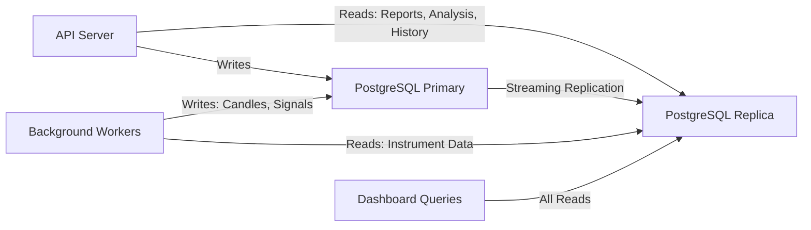

# Database Design — Indian Stock Trading Platform

> **Database Engine:** PostgreSQL 16+
> **ORM:** Entity Framework Core 8
> **Migration Strategy:** Code-First with manual review gates
> **Naming Convention:** PascalCase entities → snake_case columns via EF Core convention

---

## 1. Design Principles

| Principle | Implementation |
|---|---|
| **Normalization** | All tables conform to Third Normal Form (3NF) minimum. Denormalization is applied only to read-optimized materialized views, never to source-of-truth tables. |
| **Tenant Isolation** | Every user-owned table carries a `UserId` foreign key. All application queries **must** include a `WHERE user_id = @userId` predicate. A global query filter is registered in the EF Core `DbContext` to enforce this at the ORM layer. |
| **Monetary Precision** | All price fields use `decimal(18,4)` to handle sub-paise precision required by Indian exchanges. Quantity fields use `decimal(18,2)` where fractional lots are possible; integer quantities use `int`. No `float` or `double` is ever used for money. |
| **Timestamps** | All timestamps are stored as `timestamptz` (UTC). The application layer converts to the user's configured timezone (default `Asia/Kolkata`, UTC+05:30) at the presentation boundary only. |
| **Immutable Audit Trails** | `AuditLogs` and `OrderEvents` tables are append-only. No `UPDATE` or `DELETE` operations are permitted on these tables at the application level. Database-level triggers deny mutations. |
| **Soft Deletes** | Entities that may be referenced historically (strategies, broker connections, instruments) use an `IsActive` flag rather than physical deletion. Hard deletes are reserved for GDPR-mandated data erasure workflows only. |
| **Idempotency** | All trade-critical write paths (`PendingTradeApprovals`, `TradingOrders`) carry a unique `IdempotencyKey` to guarantee exactly-once semantics across retries and network partitions. |
| **EF Core Migrations** | Migrations are generated in development, committed to source control, peer-reviewed, and applied to production via a controlled CI/CD pipeline. `Database.Migrate()` is **never** called at application startup in production. |

---

## 2. Entity Relationship Diagram

```mermaid
erDiagram
    Users {
        uuid Id PK
        varchar Email UK
        varchar PasswordHash
        varchar FullName
        varchar PhoneNumber
        varchar Timezone
        boolean IsActive
        boolean EmailVerified
        timestamptz CreatedAt
        timestamptz UpdatedAt
    }

    Roles {
        int Id PK
        varchar Name UK
        varchar Description
    }

    UserRoles {
        uuid UserId FK
        int RoleId FK
    }

    RefreshTokens {
        uuid Id PK
        uuid UserId FK
        varchar Token UK
        timestamptz ExpiresAt
        timestamptz CreatedAt
        timestamptz RevokedAt
        varchar ReplacedByToken
    }

    BrokerProviders {
        int Id PK
        varchar Name
        varchar Code UK
        varchar ApiBaseUrl
        varchar WebSocketUrl
        varchar AuthorizationUrl
        varchar TokenUrl
        boolean IsActive
        jsonb Capabilities
        timestamptz CreatedAt
    }

    BrokerConnections {
        uuid Id PK
        uuid UserId FK
        int BrokerProviderId FK
        varchar DisplayName
        varchar ApiKey
        varchar ApiSecret
        varchar AccessToken
        varchar RefreshToken
        timestamptz TokenExpiresAt
        boolean IsAuthenticated
        boolean IsActive
        boolean TradingEnabled
        varchar TradingMode
        timestamptz LastAuthenticatedAt
        timestamptz CreatedAt
        timestamptz UpdatedAt
    }

    TradingAccounts {
        uuid Id PK
        uuid BrokerConnectionId FK
        uuid UserId FK
        varchar AccountId
        varchar AccountType
        boolean IsActive
        boolean TradingEnabled
        boolean PaperTradingMode
        timestamptz CreatedAt
        timestamptz UpdatedAt
    }

    AccountConfigurations {
        uuid Id PK
        uuid TradingAccountId FK
        decimal MaxCapitalAllocation
        decimal MaxOrderValue
        int MaxPositions
        decimal MaxRiskPerTrade
        decimal DailyLossLimit
        decimal MaxExposurePerStock
        int MaxTradesPerDay
        boolean StopLossRequired
        int ApprovalDurationSeconds
        boolean AutoExecuteOnTimeout
        boolean KillSwitchActive
        time TradingScheduleStart
        time TradingScheduleEnd
        time IntraDaySquareOffTime
        timestamptz CreatedAt
        timestamptz UpdatedAt
    }

    RiskProfiles {
        uuid Id PK
        uuid TradingAccountId FK
        varchar ProfileName
        decimal MaxCapital
        decimal MaxDailyLoss
        decimal MaxPositionSize
        decimal MaxExposure
        boolean IsActive
        timestamptz CreatedAt
    }

    StrategyDefinitions {
        uuid Id PK
        uuid UserId FK
        varchar Name
        varchar Description
        varchar StrategyType
        boolean IsActive
        timestamptz CreatedAt
        timestamptz UpdatedAt
    }

    StrategyVersions {
        uuid Id PK
        uuid StrategyDefinitionId FK
        int VersionNumber
        jsonb ConfigurationJson
        jsonb StockUniverse
        decimal CapitalAllocation
        int MaxPositions
        decimal RiskPerTrade
        decimal StopLossPercent
        decimal TargetPercent
        jsonb TradingSchedule
        boolean IsActive
        timestamptz ActivatedAt
        timestamptz DeactivatedAt
        timestamptz CreatedAt
        uuid CreatedByUserId FK
    }

    StrategyAccountMappings {
        uuid Id PK
        uuid StrategyVersionId FK
        uuid TradingAccountId FK
        boolean IsActive
        timestamptz CreatedAt
    }

    Instruments {
        int Id PK
        varchar Exchange
        varchar TradingSymbol
        varchar InstrumentToken UK
        varchar ISIN
        varchar CompanyName
        varchar InstrumentType
        int LotSize
        decimal TickSize
        varchar Segment
        boolean IsActive
        timestamptz LastUpdated
    }

    InstrumentUniverses {
        uuid Id PK
        uuid UserId FK
        varchar Name
        varchar Description
        timestamptz CreatedAt
    }

    InstrumentUniverseItems {
        uuid Id PK
        uuid UniverseId FK
        int InstrumentId FK
    }

    MarketCandles {
        bigint Id PK
        int InstrumentId FK
        varchar Timeframe
        timestamptz OpenTime
        decimal Open
        decimal High
        decimal Low
        decimal Close
        bigint Volume
        varchar Source
        timestamptz CreatedAt
    }

    MarketStatus {
        int Id PK
        varchar Exchange UK
        boolean IsOpen
        timestamptz LastUpdated
    }

    NewsArticles {
        uuid Id PK
        int InstrumentId FK
        varchar Headline
        text Content
        varchar Source
        timestamptz PublishedAt
        varchar Sentiment
        decimal SentimentScore
        timestamptz AnalyzedAt
        varchar AiProvider
        timestamptz CreatedAt
    }

    FundamentalMetrics {
        uuid Id PK
        int InstrumentId FK
        date MetricDate
        decimal MarketCap
        decimal PE
        decimal PB
        decimal EPS
        decimal DividendYield
        decimal Revenue
        decimal NetProfit
        decimal DebtToEquity
        varchar Source
        timestamptz CreatedAt
    }

    StockAnalysis {
        uuid Id PK
        int InstrumentId FK
        uuid UserId FK
        varchar AnalysisType
        text Summary
        decimal Confidence
        varchar AiProvider
        varchar AiModel
        jsonb RawResponse
        timestamptz CreatedAt
    }

    TradingSignals {
        uuid Id PK
        uuid StrategyVersionId FK
        int InstrumentId FK
        uuid TradingAccountId FK
        varchar SignalType
        timestamptz SignalTime
        decimal Price
        int Quantity
        decimal StopLoss
        decimal Target
        text Reason
        decimal Confidence
        jsonb IndicatorValues
        varchar Status
        timestamptz CreatedAt
    }

    PendingTradeApprovals {
        uuid Id PK
        uuid TradingSignalId FK
        uuid TradingAccountId FK
        uuid UserId FK
        varchar Side
        varchar Symbol
        int Quantity
        decimal IndicativePrice
        decimal StopLoss
        decimal Target
        decimal RiskAmount
        decimal EstimatedOrderValue
        text Reason
        timestamptz ApprovalDeadline
        varchar Status
        timestamptz DecisionAt
        uuid DecisionBy
        text DecisionReason
        varchar IdempotencyKey UK
        timestamptz CreatedAt
    }

    TradingOrders {
        uuid Id PK
        uuid PendingTradeApprovalId FK
        uuid TradingAccountId FK
        uuid UserId FK
        int InstrumentId FK
        uuid StrategyVersionId FK
        varchar BrokerOrderId
        varchar Side
        varchar OrderType
        varchar ProductType
        int Quantity
        decimal Price
        decimal TriggerPrice
        varchar Status
        int FilledQuantity
        decimal AveragePrice
        varchar StatusMessage
        varchar IdempotencyKey UK
        timestamptz SubmittedAt
        timestamptz LastUpdatedAt
        timestamptz CreatedAt
    }

    OrderEvents {
        uuid Id PK
        uuid TradingOrderId FK
        varchar EventType
        varchar PreviousStatus
        varchar NewStatus
        jsonb BrokerResponse
        timestamptz Timestamp
        timestamptz CreatedAt
    }

    TradeExecutions {
        uuid Id PK
        uuid TradingOrderId FK
        uuid TradingAccountId FK
        int InstrumentId FK
        varchar BrokerTradeId
        varchar Side
        int Quantity
        decimal Price
        timestamptz Timestamp
        varchar Exchange
        timestamptz CreatedAt
    }

    Positions {
        uuid Id PK
        uuid TradingAccountId FK
        int InstrumentId FK
        uuid UserId FK
        uuid StrategyVersionId FK
        varchar Side
        int Quantity
        decimal AveragePrice
        decimal CurrentPrice
        decimal UnrealizedPnL
        decimal RealizedPnL
        decimal StopLoss
        decimal Target
        varchar ProductType
        boolean IsOpen
        timestamptz OpenedAt
        timestamptz ClosedAt
        timestamptz CreatedAt
        timestamptz UpdatedAt
    }

    Notifications {
        uuid Id PK
        uuid UserId FK
        uuid TradingAccountId FK
        varchar Type
        varchar Title
        text Message
        jsonb Data
        boolean IsRead
        timestamptz CreatedAt
        timestamptz ReadAt
    }

    NotificationDeliveries {
        uuid Id PK
        uuid NotificationId FK
        varchar Channel
        varchar Status
        timestamptz SentAt
        timestamptz DeliveredAt
        varchar ErrorMessage
        int RetryCount
        timestamptz CreatedAt
    }

    DailyReports {
        uuid Id PK
        uuid UserId FK
        uuid TradingAccountId FK
        date ReportDate
        varchar ReportType
        jsonb Content
        timestamptz GeneratedAt
        jsonb DeliveredVia
        timestamptz CreatedAt
    }

    AuditLogs {
        uuid Id PK
        uuid UserId FK
        varchar Action
        varchar EntityType
        varchar EntityId
        jsonb OldValues
        jsonb NewValues
        varchar IpAddress
        varchar UserAgent
        timestamptz Timestamp
    }

    SystemConfigurations {
        int Id PK
        varchar Key UK
        text Value
        varchar Description
        timestamptz UpdatedAt
    }

    WorkerHeartbeats {
        int Id PK
        varchar WorkerName UK
        timestamptz LastHeartbeat
        varchar Status
        jsonb Metadata
    }

    %% Identity & Access relationships
    Users ||--o{ UserRoles : "has"
    Roles ||--o{ UserRoles : "assigned to"
    Users ||--o{ RefreshTokens : "owns"

    %% Broker relationships
    Users ||--o{ BrokerConnections : "configures"
    BrokerProviders ||--o{ BrokerConnections : "provides"
    BrokerConnections ||--o{ TradingAccounts : "contains"
    Users ||--o{ TradingAccounts : "owns"

    %% Configuration relationships
    TradingAccounts ||--o| AccountConfigurations : "configured by"
    TradingAccounts ||--o{ RiskProfiles : "has"

    %% Strategy relationships
    Users ||--o{ StrategyDefinitions : "creates"
    StrategyDefinitions ||--o{ StrategyVersions : "versioned as"
    Users ||--o{ StrategyVersions : "authors"
    StrategyVersions ||--o{ StrategyAccountMappings : "mapped via"
    TradingAccounts ||--o{ StrategyAccountMappings : "linked via"

    %% Instrument relationships
    Users ||--o{ InstrumentUniverses : "curates"
    InstrumentUniverses ||--o{ InstrumentUniverseItems : "contains"
    Instruments ||--o{ InstrumentUniverseItems : "included in"
    Instruments ||--o{ MarketCandles : "has"

    %% AI & Analysis relationships
    Instruments ||--o{ NewsArticles : "mentioned in"
    Instruments ||--o{ FundamentalMetrics : "measured by"
    Instruments ||--o{ StockAnalysis : "analyzed in"
    Users ||--o{ StockAnalysis : "requests"

    %% Trading relationships
    StrategyVersions ||--o{ TradingSignals : "generates"
    Instruments ||--o{ TradingSignals : "targets"
    TradingAccounts ||--o{ TradingSignals : "scoped to"
    TradingSignals ||--o| PendingTradeApprovals : "creates"
    TradingAccounts ||--o{ PendingTradeApprovals : "queued for"
    Users ||--o{ PendingTradeApprovals : "reviews"
    PendingTradeApprovals ||--o| TradingOrders : "becomes"
    TradingAccounts ||--o{ TradingOrders : "placed in"
    Users ||--o{ TradingOrders : "owns"
    Instruments ||--o{ TradingOrders : "for"
    StrategyVersions ||--o{ TradingOrders : "sourced from"
    TradingOrders ||--o{ OrderEvents : "tracked by"
    TradingOrders ||--o{ TradeExecutions : "fills"
    TradingAccounts ||--o{ TradeExecutions : "settles in"
    Instruments ||--o{ TradeExecutions : "of"
    TradingAccounts ||--o{ Positions : "holds"
    Instruments ||--o{ Positions : "in"
    Users ||--o{ Positions : "owns"
    StrategyVersions ||--o{ Positions : "from"

    %% Notification & Reporting relationships
    Users ||--o{ Notifications : "receives"
    Notifications ||--o{ NotificationDeliveries : "delivered via"
    Users ||--o{ DailyReports : "generated for"
    Users ||--o{ AuditLogs : "audited by"
```



---

## 3. Detailed Entity Definitions

### 3.1 Identity & Access

#### `Users`

The root identity entity. Every user-owned row in the system traces back here.

| Column | Type | Constraints | Description |
|---|---|---|---|
| `Id` | `uuid` | `PK`, `DEFAULT gen_random_uuid()` | Immutable user identifier |
| `Email` | `varchar(256)` | `NOT NULL`, `UNIQUE` | Login email, lowercased at write time |
| `PasswordHash` | `varchar(512)` | `NOT NULL` | BCrypt/Argon2id hash — never stored in plaintext |
| `FullName` | `varchar(200)` | `NOT NULL` | Display name for UI and reports |
| `PhoneNumber` | `varchar(15)` | `NULL` | Indian mobile (+91...) for WhatsApp/SMS alerts |
| `Timezone` | `varchar(50)` | `NOT NULL`, `DEFAULT 'Asia/Kolkata'` | IANA timezone for display conversion |
| `IsActive` | `boolean` | `NOT NULL`, `DEFAULT true` | Soft-disable flag; `false` blocks all login |
| `EmailVerified` | `boolean` | `NOT NULL`, `DEFAULT false` | Set `true` after email confirmation flow |
| `CreatedAt` | `timestamptz` | `NOT NULL`, `DEFAULT now()` | Account creation timestamp (UTC) |
| `UpdatedAt` | `timestamptz` | `NOT NULL`, `DEFAULT now()` | Last profile modification (UTC) |

#### `Roles`

Static lookup table seeded during deployment.

| Column | Type | Constraints | Description |
|---|---|---|---|
| `Id` | `int` | `PK`, `GENERATED ALWAYS AS IDENTITY` | Role identifier |
| `Name` | `varchar(50)` | `NOT NULL`, `UNIQUE` | `Admin`, `User` |
| `Description` | `varchar(200)` | `NULL` | Human-readable purpose |

#### `UserRoles`

Many-to-many junction table between `Users` and `Roles`.

| Column | Type | Constraints | Description |
|---|---|---|---|
| `UserId` | `uuid` | `FK → Users(Id) ON DELETE CASCADE` | User reference |
| `RoleId` | `int` | `FK → Roles(Id) ON DELETE CASCADE` | Role reference |

> **Composite PK:** `(UserId, RoleId)`

#### `RefreshTokens`

Supports JWT refresh token rotation with revocation chain tracking.

| Column | Type | Constraints | Description |
|---|---|---|---|
| `Id` | `uuid` | `PK`, `DEFAULT gen_random_uuid()` | Token record identifier |
| `UserId` | `uuid` | `FK → Users(Id) ON DELETE CASCADE`, `NOT NULL` | Owning user |
| `Token` | `varchar(512)` | `NOT NULL`, `UNIQUE` | Opaque refresh token value (hashed) |
| `ExpiresAt` | `timestamptz` | `NOT NULL` | Absolute expiry (typically 7 days) |
| `CreatedAt` | `timestamptz` | `NOT NULL`, `DEFAULT now()` | Issuance time |
| `RevokedAt` | `timestamptz` | `NULL` | Set on revocation; non-null = invalid |
| `ReplacedByToken` | `varchar(512)` | `NULL` | Points to successor token for rotation chain detection |

---

### 3.2 Broker Integration

#### `BrokerProviders`

Registry of supported broker APIs. Seeded at deployment; rarely changes at runtime.

| Column | Type | Constraints | Description |
|---|---|---|---|
| `Id` | `int` | `PK`, `GENERATED ALWAYS AS IDENTITY` | Provider identifier |
| `Name` | `varchar(100)` | `NOT NULL` | Display name: `Upstox`, `Zerodha` |
| `Code` | `varchar(20)` | `NOT NULL`, `UNIQUE` | Machine key: `UPSTOX`, `ZERODHA` |
| `ApiBaseUrl` | `varchar(500)` | `NOT NULL` | REST API base URL |
| `WebSocketUrl` | `varchar(500)` | `NOT NULL` | Market data streaming endpoint |
| `AuthorizationUrl` | `varchar(500)` | `NOT NULL` | OAuth2 authorization endpoint |
| `TokenUrl` | `varchar(500)` | `NOT NULL` | OAuth2 token exchange endpoint |
| `IsActive` | `boolean` | `NOT NULL`, `DEFAULT true` | Feature flag to disable a provider |
| `Capabilities` | `jsonb` | `NOT NULL`, `DEFAULT '{}'` | `{"supportsGTT": true, "supportsOptions": false, ...}` |
| `CreatedAt` | `timestamptz` | `NOT NULL`, `DEFAULT now()` | Seed timestamp |

#### `BrokerConnections`

A user's configured link to a specific broker. Sensitive fields are encrypted at rest using AES-256-GCM via the application's data protection provider.

| Column | Type | Constraints | Description |
|---|---|---|---|
| `Id` | `uuid` | `PK`, `DEFAULT gen_random_uuid()` | Connection identifier |
| `UserId` | `uuid` | `FK → Users(Id) ON DELETE CASCADE`, `NOT NULL` | Owning user (tenant key) |
| `BrokerProviderId` | `int` | `FK → BrokerProviders(Id) ON DELETE RESTRICT`, `NOT NULL` | Linked provider |
| `DisplayName` | `varchar(100)` | `NOT NULL` | User-facing label: "My Zerodha Account" |
| `ApiKey` | `varchar(1024)` | `NOT NULL` | 🔐 Encrypted at rest |
| `ApiSecret` | `varchar(1024)` | `NOT NULL` | 🔐 Encrypted at rest |
| `AccessToken` | `varchar(2048)` | `NULL` | 🔐 Encrypted at rest; set after OAuth flow |
| `RefreshToken` | `varchar(2048)` | `NULL` | 🔐 Encrypted at rest; broker's refresh token |
| `TokenExpiresAt` | `timestamptz` | `NULL` | When the access token expires |
| `IsAuthenticated` | `boolean` | `NOT NULL`, `DEFAULT false` | `true` after successful OAuth handshake |
| `IsActive` | `boolean` | `NOT NULL`, `DEFAULT true` | Soft-disable by user |
| `TradingEnabled` | `boolean` | `NOT NULL`, `DEFAULT false` | Master switch for live order placement |
| `TradingMode` | `varchar(10)` | `NOT NULL`, `DEFAULT 'Paper'`, `CHECK (TradingMode IN ('Paper', 'Live'))` | Paper or Live mode |
| `LastAuthenticatedAt` | `timestamptz` | `NULL` | Timestamp of last successful token refresh |
| `CreatedAt` | `timestamptz` | `NOT NULL`, `DEFAULT now()` | Record creation |
| `UpdatedAt` | `timestamptz` | `NOT NULL`, `DEFAULT now()` | Last modification |

> [!CAUTION]
> `ApiKey`, `ApiSecret`, `AccessToken`, and `RefreshToken` **must** be encrypted using the application-level `IDataProtector`. They are never stored as plaintext. Database-level Transparent Data Encryption (TDE) provides defense-in-depth but is not a substitute for field-level encryption.

#### `TradingAccounts`

A broker connection may expose one or more trading accounts (e.g., equity + commodity segments).

| Column | Type | Constraints | Description |
|---|---|---|---|
| `Id` | `uuid` | `PK`, `DEFAULT gen_random_uuid()` | Account identifier |
| `BrokerConnectionId` | `uuid` | `FK → BrokerConnections(Id) ON DELETE CASCADE`, `NOT NULL` | Parent connection |
| `UserId` | `uuid` | `FK → Users(Id) ON DELETE CASCADE`, `NOT NULL` | Tenant key (denormalized for query efficiency) |
| `AccountId` | `varchar(50)` | `NOT NULL` | Broker's account identifier (e.g., `AB1234`) |
| `AccountType` | `varchar(30)` | `NOT NULL`, `DEFAULT 'Equity'` | `Equity`, `Commodity`, `FnO` |
| `IsActive` | `boolean` | `NOT NULL`, `DEFAULT true` | Soft-disable |
| `TradingEnabled` | `boolean` | `NOT NULL`, `DEFAULT false` | Per-account trading permission |
| `PaperTradingMode` | `boolean` | `NOT NULL`, `DEFAULT true` | Overrides to paper trade even if connection is live |
| `CreatedAt` | `timestamptz` | `NOT NULL`, `DEFAULT now()` | Record creation |
| `UpdatedAt` | `timestamptz` | `NOT NULL`, `DEFAULT now()` | Last modification |

---

### 3.3 Configuration

#### `AccountConfigurations`

One-to-one relationship with `TradingAccounts`. Governs all risk controls and trading behavior for a single account.

| Column | Type | Constraints | Description |
|---|---|---|---|
| `Id` | `uuid` | `PK`, `DEFAULT gen_random_uuid()` | Configuration record identifier |
| `TradingAccountId` | `uuid` | `FK → TradingAccounts(Id) ON DELETE CASCADE`, `UNIQUE`, `NOT NULL` | Target account |
| `MaxCapitalAllocation` | `decimal(18,2)` | `NOT NULL`, `CHECK (MaxCapitalAllocation > 0)` | Maximum rupees deployable |
| `MaxOrderValue` | `decimal(18,2)` | `NOT NULL`, `CHECK (MaxOrderValue > 0)` | Single order cap in rupees |
| `MaxPositions` | `int` | `NOT NULL`, `CHECK (MaxPositions > 0)` | Concurrent open position limit |
| `MaxRiskPerTrade` | `decimal(5,2)` | `NOT NULL`, `CHECK (MaxRiskPerTrade > 0 AND MaxRiskPerTrade <= 100)` | Percentage of capital risked per trade |
| `DailyLossLimit` | `decimal(18,2)` | `NOT NULL`, `CHECK (DailyLossLimit > 0)` | Halt trading if daily P&L hits this negative threshold |
| `MaxExposurePerStock` | `decimal(5,2)` | `NOT NULL`, `CHECK (MaxExposurePerStock > 0 AND MaxExposurePerStock <= 100)` | Max % of capital in a single stock |
| `MaxTradesPerDay` | `int` | `NOT NULL`, `DEFAULT 20`, `CHECK (MaxTradesPerDay > 0)` | Rate limit on orders per session |
| `StopLossRequired` | `boolean` | `NOT NULL`, `DEFAULT true` | Reject orders without a stop-loss |
| `ApprovalDurationSeconds` | `int` | `NOT NULL`, `DEFAULT 2`, `CHECK (ApprovalDurationSeconds >= 0)` | Seconds user has to approve/reject a signal |
| `AutoExecuteOnTimeout` | `boolean` | `NOT NULL`, `DEFAULT false` | If `true`, execute on approval timeout; if `false`, expire it |
| `KillSwitchActive` | `boolean` | `NOT NULL`, `DEFAULT false` | Emergency halt — blocks all new orders immediately |
| `TradingScheduleStart` | `time` | `NOT NULL`, `DEFAULT '09:15'` | Earliest order time (IST, stored as time-of-day) |
| `TradingScheduleEnd` | `time` | `NOT NULL`, `DEFAULT '15:30'` | Latest order time |
| `IntraDaySquareOffTime` | `time` | `NOT NULL`, `DEFAULT '15:10'` | Auto-close MIS positions before this time |
| `CreatedAt` | `timestamptz` | `NOT NULL`, `DEFAULT now()` | Record creation |
| `UpdatedAt` | `timestamptz` | `NOT NULL`, `DEFAULT now()` | Last modification |

#### `RiskProfiles`

Named risk presets that can be switched at runtime (e.g., "Conservative", "Aggressive").

| Column | Type | Constraints | Description |
|---|---|---|---|
| `Id` | `uuid` | `PK`, `DEFAULT gen_random_uuid()` | Profile identifier |
| `TradingAccountId` | `uuid` | `FK → TradingAccounts(Id) ON DELETE CASCADE`, `NOT NULL` | Target account |
| `ProfileName` | `varchar(100)` | `NOT NULL` | Display name |
| `MaxCapital` | `decimal(18,2)` | `NOT NULL`, `CHECK (MaxCapital > 0)` | Capital ceiling |
| `MaxDailyLoss` | `decimal(18,2)` | `NOT NULL`, `CHECK (MaxDailyLoss > 0)` | Daily loss ceiling |
| `MaxPositionSize` | `decimal(18,2)` | `NOT NULL`, `CHECK (MaxPositionSize > 0)` | Single position value cap |
| `MaxExposure` | `decimal(18,2)` | `NOT NULL`, `CHECK (MaxExposure > 0)` | Total exposure cap |
| `IsActive` | `boolean` | `NOT NULL`, `DEFAULT false` | Only one profile active per account at a time |
| `CreatedAt` | `timestamptz` | `NOT NULL`, `DEFAULT now()` | Record creation |

---

### 3.4 Strategy

#### `StrategyDefinitions`

Top-level strategy container owned by a user. Versioned to allow rollback and A/B testing.

| Column | Type | Constraints | Description |
|---|---|---|---|
| `Id` | `uuid` | `PK`, `DEFAULT gen_random_uuid()` | Strategy identifier |
| `UserId` | `uuid` | `FK → Users(Id) ON DELETE CASCADE`, `NOT NULL` | Owning user (tenant key) |
| `Name` | `varchar(200)` | `NOT NULL` | Strategy name |
| `Description` | `text` | `NULL` | Detailed description |
| `StrategyType` | `varchar(20)` | `NOT NULL`, `CHECK (StrategyType IN ('Intraday', 'Swing'))` | Trading horizon |
| `IsActive` | `boolean` | `NOT NULL`, `DEFAULT true` | Soft-disable |
| `CreatedAt` | `timestamptz` | `NOT NULL`, `DEFAULT now()` | Record creation |
| `UpdatedAt` | `timestamptz` | `NOT NULL`, `DEFAULT now()` | Last modification |

#### `StrategyVersions`

Immutable snapshots of strategy configuration. A new version is created on every edit; the previous version is deactivated.

| Column | Type | Constraints | Description |
|---|---|---|---|
| `Id` | `uuid` | `PK`, `DEFAULT gen_random_uuid()` | Version identifier |
| `StrategyDefinitionId` | `uuid` | `FK → StrategyDefinitions(Id) ON DELETE CASCADE`, `NOT NULL` | Parent strategy |
| `VersionNumber` | `int` | `NOT NULL` | Monotonically increasing per strategy |
| `ConfigurationJson` | `jsonb` | `NOT NULL` | `{"indicators": [...], "entryRules": [...], "exitRules": [...], "timeframe": "5m"}` |
| `StockUniverse` | `jsonb` | `NOT NULL`, `DEFAULT '[]'` | `[{"instrumentId": 42, "symbol": "RELIANCE"}, ...]` |
| `CapitalAllocation` | `decimal(18,2)` | `NOT NULL`, `CHECK (CapitalAllocation > 0)` | Rupees allocated to this strategy |
| `MaxPositions` | `int` | `NOT NULL`, `CHECK (MaxPositions > 0)` | Concurrent position limit |
| `RiskPerTrade` | `decimal(5,2)` | `NOT NULL`, `CHECK (RiskPerTrade > 0)` | % risk per trade |
| `StopLossPercent` | `decimal(5,2)` | `NOT NULL`, `CHECK (StopLossPercent > 0)` | Default SL % |
| `TargetPercent` | `decimal(5,2)` | `NOT NULL`, `CHECK (TargetPercent > 0)` | Default target % |
| `TradingSchedule` | `jsonb` | `NULL` | `{"start": "09:20", "end": "14:30", "noEntryAfter": "14:00"}` |
| `IsActive` | `boolean` | `NOT NULL`, `DEFAULT false` | Only one version active per strategy |
| `ActivatedAt` | `timestamptz` | `NULL` | When this version was made active |
| `DeactivatedAt` | `timestamptz` | `NULL` | When this version was retired |
| `CreatedAt` | `timestamptz` | `NOT NULL`, `DEFAULT now()` | Version creation |
| `CreatedByUserId` | `uuid` | `FK → Users(Id) ON DELETE RESTRICT`, `NOT NULL` | Author (may differ from strategy owner in team scenarios) |

> **Unique constraint:** `(StrategyDefinitionId, VersionNumber)`

#### `StrategyAccountMappings`

Links a strategy version to one or more trading accounts for execution.

| Column | Type | Constraints | Description |
|---|---|---|---|
| `Id` | `uuid` | `PK`, `DEFAULT gen_random_uuid()` | Mapping identifier |
| `StrategyVersionId` | `uuid` | `FK → StrategyVersions(Id) ON DELETE CASCADE`, `NOT NULL` | Strategy version |
| `TradingAccountId` | `uuid` | `FK → TradingAccounts(Id) ON DELETE CASCADE`, `NOT NULL` | Execution account |
| `IsActive` | `boolean` | `NOT NULL`, `DEFAULT true` | Active mapping flag |
| `CreatedAt` | `timestamptz` | `NOT NULL`, `DEFAULT now()` | Record creation |

> **Unique constraint:** `(StrategyVersionId, TradingAccountId)`

---

### 3.5 Instruments & Market Data

#### `Instruments`

Master instrument registry. Populated daily via broker instrument download APIs.

| Column | Type | Constraints | Description |
|---|---|---|---|
| `Id` | `int` | `PK`, `GENERATED ALWAYS AS IDENTITY` | Internal instrument identifier |
| `Exchange` | `varchar(10)` | `NOT NULL` | `NSE`, `BSE` |
| `TradingSymbol` | `varchar(50)` | `NOT NULL` | Exchange trading symbol |
| `InstrumentToken` | `varchar(50)` | `NOT NULL`, `UNIQUE` | Broker-specific token for WebSocket subscriptions |
| `ISIN` | `varchar(12)` | `NULL` | International Securities Identification Number |
| `CompanyName` | `varchar(200)` | `NOT NULL` | Full company name |
| `InstrumentType` | `varchar(20)` | `NOT NULL` | `EQ`, `FUT`, `CE`, `PE` |
| `LotSize` | `int` | `NOT NULL`, `DEFAULT 1` | Minimum tradeable quantity |
| `TickSize` | `decimal(10,4)` | `NOT NULL`, `DEFAULT 0.05` | Minimum price movement |
| `Segment` | `varchar(20)` | `NOT NULL` | `NSE_EQ`, `NSE_FNO`, `BSE_EQ` |
| `IsActive` | `boolean` | `NOT NULL`, `DEFAULT true` | Delisted instruments set to `false` |
| `LastUpdated` | `timestamptz` | `NOT NULL`, `DEFAULT now()` | Last instrument data refresh |

> **Unique constraint:** `(Exchange, TradingSymbol)`

#### `InstrumentUniverses`

User-curated watchlists / stock universes for strategy scoping.

| Column | Type | Constraints | Description |
|---|---|---|---|
| `Id` | `uuid` | `PK`, `DEFAULT gen_random_uuid()` | Universe identifier |
| `UserId` | `uuid` | `FK → Users(Id) ON DELETE CASCADE`, `NOT NULL` | Owning user |
| `Name` | `varchar(100)` | `NOT NULL` | Universe name |
| `Description` | `text` | `NULL` | Purpose description |
| `CreatedAt` | `timestamptz` | `NOT NULL`, `DEFAULT now()` | Record creation |

#### `InstrumentUniverseItems`

Junction table linking instruments to universes.

| Column | Type | Constraints | Description |
|---|---|---|---|
| `Id` | `uuid` | `PK`, `DEFAULT gen_random_uuid()` | Item identifier |
| `UniverseId` | `uuid` | `FK → InstrumentUniverses(Id) ON DELETE CASCADE`, `NOT NULL` | Parent universe |
| `InstrumentId` | `int` | `FK → Instruments(Id) ON DELETE CASCADE`, `NOT NULL` | Linked instrument |

> **Unique constraint:** `(UniverseId, InstrumentId)`

#### `MarketCandles`

OHLCV candle data. This is the highest-volume table in the system and is **range-partitioned by date** on `OpenTime`.

| Column | Type | Constraints | Description |
|---|---|---|---|
| `Id` | `bigint` | `PK`, `GENERATED ALWAYS AS IDENTITY` | Candle identifier |
| `InstrumentId` | `int` | `FK → Instruments(Id) ON DELETE CASCADE`, `NOT NULL` | Source instrument |
| `Timeframe` | `varchar(5)` | `NOT NULL`, `CHECK (Timeframe IN ('1m','5m','15m','1h','1d'))` | Candle interval |
| `OpenTime` | `timestamptz` | `NOT NULL` | Candle open timestamp (UTC) |
| `Open` | `decimal(18,4)` | `NOT NULL`, `CHECK (Open >= 0)` | Opening price |
| `High` | `decimal(18,4)` | `NOT NULL`, `CHECK (High >= 0)` | Period high |
| `Low` | `decimal(18,4)` | `NOT NULL`, `CHECK (Low >= 0)` | Period low |
| `Close` | `decimal(18,4)` | `NOT NULL`, `CHECK (Close >= 0)` | Closing price |
| `Volume` | `bigint` | `NOT NULL`, `CHECK (Volume >= 0)` | Volume traded |
| `Source` | `varchar(20)` | `NOT NULL`, `DEFAULT 'Broker'` | Data source: `Broker`, `Exchange`, `Vendor` |
| `CreatedAt` | `timestamptz` | `NOT NULL`, `DEFAULT now()` | Record creation |

> **Unique constraint:** `(InstrumentId, Timeframe, OpenTime)` — prevents duplicate candles.

> [!IMPORTANT]
> This table uses PostgreSQL declarative range partitioning on `OpenTime` with monthly partitions. See [Section 7 — Performance Considerations](#7-performance-considerations) for the partitioning strategy.

#### `MarketStatus`

Tracks exchange open/close state for trading hour enforcement.

| Column | Type | Constraints | Description |
|---|---|---|---|
| `Id` | `int` | `PK`, `GENERATED ALWAYS AS IDENTITY` | Status identifier |
| `Exchange` | `varchar(10)` | `NOT NULL`, `UNIQUE` | `NSE`, `BSE` |
| `IsOpen` | `boolean` | `NOT NULL`, `DEFAULT false` | Current market state |
| `LastUpdated` | `timestamptz` | `NOT NULL`, `DEFAULT now()` | Last poll timestamp |

---

### 3.6 AI & Analysis

#### `NewsArticles`

| Column | Type | Constraints | Description |
|---|---|---|---|
| `Id` | `uuid` | `PK`, `DEFAULT gen_random_uuid()` | Article identifier |
| `InstrumentId` | `int` | `FK → Instruments(Id) ON DELETE SET NULL`, `NULL` | Related instrument (null for macro news) |
| `Headline` | `varchar(500)` | `NOT NULL` | Article headline |
| `Content` | `text` | `NULL` | Full article body |
| `Source` | `varchar(100)` | `NOT NULL` | News provider name |
| `PublishedAt` | `timestamptz` | `NOT NULL` | Original publication time |
| `Sentiment` | `varchar(20)` | `NULL` | `Bullish`, `Bearish`, `Neutral` |
| `SentimentScore` | `decimal(5,4)` | `NULL`, `CHECK (SentimentScore >= -1 AND SentimentScore <= 1)` | -1.0 to +1.0 |
| `AnalyzedAt` | `timestamptz` | `NULL` | When sentiment analysis completed |
| `AiProvider` | `varchar(50)` | `NULL` | `OpenAI`, `Gemini`, etc. |
| `CreatedAt` | `timestamptz` | `NOT NULL`, `DEFAULT now()` | Record creation |

#### `FundamentalMetrics`

Quarterly/annual fundamental data points per instrument.

| Column | Type | Constraints | Description |
|---|---|---|---|
| `Id` | `uuid` | `PK`, `DEFAULT gen_random_uuid()` | Metric identifier |
| `InstrumentId` | `int` | `FK → Instruments(Id) ON DELETE CASCADE`, `NOT NULL` | Source instrument |
| `MetricDate` | `date` | `NOT NULL` | Reporting period date |
| `MarketCap` | `decimal(18,2)` | `NULL` | Market capitalization in crores |
| `PE` | `decimal(10,2)` | `NULL` | Price-to-Earnings ratio |
| `PB` | `decimal(10,2)` | `NULL` | Price-to-Book ratio |
| `EPS` | `decimal(10,2)` | `NULL` | Earnings Per Share |
| `DividendYield` | `decimal(5,2)` | `NULL` | Dividend yield % |
| `Revenue` | `decimal(18,2)` | `NULL` | Revenue in crores |
| `NetProfit` | `decimal(18,2)` | `NULL` | Net profit in crores |
| `DebtToEquity` | `decimal(10,2)` | `NULL` | Debt-to-Equity ratio |
| `Source` | `varchar(100)` | `NOT NULL` | Data provider |
| `CreatedAt` | `timestamptz` | `NOT NULL`, `DEFAULT now()` | Record creation |

> **Unique constraint:** `(InstrumentId, MetricDate)`

#### `StockAnalysis`

AI-generated analysis results linked to an instrument and the requesting user.

| Column | Type | Constraints | Description |
|---|---|---|---|
| `Id` | `uuid` | `PK`, `DEFAULT gen_random_uuid()` | Analysis identifier |
| `InstrumentId` | `int` | `FK → Instruments(Id) ON DELETE CASCADE`, `NOT NULL` | Analyzed instrument |
| `UserId` | `uuid` | `FK → Users(Id) ON DELETE CASCADE`, `NOT NULL` | Requesting user |
| `AnalysisType` | `varchar(50)` | `NOT NULL` | `Technical`, `Fundamental`, `Sentiment`, `Composite` |
| `Summary` | `text` | `NOT NULL` | Human-readable analysis summary |
| `Confidence` | `decimal(5,4)` | `NOT NULL`, `CHECK (Confidence >= 0 AND Confidence <= 1)` | 0.0 to 1.0 |
| `AiProvider` | `varchar(50)` | `NOT NULL` | AI service used |
| `AiModel` | `varchar(50)` | `NOT NULL` | Model identifier (e.g., `gpt-4o`) |
| `RawResponse` | `jsonb` | `NOT NULL` | Full AI response for audit and reprocessing |
| `CreatedAt` | `timestamptz` | `NOT NULL`, `DEFAULT now()` | Record creation |

---

### 3.7 Trading

#### `TradingSignals`

Strategy-generated trade signals awaiting user action.

| Column | Type | Constraints | Description |
|---|---|---|---|
| `Id` | `uuid` | `PK`, `DEFAULT gen_random_uuid()` | Signal identifier |
| `StrategyVersionId` | `uuid` | `FK → StrategyVersions(Id) ON DELETE RESTRICT`, `NOT NULL` | Generating strategy |
| `InstrumentId` | `int` | `FK → Instruments(Id) ON DELETE RESTRICT`, `NOT NULL` | Target instrument |
| `TradingAccountId` | `uuid` | `FK → TradingAccounts(Id) ON DELETE RESTRICT`, `NOT NULL` | Execution account |
| `SignalType` | `varchar(10)` | `NOT NULL`, `CHECK (SignalType IN ('Buy', 'Sell'))` | Direction |
| `SignalTime` | `timestamptz` | `NOT NULL` | When the signal was generated |
| `Price` | `decimal(18,4)` | `NOT NULL`, `CHECK (Price > 0)` | Indicative price at signal time |
| `Quantity` | `int` | `NOT NULL`, `CHECK (Quantity > 0)` | Suggested quantity |
| `StopLoss` | `decimal(18,4)` | `NULL`, `CHECK (StopLoss >= 0)` | Suggested stop-loss price |
| `Target` | `decimal(18,4)` | `NULL`, `CHECK (Target >= 0)` | Suggested target price |
| `Reason` | `text` | `NOT NULL` | Human-readable explanation |
| `Confidence` | `decimal(5,4)` | `NOT NULL`, `CHECK (Confidence >= 0 AND Confidence <= 1)` | Signal strength |
| `IndicatorValues` | `jsonb` | `NOT NULL`, `DEFAULT '{}'` | `{"rsi": 32.5, "macd": {"line": 1.2, "signal": 0.8}}` |
| `Status` | `varchar(20)` | `NOT NULL`, `DEFAULT 'Generated'`, `CHECK (Status IN ('Generated','Pending','Approved','Rejected','Expired','Executed'))` | Lifecycle state |
| `CreatedAt` | `timestamptz` | `NOT NULL`, `DEFAULT now()` | Record creation |

#### `PendingTradeApprovals`

User-facing approval queue with time-bounded decision windows.

| Column | Type | Constraints | Description |
|---|---|---|---|
| `Id` | `uuid` | `PK`, `DEFAULT gen_random_uuid()` | Approval identifier |
| `TradingSignalId` | `uuid` | `FK → TradingSignals(Id) ON DELETE RESTRICT`, `NOT NULL` | Source signal |
| `TradingAccountId` | `uuid` | `FK → TradingAccounts(Id) ON DELETE RESTRICT`, `NOT NULL` | Execution account |
| `UserId` | `uuid` | `FK → Users(Id) ON DELETE CASCADE`, `NOT NULL` | Approver (tenant key) |
| `Side` | `varchar(4)` | `NOT NULL`, `CHECK (Side IN ('Buy', 'Sell'))` | Order side |
| `Symbol` | `varchar(50)` | `NOT NULL` | Display symbol |
| `Quantity` | `int` | `NOT NULL`, `CHECK (Quantity > 0)` | Order quantity |
| `IndicativePrice` | `decimal(18,4)` | `NOT NULL`, `CHECK (IndicativePrice > 0)` | Price at approval creation |
| `StopLoss` | `decimal(18,4)` | `NULL` | Proposed stop-loss |
| `Target` | `decimal(18,4)` | `NULL` | Proposed target |
| `RiskAmount` | `decimal(18,2)` | `NOT NULL`, `CHECK (RiskAmount >= 0)` | Capital at risk in rupees |
| `EstimatedOrderValue` | `decimal(18,2)` | `NOT NULL`, `CHECK (EstimatedOrderValue > 0)` | Estimated total order value |
| `Reason` | `text` | `NOT NULL` | Signal rationale forwarded to user |
| `ApprovalDeadline` | `timestamptz` | `NOT NULL` | Auto-expire/execute after this time |
| `Status` | `varchar(20)` | `NOT NULL`, `DEFAULT 'Pending'`, `CHECK (Status IN ('Pending','Approved','Rejected','Expired','Cancelled'))` | Decision state |
| `DecisionAt` | `timestamptz` | `NULL` | When user/system decided |
| `DecisionBy` | `uuid` | `NULL` | User who decided (null if system auto-expired) |
| `DecisionReason` | `text` | `NULL` | Optional rejection/approval notes |
| `IdempotencyKey` | `varchar(64)` | `NOT NULL`, `UNIQUE` | Prevents duplicate approvals for the same signal |
| `CreatedAt` | `timestamptz` | `NOT NULL`, `DEFAULT now()` | Record creation |

#### `TradingOrders`

Broker-submitted order records. The definitive record of every order placed.

| Column | Type | Constraints | Description |
|---|---|---|---|
| `Id` | `uuid` | `PK`, `DEFAULT gen_random_uuid()` | Order identifier |
| `PendingTradeApprovalId` | `uuid` | `FK → PendingTradeApprovals(Id) ON DELETE SET NULL`, `NULL` | Source approval (null for manual orders) |
| `TradingAccountId` | `uuid` | `FK → TradingAccounts(Id) ON DELETE RESTRICT`, `NOT NULL` | Execution account |
| `UserId` | `uuid` | `FK → Users(Id) ON DELETE CASCADE`, `NOT NULL` | Tenant key |
| `InstrumentId` | `int` | `FK → Instruments(Id) ON DELETE RESTRICT`, `NOT NULL` | Traded instrument |
| `StrategyVersionId` | `uuid` | `FK → StrategyVersions(Id) ON DELETE SET NULL`, `NULL` | Source strategy (null for manual orders) |
| `BrokerOrderId` | `varchar(50)` | `NULL` | Broker-assigned order ID |
| `Side` | `varchar(4)` | `NOT NULL`, `CHECK (Side IN ('Buy', 'Sell'))` | Order direction |
| `OrderType` | `varchar(10)` | `NOT NULL`, `CHECK (OrderType IN ('Market','Limit','SL','SLM'))` | NSE order types |
| `ProductType` | `varchar(10)` | `NOT NULL`, `CHECK (ProductType IN ('CNC','MIS','NRML'))` | Delivery/Intraday/Normal |
| `Quantity` | `int` | `NOT NULL`, `CHECK (Quantity > 0)` | Order quantity |
| `Price` | `decimal(18,4)` | `NULL`, `CHECK (Price >= 0)` | Limit price (null for Market orders) |
| `TriggerPrice` | `decimal(18,4)` | `NULL`, `CHECK (TriggerPrice >= 0)` | SL trigger price |
| `Status` | `varchar(20)` | `NOT NULL`, `DEFAULT 'Created'` | `Created/Submitted/Accepted/Open/PartiallyFilled/Filled/Cancelled/Rejected/Error` |
| `FilledQuantity` | `int` | `NOT NULL`, `DEFAULT 0`, `CHECK (FilledQuantity >= 0)` | Cumulative filled quantity |
| `AveragePrice` | `decimal(18,4)` | `NULL` | Volume-weighted average fill price |
| `StatusMessage` | `varchar(500)` | `NULL` | Broker status/rejection reason |
| `IdempotencyKey` | `varchar(64)` | `NOT NULL`, `UNIQUE` | Prevents duplicate order submission |
| `SubmittedAt` | `timestamptz` | `NULL` | When sent to broker |
| `LastUpdatedAt` | `timestamptz` | `NOT NULL`, `DEFAULT now()` | Last status change |
| `CreatedAt` | `timestamptz` | `NOT NULL`, `DEFAULT now()` | Record creation |

#### `OrderEvents`

Append-only event log tracking every state transition of an order.

| Column | Type | Constraints | Description |
|---|---|---|---|
| `Id` | `uuid` | `PK`, `DEFAULT gen_random_uuid()` | Event identifier |
| `TradingOrderId` | `uuid` | `FK → TradingOrders(Id) ON DELETE CASCADE`, `NOT NULL` | Parent order |
| `EventType` | `varchar(50)` | `NOT NULL` | `StatusChange`, `Fill`, `Amendment`, `CancellationRequest` |
| `PreviousStatus` | `varchar(20)` | `NULL` | Status before transition |
| `NewStatus` | `varchar(20)` | `NOT NULL` | Status after transition |
| `BrokerResponse` | `jsonb` | `NULL` | Raw broker callback/response payload |
| `Timestamp` | `timestamptz` | `NOT NULL` | When the event occurred at the broker |
| `CreatedAt` | `timestamptz` | `NOT NULL`, `DEFAULT now()` | When we recorded it |

> [!WARNING]
> This table is **append-only**. The application must never issue `UPDATE` or `DELETE` statements against `OrderEvents`. A database-level trigger enforces this constraint.

#### `TradeExecutions`

Individual fill records. A single order may have multiple partial fills.

| Column | Type | Constraints | Description |
|---|---|---|---|
| `Id` | `uuid` | `PK`, `DEFAULT gen_random_uuid()` | Execution identifier |
| `TradingOrderId` | `uuid` | `FK → TradingOrders(Id) ON DELETE CASCADE`, `NOT NULL` | Parent order |
| `TradingAccountId` | `uuid` | `FK → TradingAccounts(Id) ON DELETE RESTRICT`, `NOT NULL` | Settlement account |
| `InstrumentId` | `int` | `FK → Instruments(Id) ON DELETE RESTRICT`, `NOT NULL` | Executed instrument |
| `BrokerTradeId` | `varchar(50)` | `NOT NULL` | Broker-assigned trade/fill ID |
| `Side` | `varchar(4)` | `NOT NULL`, `CHECK (Side IN ('Buy', 'Sell'))` | Fill direction |
| `Quantity` | `int` | `NOT NULL`, `CHECK (Quantity > 0)` | Fill quantity |
| `Price` | `decimal(18,4)` | `NOT NULL`, `CHECK (Price > 0)` | Fill price |
| `Timestamp` | `timestamptz` | `NOT NULL` | Exchange timestamp of the fill |
| `Exchange` | `varchar(10)` | `NOT NULL` | `NSE`, `BSE` |
| `CreatedAt` | `timestamptz` | `NOT NULL`, `DEFAULT now()` | Record creation |

#### `Positions`

Aggregated real-time position state per account/instrument/strategy.

| Column | Type | Constraints | Description |
|---|---|---|---|
| `Id` | `uuid` | `PK`, `DEFAULT gen_random_uuid()` | Position identifier |
| `TradingAccountId` | `uuid` | `FK → TradingAccounts(Id) ON DELETE RESTRICT`, `NOT NULL` | Holding account |
| `InstrumentId` | `int` | `FK → Instruments(Id) ON DELETE RESTRICT`, `NOT NULL` | Held instrument |
| `UserId` | `uuid` | `FK → Users(Id) ON DELETE CASCADE`, `NOT NULL` | Tenant key |
| `StrategyVersionId` | `uuid` | `FK → StrategyVersions(Id) ON DELETE SET NULL`, `NULL` | Strategy that opened this position |
| `Side` | `varchar(5)` | `NOT NULL`, `CHECK (Side IN ('Long', 'Short'))` | Position direction |
| `Quantity` | `int` | `NOT NULL`, `CHECK (Quantity >= 0)` | Current open quantity |
| `AveragePrice` | `decimal(18,4)` | `NOT NULL`, `CHECK (AveragePrice > 0)` | Weighted average entry price |
| `CurrentPrice` | `decimal(18,4)` | `NOT NULL`, `DEFAULT 0` | Last known market price |
| `UnrealizedPnL` | `decimal(18,2)` | `NOT NULL`, `DEFAULT 0` | Mark-to-market P&L |
| `RealizedPnL` | `decimal(18,2)` | `NOT NULL`, `DEFAULT 0` | Closed portion P&L |
| `StopLoss` | `decimal(18,4)` | `NULL` | Active stop-loss level |
| `Target` | `decimal(18,4)` | `NULL` | Active target level |
| `ProductType` | `varchar(10)` | `NOT NULL`, `CHECK (ProductType IN ('CNC','MIS','NRML'))` | Product type |
| `IsOpen` | `boolean` | `NOT NULL`, `DEFAULT true` | `false` when fully exited |
| `OpenedAt` | `timestamptz` | `NOT NULL` | First entry timestamp |
| `ClosedAt` | `timestamptz` | `NULL` | Full exit timestamp |
| `CreatedAt` | `timestamptz` | `NOT NULL`, `DEFAULT now()` | Record creation |
| `UpdatedAt` | `timestamptz` | `NOT NULL`, `DEFAULT now()` | Last modification |

---

### 3.8 Notifications & Reporting

#### `Notifications`

Central notification store for all channels.

| Column | Type | Constraints | Description |
|---|---|---|---|
| `Id` | `uuid` | `PK`, `DEFAULT gen_random_uuid()` | Notification identifier |
| `UserId` | `uuid` | `FK → Users(Id) ON DELETE CASCADE`, `NOT NULL` | Recipient user |
| `TradingAccountId` | `uuid` | `FK → TradingAccounts(Id) ON DELETE SET NULL`, `NULL` | Related account (optional) |
| `Type` | `varchar(50)` | `NOT NULL` | `TradeApproval`, `OrderFilled`, `KillSwitchActivated`, `DailyReport`, etc. |
| `Title` | `varchar(200)` | `NOT NULL` | Notification title |
| `Message` | `text` | `NOT NULL` | Body text |
| `Data` | `jsonb` | `NULL` | Structured payload for client rendering |
| `IsRead` | `boolean` | `NOT NULL`, `DEFAULT false` | Read status |
| `CreatedAt` | `timestamptz` | `NOT NULL`, `DEFAULT now()` | Creation timestamp |
| `ReadAt` | `timestamptz` | `NULL` | When marked as read |

#### `NotificationDeliveries`

Per-channel delivery tracking with retry state.

| Column | Type | Constraints | Description |
|---|---|---|---|
| `Id` | `uuid` | `PK`, `DEFAULT gen_random_uuid()` | Delivery identifier |
| `NotificationId` | `uuid` | `FK → Notifications(Id) ON DELETE CASCADE`, `NOT NULL` | Parent notification |
| `Channel` | `varchar(20)` | `NOT NULL`, `CHECK (Channel IN ('SignalR','Email','WhatsApp'))` | Delivery channel |
| `Status` | `varchar(20)` | `NOT NULL`, `DEFAULT 'Pending'`, `CHECK (Status IN ('Pending','Sent','Delivered','Failed'))` | Delivery state |
| `SentAt` | `timestamptz` | `NULL` | When dispatched |
| `DeliveredAt` | `timestamptz` | `NULL` | When delivery confirmed |
| `ErrorMessage` | `varchar(500)` | `NULL` | Failure reason |
| `RetryCount` | `int` | `NOT NULL`, `DEFAULT 0` | Number of retry attempts |
| `CreatedAt` | `timestamptz` | `NOT NULL`, `DEFAULT now()` | Record creation |

#### `DailyReports`

End-of-day and periodic report snapshots.

| Column | Type | Constraints | Description |
|---|---|---|---|
| `Id` | `uuid` | `PK`, `DEFAULT gen_random_uuid()` | Report identifier |
| `UserId` | `uuid` | `FK → Users(Id) ON DELETE CASCADE`, `NOT NULL` | Report owner |
| `TradingAccountId` | `uuid` | `FK → TradingAccounts(Id) ON DELETE SET NULL`, `NULL` | Scoped account (null = all accounts) |
| `ReportDate` | `date` | `NOT NULL` | Trading session date |
| `ReportType` | `varchar(50)` | `NOT NULL` | `DailyPnL`, `WeeklySummary`, `MonthlyStatement` |
| `Content` | `jsonb` | `NOT NULL` | Structured report data |
| `GeneratedAt` | `timestamptz` | `NOT NULL` | Generation timestamp |
| `DeliveredVia` | `jsonb` | `NULL` | `["Email", "WhatsApp"]` |
| `CreatedAt` | `timestamptz` | `NOT NULL`, `DEFAULT now()` | Record creation |

#### `AuditLogs`

Immutable, append-only audit trail for compliance and debugging. **Range-partitioned by month** on `Timestamp`.

| Column | Type | Constraints | Description |
|---|---|---|---|
| `Id` | `uuid` | `PK`, `DEFAULT gen_random_uuid()` | Log entry identifier |
| `UserId` | `uuid` | `FK → Users(Id) ON DELETE SET NULL`, `NOT NULL` | Acting user |
| `Action` | `varchar(100)` | `NOT NULL` | `Login`, `OrderPlaced`, `KillSwitchToggled`, `StrategyActivated` |
| `EntityType` | `varchar(100)` | `NOT NULL` | `TradingOrder`, `BrokerConnection`, `AccountConfiguration` |
| `EntityId` | `varchar(50)` | `NOT NULL` | UUID/int of the affected entity |
| `OldValues` | `jsonb` | `NULL` | Snapshot before change |
| `NewValues` | `jsonb` | `NULL` | Snapshot after change |
| `IpAddress` | `varchar(45)` | `NULL` | IPv4/IPv6 address |
| `UserAgent` | `varchar(500)` | `NULL` | Browser/client user-agent string |
| `Timestamp` | `timestamptz` | `NOT NULL`, `DEFAULT now()` | Event time (UTC) |

> [!WARNING]
> This table is **append-only**. No `UPDATE` or `DELETE` operations are permitted. A database trigger enforces immutability.

---

### 3.9 System

#### `SystemConfigurations`

Key-value runtime configuration store for feature flags and tuning parameters.

| Column | Type | Constraints | Description |
|---|---|---|---|
| `Id` | `int` | `PK`, `GENERATED ALWAYS AS IDENTITY` | Config identifier |
| `Key` | `varchar(200)` | `NOT NULL`, `UNIQUE` | Configuration key |
| `Value` | `text` | `NOT NULL` | Configuration value (JSON or scalar) |
| `Description` | `varchar(500)` | `NULL` | Human-readable explanation |
| `UpdatedAt` | `timestamptz` | `NOT NULL`, `DEFAULT now()` | Last modification |

#### `WorkerHeartbeats`

Health monitoring for background worker processes (strategy engines, market data ingestors, etc.).

| Column | Type | Constraints | Description |
|---|---|---|---|
| `Id` | `int` | `PK`, `GENERATED ALWAYS AS IDENTITY` | Heartbeat identifier |
| `WorkerName` | `varchar(100)` | `NOT NULL`, `UNIQUE` | Worker identifier |
| `LastHeartbeat` | `timestamptz` | `NOT NULL` | Last check-in timestamp |
| `Status` | `varchar(20)` | `NOT NULL`, `DEFAULT 'Running'` | `Running`, `Idle`, `Error`, `Stopped` |
| `Metadata` | `jsonb` | `NULL` | `{"version": "1.2.0", "queueDepth": 42}` |

---

## 4. Indexes

### 4.1 Primary & Unique Indexes

All primary keys and unique constraints automatically create indexes. The following lists **additional** indexes required for query performance.

### 4.2 Secondary Indexes

```sql
-- ============================================
-- Identity & Access
-- ============================================
CREATE UNIQUE INDEX ix_users_email ON users (email);
-- Already created by UNIQUE constraint, listed for completeness

CREATE INDEX ix_refresh_tokens_user_id ON refresh_tokens (user_id);
CREATE INDEX ix_refresh_tokens_expires_at ON refresh_tokens (expires_at)
    WHERE revoked_at IS NULL;

-- ============================================
-- Broker
-- ============================================
CREATE INDEX ix_broker_connections_user_id ON broker_connections (user_id);
CREATE INDEX ix_broker_connections_user_provider
    ON broker_connections (user_id, broker_provider_id);

CREATE INDEX ix_trading_accounts_user_id ON trading_accounts (user_id);
CREATE INDEX ix_trading_accounts_broker_connection
    ON trading_accounts (broker_connection_id);

-- ============================================
-- Trading Orders (Critical Path)
-- ============================================
CREATE INDEX ix_trading_orders_account_status
    ON trading_orders (trading_account_id, status);
CREATE UNIQUE INDEX ix_trading_orders_idempotency_key
    ON trading_orders (idempotency_key);
CREATE INDEX ix_trading_orders_broker_order_id
    ON trading_orders (broker_order_id)
    WHERE broker_order_id IS NOT NULL;
CREATE INDEX ix_trading_orders_user_id_created
    ON trading_orders (user_id, created_at DESC);
CREATE INDEX ix_trading_orders_strategy_version
    ON trading_orders (strategy_version_id)
    WHERE strategy_version_id IS NOT NULL;

-- ============================================
-- Pending Trade Approvals (Time-Critical)
-- ============================================
CREATE UNIQUE INDEX ix_pending_trade_approvals_idempotency_key
    ON pending_trade_approvals (idempotency_key);
CREATE INDEX ix_pending_trade_approvals_status_deadline
    ON pending_trade_approvals (status, approval_deadline)
    WHERE status = 'Pending';
CREATE INDEX ix_pending_trade_approvals_user_id
    ON pending_trade_approvals (user_id, created_at DESC);

-- ============================================
-- Market Candles (High Volume)
-- ============================================
CREATE UNIQUE INDEX ix_market_candles_instrument_timeframe_opentime
    ON market_candles (instrument_id, timeframe, open_time);
-- This is the primary access pattern; covered by the unique constraint

CREATE INDEX ix_market_candles_opentime
    ON market_candles (open_time);
-- Supports partition pruning queries

-- ============================================
-- Positions
-- ============================================
CREATE INDEX ix_positions_account_open
    ON positions (trading_account_id, is_open)
    WHERE is_open = true;
CREATE INDEX ix_positions_user_id_open
    ON positions (user_id, is_open)
    WHERE is_open = true;
CREATE INDEX ix_positions_strategy_version
    ON positions (strategy_version_id)
    WHERE strategy_version_id IS NOT NULL;

-- ============================================
-- Trading Signals
-- ============================================
CREATE INDEX ix_trading_signals_status
    ON trading_signals (status)
    WHERE status IN ('Generated', 'Pending');
CREATE INDEX ix_trading_signals_strategy_version
    ON trading_signals (strategy_version_id, created_at DESC);
CREATE INDEX ix_trading_signals_account_status
    ON trading_signals (trading_account_id, status);

-- ============================================
-- Audit Logs (High Volume, Partitioned)
-- ============================================
CREATE INDEX ix_audit_logs_user_timestamp
    ON audit_logs (user_id, timestamp DESC);
CREATE INDEX ix_audit_logs_entity
    ON audit_logs (entity_type, entity_id);
CREATE INDEX ix_audit_logs_action
    ON audit_logs (action, timestamp DESC);

-- ============================================
-- Order Events
-- ============================================
CREATE INDEX ix_order_events_order_id
    ON order_events (trading_order_id, timestamp);

-- ============================================
-- Trade Executions
-- ============================================
CREATE INDEX ix_trade_executions_order_id
    ON trade_executions (trading_order_id);
CREATE INDEX ix_trade_executions_account_timestamp
    ON trade_executions (trading_account_id, timestamp DESC);

-- ============================================
-- Notifications
-- ============================================
CREATE INDEX ix_notifications_user_unread
    ON notifications (user_id, created_at DESC)
    WHERE is_read = false;

-- ============================================
-- Instruments
-- ============================================
CREATE UNIQUE INDEX ix_instruments_exchange_symbol
    ON instruments (exchange, trading_symbol);
CREATE INDEX ix_instruments_isin ON instruments (isin)
    WHERE isin IS NOT NULL;

-- ============================================
-- Strategy
-- ============================================
CREATE INDEX ix_strategy_definitions_user_id
    ON strategy_definitions (user_id);
CREATE UNIQUE INDEX ix_strategy_versions_def_version
    ON strategy_versions (strategy_definition_id, version_number);
CREATE UNIQUE INDEX ix_strategy_account_mappings_version_account
    ON strategy_account_mappings (strategy_version_id, trading_account_id);
```

> [!TIP]
> Partial indexes (with `WHERE` clauses) dramatically reduce index size and improve write performance. Use them wherever queries consistently filter on a known predicate (e.g., `is_open = true`, `status = 'Pending'`).

---

## 5. Data Integrity Rules

### 5.1 Foreign Key Policies

| Parent Table | Child Table | On Delete | Rationale |
|---|---|---|---|
| `Users` | `BrokerConnections` | `CASCADE` | User deletion removes all connections |
| `Users` | `TradingOrders` | `CASCADE` | GDPR erasure path |
| `Users` | `AuditLogs` | `SET NULL` | Preserve audit trail even after user deletion |
| `BrokerProviders` | `BrokerConnections` | `RESTRICT` | Cannot delete a provider with active connections |
| `BrokerConnections` | `TradingAccounts` | `CASCADE` | Connection removal cascades |
| `TradingAccounts` | `TradingOrders` | `RESTRICT` | Cannot delete account with order history |
| `TradingAccounts` | `Positions` | `RESTRICT` | Cannot delete account with open positions |
| `Instruments` | `TradingOrders` | `RESTRICT` | Cannot delete traded instruments |
| `Instruments` | `NewsArticles` | `SET NULL` | Preserve news even if instrument delisted |
| `StrategyVersions` | `TradingSignals` | `RESTRICT` | Preserve signal history |
| `TradingSignals` | `PendingTradeApprovals` | `RESTRICT` | Preserve approval chain |
| `PendingTradeApprovals` | `TradingOrders` | `SET NULL` | Order survives approval record cleanup |
| `TradingOrders` | `OrderEvents` | `CASCADE` | Events meaningless without parent order |
| `TradingOrders` | `TradeExecutions` | `CASCADE` | Fills tied to order lifecycle |
| `Notifications` | `NotificationDeliveries` | `CASCADE` | Deliveries tied to notification |

### 5.2 Check Constraints

```sql
-- Monetary values must be non-negative
ALTER TABLE trading_orders ADD CONSTRAINT chk_order_quantity
    CHECK (quantity > 0);
ALTER TABLE trading_orders ADD CONSTRAINT chk_order_price
    CHECK (price IS NULL OR price >= 0);
ALTER TABLE trading_orders ADD CONSTRAINT chk_order_trigger_price
    CHECK (trigger_price IS NULL OR trigger_price >= 0);
ALTER TABLE trading_orders ADD CONSTRAINT chk_order_filled_quantity
    CHECK (filled_quantity >= 0 AND filled_quantity <= quantity);

-- Market candle OHLC validity
ALTER TABLE market_candles ADD CONSTRAINT chk_candle_high_low
    CHECK (high >= low);
ALTER TABLE market_candles ADD CONSTRAINT chk_candle_high_open_close
    CHECK (high >= open AND high >= close);
ALTER TABLE market_candles ADD CONSTRAINT chk_candle_low_open_close
    CHECK (low <= open AND low <= close);

-- Risk configuration bounds
ALTER TABLE account_configurations ADD CONSTRAINT chk_config_risk_pct
    CHECK (max_risk_per_trade > 0 AND max_risk_per_trade <= 100);
ALTER TABLE account_configurations ADD CONSTRAINT chk_config_schedule
    CHECK (trading_schedule_start < trading_schedule_end);
ALTER TABLE account_configurations ADD CONSTRAINT chk_config_squareoff
    CHECK (intra_day_square_off_time <= trading_schedule_end);

-- Confidence scores normalized
ALTER TABLE trading_signals ADD CONSTRAINT chk_signal_confidence
    CHECK (confidence >= 0 AND confidence <= 1);
ALTER TABLE stock_analysis ADD CONSTRAINT chk_analysis_confidence
    CHECK (confidence >= 0 AND confidence <= 1);

-- Sentiment scores bounded
ALTER TABLE news_articles ADD CONSTRAINT chk_sentiment_score
    CHECK (sentiment_score IS NULL OR (sentiment_score >= -1 AND sentiment_score <= 1));
```

### 5.3 Idempotency Enforcement

The following unique constraints prevent duplicate operations in the critical trading path:

| Table | Column | Purpose |
|---|---|---|
| `PendingTradeApprovals` | `IdempotencyKey` | One approval per signal per account |
| `TradingOrders` | `IdempotencyKey` | One order per approval decision |
| `MarketCandles` | `(InstrumentId, Timeframe, OpenTime)` | One candle per instrument per timeframe per period |
| `FundamentalMetrics` | `(InstrumentId, MetricDate)` | One metric set per instrument per period |

### 5.4 Tenant Isolation

Every user-scoped query **must** include a `UserId` filter. This is enforced at two levels:

**1. EF Core Global Query Filters (Application Level)**

```csharp
// In TradingDbContext.OnModelCreating
modelBuilder.Entity<BrokerConnection>()
    .HasQueryFilter(bc => bc.UserId == _currentUserService.UserId);

modelBuilder.Entity<TradingOrder>()
    .HasQueryFilter(to => to.UserId == _currentUserService.UserId);

modelBuilder.Entity<Position>()
    .HasQueryFilter(p => p.UserId == _currentUserService.UserId);

// Applied to ALL user-owned entities...
```

**2. Row-Level Security (Database Level — Defense in Depth)**

```sql
-- Enable RLS on critical tables
ALTER TABLE trading_orders ENABLE ROW LEVEL SECURITY;

CREATE POLICY trading_orders_tenant_isolation ON trading_orders
    USING (user_id = current_setting('app.current_user_id')::uuid);
```

> [!NOTE]
> Row-Level Security is a defense-in-depth measure. The primary isolation mechanism is the EF Core global query filter. RLS catches any bypass of the ORM layer (e.g., raw SQL, admin tools).

---

## 6. Migration Strategy

### 6.1 Workflow

```mermaid
flowchart LR
    A["Developer creates migration"] --> B["Code review includes migration SQL"]
    B --> C["CI pipeline validates migration"]
    C --> D["Deploy to staging"]
    D --> E["Manual QA verification"]
    E --> F["DBA reviews for production"]
    F --> G["Backup production database"]
    G --> H["Apply migration in maintenance window"]
    H --> I["Verify & monitor"]
```



### 6.2 EF Core Migration Commands

```bash
# Generate a new migration
dotnet ef migrations add AddKillSwitchToAccountConfig \
    --project src/Infrastructure \
    --startup-project src/Api

# Generate SQL script for review (always do this before applying)
dotnet ef migrations script PreviousMigration AddKillSwitchToAccountConfig \
    --project src/Infrastructure \
    --startup-project src/Api \
    --output migrations/20240115_AddKillSwitch.sql

# Apply to development only
dotnet ef database update \
    --project src/Infrastructure \
    --startup-project src/Api
```

### 6.3 Production Rules

| Rule | Implementation |
|---|---|
| **No auto-migrate** | `Database.Migrate()` is never called in `Program.cs` for production builds. Controlled by `ASPNETCORE_ENVIRONMENT`. |
| **Script review** | Every migration generates a SQL script that is reviewed by at least one other engineer and a DBA for production. |
| **Pre-migration backup** | `pg_dump` is executed before any destructive migration. Backup retention: 30 days. |
| **Rollback plan** | Every migration PR includes a rollback script (`Down` migration verified). |
| **Zero-downtime** | Schema changes must be backward-compatible. Column additions use `NULL` defaults. Column removals follow a 2-release deprecation cycle. |
| **Data migrations** | Large data migrations run as background jobs, not in the EF Core migration transaction. |

### 6.4 Seed Data

The following data is seeded on initial deployment via `HasData()` in EF Core configuration:

**Roles:**

```csharp
modelBuilder.Entity<Role>().HasData(
    new Role { Id = 1, Name = "Admin", Description = "Platform administrator" },
    new Role { Id = 2, Name = "User", Description = "Standard trading user" }
);
```

**BrokerProviders:**

```csharp
modelBuilder.Entity<BrokerProvider>().HasData(
    new BrokerProvider
    {
        Id = 1,
        Name = "Upstox",
        Code = "UPSTOX",
        ApiBaseUrl = "https://api.upstox.com/v2",
        WebSocketUrl = "wss://api.upstox.com/v2/feed/market-data-feed",
        AuthorizationUrl = "https://api.upstox.com/v2/login/authorization/dialog",
        TokenUrl = "https://api.upstox.com/v2/login/authorization/token",
        IsActive = true,
        Capabilities = JsonDocument.Parse("""
        {
            "supportsGTT": true,
            "supportsOptions": true,
            "supportsCommodity": false,
            "maxWebSocketInstruments": 100
        }
        """),
        CreatedAt = new DateTime(2024, 1, 1, 0, 0, 0, DateTimeKind.Utc)
    },
    new BrokerProvider
    {
        Id = 2,
        Name = "Zerodha",
        Code = "ZERODHA",
        ApiBaseUrl = "https://api.kite.trade",
        WebSocketUrl = "wss://ws.kite.trade",
        AuthorizationUrl = "https://kite.zerodha.com/connect/login",
        TokenUrl = "https://api.kite.trade/session/token",
        IsActive = true,
        Capabilities = JsonDocument.Parse("""
        {
            "supportsGTT": true,
            "supportsOptions": true,
            "supportsCommodity": true,
            "maxWebSocketInstruments": 3000
        }
        """),
        CreatedAt = new DateTime(2024, 1, 1, 0, 0, 0, DateTimeKind.Utc)
    }
);
```

---

## 7. Performance Considerations

### 7.1 Connection Pooling

```jsonc
// appsettings.Production.json
{
    "ConnectionStrings": {
        "TradingDb": "Host=db-primary.internal;Database=trading_platform;Username=app_user;Password=***;Minimum Pool Size=10;Maximum Pool Size=100;Connection Idle Lifetime=300;Connection Pruning Interval=10;Multiplexing=true;Read Buffer Size=65536"
    }
}
```

| Parameter | Value | Rationale |
|---|---|---|
| `Minimum Pool Size` | `10` | Pre-warm connections for low-latency first requests |
| `Maximum Pool Size` | `100` | Cap for a single API instance; scale horizontally beyond this |
| `Multiplexing` | `true` | Npgsql 7+ feature — share connections across async calls |
| `Connection Idle Lifetime` | `300s` | Recycle idle connections to rebalance across read replicas |

### 7.2 Table Partitioning

#### MarketCandles — Range Partitioning by Month

```sql
CREATE TABLE market_candles (
    id              bigint GENERATED ALWAYS AS IDENTITY,
    instrument_id   int NOT NULL,
    timeframe       varchar(5) NOT NULL,
    open_time       timestamptz NOT NULL,
    open            decimal(18,4) NOT NULL,
    high            decimal(18,4) NOT NULL,
    low             decimal(18,4) NOT NULL,
    close           decimal(18,4) NOT NULL,
    volume          bigint NOT NULL,
    source          varchar(20) NOT NULL DEFAULT 'Broker',
    created_at      timestamptz NOT NULL DEFAULT now(),
    PRIMARY KEY (id, open_time)
) PARTITION BY RANGE (open_time);

-- Create monthly partitions (automated via pg_partman or cron job)
CREATE TABLE market_candles_2024_01
    PARTITION OF market_candles
    FOR VALUES FROM ('2024-01-01') TO ('2024-02-01');

CREATE TABLE market_candles_2024_02
    PARTITION OF market_candles
    FOR VALUES FROM ('2024-02-01') TO ('2024-03-01');

-- ... generated automatically for future months
```

**Partition management:** Use `pg_partman` extension to auto-create future partitions and drop/detach partitions older than the retention period (default: 24 months for minute candles, indefinite for daily candles).

#### AuditLogs — Range Partitioning by Month

```sql
CREATE TABLE audit_logs (
    id          uuid DEFAULT gen_random_uuid(),
    user_id     uuid NOT NULL,
    action      varchar(100) NOT NULL,
    entity_type varchar(100) NOT NULL,
    entity_id   varchar(50) NOT NULL,
    old_values  jsonb,
    new_values  jsonb,
    ip_address  varchar(45),
    user_agent  varchar(500),
    timestamp   timestamptz NOT NULL DEFAULT now(),
    PRIMARY KEY (id, timestamp)
) PARTITION BY RANGE (timestamp);
```

**Retention policy:** Audit logs are retained for 7 years per SEBI regulatory requirements. Partitions older than 12 months are moved to cold storage (compressed tablespace on cheaper storage).

### 7.3 JSONB Usage Strategy

| Table | Column | Purpose | Indexed? |
|---|---|---|---|
| `BrokerProviders` | `Capabilities` | Broker feature flags | GIN index for `@>` queries |
| `StrategyVersions` | `ConfigurationJson` | Full strategy config | Not indexed — loaded whole |
| `StrategyVersions` | `StockUniverse` | Instrument list | Not indexed — loaded whole |
| `TradingSignals` | `IndicatorValues` | Point-in-time indicator snapshot | Not indexed — read-only archive |
| `OrderEvents` | `BrokerResponse` | Raw broker API response | Not indexed — debug/audit only |
| `StockAnalysis` | `RawResponse` | Full AI response | Not indexed — archive |
| `Notifications` | `Data` | Client rendering payload | Not indexed — loaded whole |
| `DailyReports` | `Content` | Report data | Not indexed — loaded whole |
| `AuditLogs` | `OldValues`/`NewValues` | Change snapshots | GIN index on `NewValues` for compliance queries |

> [!TIP]
> JSONB columns are used for semi-structured data that varies across records or evolves frequently. They are **never** used for data that participates in WHERE clauses, JOINs, or aggregations — those belong in typed columns.

### 7.4 Read Replica Strategy



**Implementation via Npgsql:**

```csharp
// Register separate DbContext for read operations
services.AddDbContext<TradingDbReadContext>(options =>
    options.UseNpgsql(config.GetConnectionString("TradingDbReadReplica"),
        npgsql => npgsql.UseReadOnlyMode()));
```

| Query Type | Target | Rationale |
|---|---|---|
| Order placement, approval decisions | Primary | Write consistency required |
| Position updates, trade execution recording | Primary | Write path |
| Dashboard P&L, position views | Replica | Read-heavy, tolerates ~100ms lag |
| Historical candle queries | Replica | Bulk read, never stale for closed candles |
| Report generation | Replica | Heavy aggregation offloaded from primary |
| Audit log queries | Replica | Compliance queries don't need real-time |

### 7.5 Query Optimization Guidelines

| Pattern | Guideline |
|---|---|
| **Pagination** | Use keyset pagination (`WHERE created_at < @cursor ORDER BY created_at DESC LIMIT 50`) instead of `OFFSET`. |
| **N+1 Prevention** | Use `.Include()` / `.ThenInclude()` or `SplitQuery` in EF Core for related entities. |
| **Projection** | Use `.Select()` to project only needed columns; avoid loading full entities for list views. |
| **Compiled Queries** | Use `EF.CompileAsyncQuery` for hot-path queries (e.g., position lookup, signal status check). |
| **Batch Operations** | Use `ExecuteUpdate` / `ExecuteDelete` (EF Core 7+) for bulk status changes instead of loading entities. |
| **JSONB Queries** | Use PostgreSQL-specific operators (`@>`, `->`, `->>`) via `EF.Functions` for JSONB filtering. |

---

## Appendix A: Naming Conventions

| Layer | Convention | Example |
|---|---|---|
| C# Entity | PascalCase | `TradingOrder` |
| Database Table | snake_case | `trading_orders` |
| Database Column | snake_case | `trading_account_id` |
| Primary Key | `id` | `id` |
| Foreign Key | `{referenced_table_singular}_id` | `user_id`, `instrument_id` |
| Index | `ix_{table}_{columns}` | `ix_trading_orders_account_status` |
| Unique Index | `ix_{table}_{columns}` (or `uq_` prefix) | `ix_trading_orders_idempotency_key` |
| Check Constraint | `chk_{table}_{description}` | `chk_order_quantity` |

EF Core convention configuration:

```csharp
protected override void ConfigureConventions(ModelConfigurationBuilder configurationBuilder)
{
    configurationBuilder.Properties<decimal>()
        .HavePrecision(18, 4);

    configurationBuilder.Properties<string>()
        .HaveMaxLength(200);
}

protected override void OnModelCreating(ModelBuilder modelBuilder)
{
    // Apply snake_case naming
    modelBuilder.UseSnakeCaseNamingConvention();

    // Apply all entity configurations from assembly
    modelBuilder.ApplyConfigurationsFromAssembly(
        typeof(TradingDbContext).Assembly);
}
```
