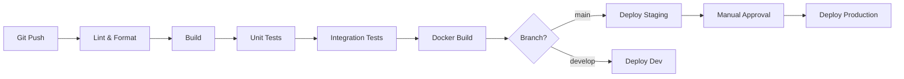

# Deployment Architecture

> **Document Version:** 1.0  
> **Last Updated:** 2026-11-11  
> **Status:** Draft — Milestone 0  

This document defines the complete deployment architecture for the Indian Stock Trading Platform, covering local development, Docker containerization, production infrastructure, CI/CD pipeline, database operations, monitoring, and scaling strategy.

---

## Table of Contents

1. [Development Environment](#1-development-environment)
2. [Docker Architecture](#2-docker-architecture)
3. [Production Architecture](#3-production-architecture-ubuntu-vps)
4. [Nginx Configuration](#4-nginx-configuration)
5. [CI/CD Pipeline](#5-cicd-pipeline)
6. [Database Operations](#6-database-operations)
7. [Health Monitoring](#7-health-monitoring)
8. [Configuration Management](#8-configuration-management)
9. [Production Defaults](#9-production-defaults)
10. [Scaling Path](#10-scaling-path)

---

## 1. Development Environment

### Required Software

| Software             | Version         | Purpose                                      |
|----------------------|-----------------|----------------------------------------------|
| Windows 10/11        | 22H2+           | Development OS                               |
| Visual Studio 2026   | 17.14+          | Primary IDE for .NET development             |
| .NET 10 LTS SDK      | 10.0.404        | Backend framework (Long-Term Support)        |
| Node.js              | v26.13.0        | Frontend build tooling                       |
| npm                  | v10.x (bundled) | Package management for React frontend        |
| Docker Desktop       | 29.9.3          | Container runtime for PostgreSQL and testing |
| Git                  | 2.45+           | Version control                              |
| pgAdmin 4 (optional) | 8.x             | Database administration GUI                  |

> [!IMPORTANT]
> PostgreSQL is **not** installed locally. It runs exclusively via Docker. This ensures environment parity between development and production.

### Local Development Setup

```powershell
# 1. Clone the repository
git clone https://github.com/<org>/trading-platform.git
cd trading-platform

# 2. Verify .NET SDK
dotnet --version
# Expected: 10.0.404

# 3. Verify Node.js
node --version
# Expected: v26.13.0

# 4. Start development infrastructure (PostgreSQL)
docker compose -f docker-compose.dev.yml up -d

# 5. Apply database migrations
dotnet ef database update --project src/TradingPlatform.Infrastructure

# 6. Run the API
dotnet run --project src/TradingPlatform.API

# 7. Run the Worker (separate terminal)
dotnet run --project src/TradingPlatform.Worker

# 8. Start the frontend dev server (separate terminal)
cd src/trading-frontend
npm install
npm run dev
```

### Development Docker Compose

The `docker-compose.dev.yml` file provides only the database for local development, while the API, Worker, and Frontend run natively for hot-reload and debugging:

```yaml
# docker-compose.dev.yml (structure — created during implementation)
services:
  trading-db:
    image: postgres:17-alpine
    container_name: trading-db-dev
    environment:
      POSTGRES_USER: trading_dev
      POSTGRES_PASSWORD: dev_password_change_me
      POSTGRES_DB: trading_platform_dev
    ports:
      - "5432:5432"
    volumes:
      - pgdata-dev:/var/lib/postgresql/data
    healthcheck:
      test: ["CMD-SHELL", "pg_isready -U trading_dev"]
      interval: 10s
      timeout: 5s
      retries: 5

volumes:
  pgdata-dev:
```

### Development URLs

| Service       | URL                          | Notes                    |
|---------------|------------------------------|--------------------------|
| React Frontend| `http://localhost:5173`       | Vite dev server          |
| API           | `http://localhost:5000`       | Kestrel direct           |
| API Swagger   | `http://localhost:5000/swagger` | Development only       |
| PostgreSQL    | `localhost:5432`             | Docker container         |
| pgAdmin       | `http://localhost:5050`      | Optional, if configured  |

---

## 2. Docker Architecture

### Container Topology

```
┌─────────────────────────────────────────────────────────────────┐
│                        trading-net (bridge)                      │
│                                                                 │
│  ┌──────────────────┐   ┌──────────────────┐                    │
│  │ trading-frontend │   │   trading-api    │                    │
│  │   (React/Nginx)  │   │  (ASP.NET Core)  │                    │
│  │   Port: 80 int   │   │  Port: 5000 int  │                    │
│  └──────────────────┘   └────────┬─────────┘                    │
│                                  │                              │
│  ┌──────────────────┐   ┌────────┴─────────┐                    │
│  │ trading-worker   │   │   trading-db     │                    │
│  │ (.NET Worker)    │───│  (PostgreSQL 17) │                    │
│  │   No port        │   │  Port: 5432 int  │                    │
│  └──────────────────┘   └──────────────────┘                    │
│                                                                 │
└─────────────────────────────────────────────────────────────────┘
```

### Container Details

#### trading-frontend

| Property       | Value                                |
|----------------|--------------------------------------|
| Base Image     | `node:26-alpine` (build), `nginx:1.27-alpine` (runtime) |
| Build Tool     | Vite (multi-stage build)             |
| Internal Port  | 80                                   |
| Volumes        | Nginx config mount                   |
| Health Check   | `curl -f http://localhost/ \|\| exit 1` |

#### trading-api

| Property       | Value                                |
|----------------|--------------------------------------|
| Base Image     | `mcr.microsoft.com/dotnet/aspnet:10.0-alpine` |
| Build Image    | `mcr.microsoft.com/dotnet/sdk:10.0-alpine` |
| Internal Port  | 5000                                 |
| Depends On     | `trading-db` (healthy)               |
| Health Check   | `curl -f http://localhost:5000/health \|\| exit 1` |
| Environment    | Connection strings, JWT secrets, broker config |

#### trading-worker

| Property       | Value                                |
|----------------|--------------------------------------|
| Base Image     | `mcr.microsoft.com/dotnet/aspnet:10.0-alpine` |
| Build Image    | `mcr.microsoft.com/dotnet/sdk:10.0-alpine` |
| Internal Port  | None (background service)            |
| Depends On     | `trading-db` (healthy)               |
| Health Check   | Heartbeat row in `WorkerHeartbeats` table |
| Environment    | Connection strings, worker config    |

#### trading-db

| Property       | Value                                |
|----------------|--------------------------------------|
| Base Image     | `postgres:17-alpine`                 |
| Internal Port  | 5432 (not exposed to host in prod)   |
| Volumes        | Named volume for data persistence    |
| Health Check   | `pg_isready -U trading_user`         |
| Environment    | POSTGRES_USER, POSTGRES_PASSWORD, POSTGRES_DB |

### Production Docker Compose

```yaml
# docker-compose.yml (structure — created during implementation)
services:
  trading-frontend:
    build:
      context: ./src/trading-frontend
      dockerfile: Dockerfile
    container_name: trading-frontend
    restart: unless-stopped
    networks:
      - trading-net
    healthcheck:
      test: ["CMD", "curl", "-f", "http://localhost/"]
      interval: 30s
      timeout: 10s
      retries: 3

  trading-api:
    build:
      context: .
      dockerfile: src/TradingPlatform.API/Dockerfile
    container_name: trading-api
    restart: unless-stopped
    env_file:
      - .env.production
    depends_on:
      trading-db:
        condition: service_healthy
    networks:
      - trading-net
    healthcheck:
      test: ["CMD", "curl", "-f", "http://localhost:5000/health"]
      interval: 30s
      timeout: 10s
      retries: 3

  trading-worker:
    build:
      context: .
      dockerfile: src/TradingPlatform.Worker/Dockerfile
    container_name: trading-worker
    restart: unless-stopped
    env_file:
      - .env.production
    depends_on:
      trading-db:
        condition: service_healthy
    networks:
      - trading-net

  trading-db:
    image: postgres:17-alpine
    container_name: trading-db
    restart: unless-stopped
    environment:
      POSTGRES_USER: ${DB_USER}
      POSTGRES_PASSWORD: ${DB_PASSWORD}
      POSTGRES_DB: ${DB_NAME}
    volumes:
      - pgdata:/var/lib/postgresql/data
      - ./backups:/backups
    networks:
      - trading-net
    healthcheck:
      test: ["CMD-SHELL", "pg_isready -U ${DB_USER}"]
      interval: 10s
      timeout: 5s
      retries: 5

networks:
  trading-net:
    driver: bridge

volumes:
  pgdata:
```

> [!WARNING]
> The `trading-db` container does **not** expose port 5432 to the host in production. Database access is restricted to containers on the `trading-net` network.

### Dockerfile Patterns

#### Multi-Stage .NET Build (API and Worker)

```dockerfile
# Stage 1: Build
FROM mcr.microsoft.com/dotnet/sdk:10.0-alpine AS build
WORKDIR /src
COPY ["Directory.Build.props", "."]
COPY ["src/TradingPlatform.API/TradingPlatform.API.csproj", "src/TradingPlatform.API/"]
COPY ["src/TradingPlatform.Application/TradingPlatform.Application.csproj", "src/TradingPlatform.Application/"]
COPY ["src/TradingPlatform.Domain/TradingPlatform.Domain.csproj", "src/TradingPlatform.Domain/"]
COPY ["src/TradingPlatform.Infrastructure/TradingPlatform.Infrastructure.csproj", "src/TradingPlatform.Infrastructure/"]
RUN dotnet restore "src/TradingPlatform.API/TradingPlatform.API.csproj"
COPY . .
RUN dotnet publish "src/TradingPlatform.API/TradingPlatform.API.csproj" \
    -c Release -o /app/publish --no-restore

# Stage 2: Runtime
FROM mcr.microsoft.com/dotnet/aspnet:10.0-alpine AS runtime
WORKDIR /app
RUN addgroup -S appgroup && adduser -S appuser -G appgroup
COPY --from=build /app/publish .
USER appuser
EXPOSE 5000
ENV ASPNETCORE_URLS=http://+:5000
ENTRYPOINT ["dotnet", "TradingPlatform.API.dll"]
```

#### Multi-Stage React Build (Frontend)

```dockerfile
# Stage 1: Build
FROM node:26-alpine AS build
WORKDIR /app
COPY package*.json ./
RUN npm ci --production=false
COPY . .
RUN npm run build

# Stage 2: Serve
FROM nginx:1.27-alpine AS runtime
COPY --from=build /app/dist /usr/share/nginx/html
COPY nginx.conf /etc/nginx/conf.d/default.conf
EXPOSE 80
CMD ["nginx", "-g", "daemon off;"]
```

---

## 3. Production Architecture (Ubuntu VPS)

### Network Flow

```
Internet
   │
   ▼
Cloudflare DNS (A record → VPS Public IP)
   │
   ▼
┌──────────────────────────────────────────────────────────┐
│  Ubuntu VPS (e.g., DigitalOcean, Hetzner, AWS Lightsail) │
│                                                          │
│  ┌────────────────────────────────────────────────────┐  │
│  │  Host Nginx (port 443, HTTPS + Let's Encrypt)      │  │
│  │                                                    │  │
│  │  /api/*  → reverse proxy → trading-api:5000        │  │
│  │  /hubs/* → reverse proxy → trading-api:5000 (WS)   │  │
│  │  /*      → reverse proxy → trading-frontend:80     │  │
│  └────────────────────────────────────────────────────┘  │
│                                                          │
│  ┌────────────────────────────────────────────────────┐  │
│  │  Docker Compose (trading-net)                       │  │
│  │                                                    │  │
│  │  trading-frontend:80   ← static React app          │  │
│  │  trading-api:5000      ← ASP.NET Core API          │  │
│  │  trading-worker        ← background processor      │  │
│  │  trading-db:5432       ← PostgreSQL (internal only) │  │
│  └────────────────────────────────────────────────────┘  │
│                                                          │
└──────────────────────────────────────────────────────────┘
```

### VPS Requirements (Initial)

| Resource   | Minimum    | Recommended |
|------------|------------|-------------|
| CPU        | 2 vCPU     | 4 vCPU      |
| RAM        | 4 GB       | 8 GB        |
| Storage    | 40 GB SSD  | 80 GB SSD   |
| OS         | Ubuntu 24.04 LTS | Ubuntu 24.04 LTS |
| Bandwidth  | 2 TB/month | 4 TB/month  |

### VPS Initial Setup

```bash
# 1. Update system
sudo apt update && sudo apt upgrade -y

# 2. Install Docker
curl -fsSL https://get.docker.com -o get-docker.sh
sudo sh get-docker.sh
sudo usermod -aG docker $USER

# 3. Install Docker Compose (v2 plugin)
sudo apt install docker-compose-plugin -y

# 4. Install Nginx
sudo apt install nginx -y

# 5. Install Certbot
sudo apt install certbot python3-certbot-nginx -y

# 6. Configure firewall
sudo ufw allow OpenSSH
sudo ufw allow 'Nginx Full'
sudo ufw enable

# 7. Create application directory
sudo mkdir -p /opt/trading-platform
sudo chown $USER:$USER /opt/trading-platform
```

---

## 4. Nginx Configuration

### Host Nginx (HTTPS Reverse Proxy)

```nginx
# /etc/nginx/sites-available/trading-platform
upstream trading_api {
    server 127.0.0.1:5000;
    keepalive 32;
}

upstream trading_frontend {
    server 127.0.0.1:8080;
    keepalive 16;
}

# Rate limiting zones
limit_req_zone $binary_remote_addr zone=api_limit:10m rate=30r/s;
limit_req_zone $binary_remote_addr zone=auth_limit:10m rate=5r/m;

# Redirect HTTP to HTTPS
server {
    listen 80;
    server_name trading.yourdomain.com;
    return 301 https://$host$request_uri;
}

server {
    listen 443 ssl http2;
    server_name trading.yourdomain.com;

    # SSL (managed by Certbot)
    ssl_certificate /etc/letsencrypt/live/trading.yourdomain.com/fullchain.pem;
    ssl_certificate_key /etc/letsencrypt/live/trading.yourdomain.com/privkey.pem;
    include /etc/letsencrypt/options-ssl-nginx.conf;
    ssl_dhparam /etc/letsencrypt/ssl-dhparams.pem;

    # Security headers
    add_header X-Frame-Options "SAMEORIGIN" always;
    add_header X-Content-Type-Options "nosniff" always;
    add_header X-XSS-Protection "1; mode=block" always;
    add_header Referrer-Policy "strict-origin-when-cross-origin" always;
    add_header Content-Security-Policy "default-src 'self'; script-src 'self'; style-src 'self' 'unsafe-inline'; img-src 'self' data:; connect-src 'self' wss://trading.yourdomain.com;" always;
    add_header Strict-Transport-Security "max-age=31536000; includeSubDomains" always;

    # Gzip compression
    gzip on;
    gzip_vary on;
    gzip_proxied any;
    gzip_comp_level 6;
    gzip_types text/plain text/css application/json application/javascript text/xml application/xml text/javascript image/svg+xml;

    # API routes
    location /api/ {
        limit_req zone=api_limit burst=20 nodelay;
        proxy_pass http://trading_api;
        proxy_http_version 1.1;
        proxy_set_header Host $host;
        proxy_set_header X-Real-IP $remote_addr;
        proxy_set_header X-Forwarded-For $proxy_add_x_forwarded_for;
        proxy_set_header X-Forwarded-Proto $scheme;
        proxy_read_timeout 90s;
        proxy_buffering off;
    }

    # Auth routes (stricter rate limiting)
    location /api/auth/ {
        limit_req zone=auth_limit burst=3 nodelay;
        proxy_pass http://trading_api;
        proxy_http_version 1.1;
        proxy_set_header Host $host;
        proxy_set_header X-Real-IP $remote_addr;
        proxy_set_header X-Forwarded-For $proxy_add_x_forwarded_for;
        proxy_set_header X-Forwarded-Proto $scheme;
    }

    # SignalR WebSocket upgrade
    location /hubs/ {
        proxy_pass http://trading_api;
        proxy_http_version 1.1;
        proxy_set_header Upgrade $http_upgrade;
        proxy_set_header Connection "upgrade";
        proxy_set_header Host $host;
        proxy_set_header X-Real-IP $remote_addr;
        proxy_set_header X-Forwarded-For $proxy_add_x_forwarded_for;
        proxy_set_header X-Forwarded-Proto $scheme;
        proxy_read_timeout 3600s;
        proxy_send_timeout 3600s;
    }

    # Health check (no rate limiting)
    location /health {
        proxy_pass http://trading_api;
        proxy_http_version 1.1;
        proxy_set_header Host $host;
        access_log off;
    }

    # Frontend (everything else)
    location / {
        proxy_pass http://trading_frontend;
        proxy_http_version 1.1;
        proxy_set_header Host $host;
        proxy_set_header X-Real-IP $remote_addr;
        proxy_set_header X-Forwarded-For $proxy_add_x_forwarded_for;
        proxy_set_header X-Forwarded-Proto $scheme;

        # Cache static assets
        location ~* \.(js|css|png|jpg|jpeg|gif|ico|svg|woff|woff2|ttf|eot)$ {
            proxy_pass http://trading_frontend;
            expires 30d;
            add_header Cache-Control "public, immutable";
        }
    }
}
```

### Let's Encrypt Setup

```bash
# Initial certificate
sudo certbot --nginx -d trading.yourdomain.com

# Verify auto-renewal
sudo certbot renew --dry-run

# Auto-renewal is configured via systemd timer by certbot
```

---

## 5. CI/CD Pipeline

### Pipeline Architecture



### GitHub Actions Workflow

```yaml
# .github/workflows/deploy.yml (structure — created during implementation)
name: Build and Deploy

on:
  push:
    branches: [main, develop]
  pull_request:
    branches: [main]

env:
  DOTNET_VERSION: '10.0.x'
  NODE_VERSION: '26'

jobs:
  lint:
    runs-on: ubuntu-latest
    steps:
      - uses: actions/checkout@v4
      - name: .NET Format Check
        run: dotnet format --verify-no-changes
      - name: ESLint
        working-directory: src/trading-frontend
        run: npm ci && npm run lint

  build:
    runs-on: ubuntu-latest
    needs: lint
    steps:
      - uses: actions/checkout@v4
      - name: Setup .NET
        uses: actions/setup-dotnet@v4
        with:
          dotnet-version: ${{ env.DOTNET_VERSION }}
      - name: Restore & Build
        run: dotnet build --configuration Release
      - name: Build Frontend
        working-directory: src/trading-frontend
        run: npm ci && npm run build

  unit-test:
    runs-on: ubuntu-latest
    needs: build
    steps:
      - uses: actions/checkout@v4
      - name: Setup .NET
        uses: actions/setup-dotnet@v4
        with:
          dotnet-version: ${{ env.DOTNET_VERSION }}
      - name: Run Unit Tests
        run: dotnet test --filter "Category=Unit" --configuration Release --logger trx --collect:"XPlat Code Coverage"
      - name: Publish Test Results
        uses: dorny/test-reporter@v1
        if: always()
        with:
          name: Unit Test Results
          path: '**/*.trx'
          reporter: dotnet-trx

  integration-test:
    runs-on: ubuntu-latest
    needs: unit-test
    services:
      postgres:
        image: postgres:17-alpine
        env:
          POSTGRES_USER: test_user
          POSTGRES_PASSWORD: test_password
          POSTGRES_DB: trading_test
        ports:
          - 5432:5432
        options: >-
          --health-cmd "pg_isready -U test_user"
          --health-interval 10s
          --health-timeout 5s
          --health-retries 5
    steps:
      - uses: actions/checkout@v4
      - name: Setup .NET
        uses: actions/setup-dotnet@v4
        with:
          dotnet-version: ${{ env.DOTNET_VERSION }}
      - name: Run Integration Tests
        run: dotnet test --filter "Category=Integration" --configuration Release
        env:
          ConnectionStrings__DefaultConnection: "Host=localhost;Database=trading_test;Username=test_user;Password=test_password"

  docker-build:
    runs-on: ubuntu-latest
    needs: integration-test
    if: github.ref == 'refs/heads/main' || github.ref == 'refs/heads/develop'
    steps:
      - uses: actions/checkout@v4
      - name: Build Docker Images
        run: docker compose build
      - name: Save Docker Images
        run: |
          docker save trading-api trading-worker trading-frontend | gzip > images.tar.gz
      - name: Upload Artifact
        uses: actions/upload-artifact@v4
        with:
          name: docker-images
          path: images.tar.gz

  deploy:
    runs-on: ubuntu-latest
    needs: docker-build
    if: github.ref == 'refs/heads/main'
    environment: production
    steps:
      - name: Download Docker Images
        uses: actions/download-artifact@v4
        with:
          name: docker-images
      - name: Deploy to VPS
        run: |
          scp images.tar.gz ${{ secrets.VPS_USER }}@${{ secrets.VPS_HOST }}:/opt/trading-platform/
          ssh ${{ secrets.VPS_USER }}@${{ secrets.VPS_HOST }} << 'EOF'
            cd /opt/trading-platform
            docker load < images.tar.gz
            docker compose down
            docker compose up -d
            docker compose ps
            # Verify health
            sleep 10
            curl -f http://localhost:5000/health || exit 1
          EOF
```

### Rollback Procedure

```bash
# On VPS: Rollback to previous version
cd /opt/trading-platform

# 1. Stop current containers
docker compose down

# 2. Load previous images
docker load < images-previous.tar.gz

# 3. Start containers
docker compose up -d

# 4. Verify health
curl -f http://localhost:5000/health

# 5. If database migration needs rollback
docker exec trading-api dotnet ef database update <PreviousMigrationName>
```

> [!CAUTION]
> Production deployments require manual approval in the GitHub Actions workflow. Never bypass this gate.

---

## 6. Database Operations

### Migration Workflow

#### Development

```bash
# Create a new migration
dotnet ef migrations add <MigrationName> \
  --project src/TradingPlatform.Infrastructure \
  --startup-project src/TradingPlatform.API

# Review the generated migration file before applying

# Apply migration
dotnet ef database update \
  --project src/TradingPlatform.Infrastructure \
  --startup-project src/TradingPlatform.API
```

#### Production

```bash
# 1. Generate SQL script for review
dotnet ef migrations script <FromMigration> <ToMigration> \
  --project src/TradingPlatform.Infrastructure \
  --startup-project src/TradingPlatform.API \
  --idempotent \
  --output migration.sql

# 2. Review the SQL script

# 3. Backup database BEFORE migration
docker exec trading-db pg_dump -U trading_user -d trading_platform \
  -F c -f /backups/pre-migration-$(date +%Y%m%d-%H%M%S).dump

# 4. Apply migration via CLI (NOT auto-applied on startup)
docker exec trading-api dotnet ef database update
```

> [!WARNING]
> Migrations are **never** auto-applied in production. Always back up, review, and manually apply.

### Backup Strategy

| Backup Type   | Frequency | Retention | Storage              |
|---------------|-----------|-----------|----------------------|
| Full backup   | Daily     | 30 days   | External volume      |
| Pre-migration | Per deploy| 90 days   | External volume      |
| WAL archiving | Continuous| 7 days    | External volume      |

#### Daily Backup Script

```bash
#!/bin/bash
# /opt/trading-platform/scripts/backup.sh

BACKUP_DIR="/opt/trading-platform/backups"
TIMESTAMP=$(date +%Y%m%d-%H%M%S)
BACKUP_FILE="${BACKUP_DIR}/trading_platform_${TIMESTAMP}.dump"
RETENTION_DAYS=30

# Create backup
docker exec trading-db pg_dump \
  -U ${DB_USER} \
  -d ${DB_NAME} \
  -F c \
  -f /backups/trading_platform_${TIMESTAMP}.dump

# Verify backup integrity
docker exec trading-db pg_restore \
  --list /backups/trading_platform_${TIMESTAMP}.dump > /dev/null 2>&1

if [ $? -eq 0 ]; then
  echo "[$(date)] Backup successful: ${BACKUP_FILE}"

  # Encrypt backup (optional — with gpg)
  # gpg --symmetric --cipher-algo AES256 --batch --passphrase-file /opt/trading-platform/.backup-key \
  #   "${BACKUP_FILE}"

  # Upload to external storage (optional)
  # rclone copy "${BACKUP_FILE}" remote:trading-backups/
else
  echo "[$(date)] ERROR: Backup verification failed!"
  # Send alert
fi

# Remove old backups
find ${BACKUP_DIR} -name "*.dump" -mtime +${RETENTION_DAYS} -delete
```

#### Cron Schedule

```bash
# Daily backup at 1:00 AM IST
0 1 * * * /opt/trading-platform/scripts/backup.sh >> /var/log/trading-backup.log 2>&1
```

### Restore Procedure

```bash
# 1. Stop the application
docker compose stop trading-api trading-worker

# 2. Restore from backup
docker exec trading-db pg_restore \
  -U trading_user \
  -d trading_platform \
  --clean --if-exists \
  -F c /backups/trading_platform_20261111-010000.dump

# 3. Verify data integrity
docker exec trading-db psql -U trading_user -d trading_platform \
  -c "SELECT COUNT(*) FROM \"Orders\";"

# 4. Restart application
docker compose start trading-api trading-worker
```

### Migration Rollback

```bash
# Rollback to a specific migration
docker exec trading-api dotnet ef database update <PreviousMigrationName>

# Or generate a rollback script
dotnet ef migrations script <CurrentMigration> <PreviousMigration> \
  --project src/TradingPlatform.Infrastructure \
  --startup-project src/TradingPlatform.API \
  --output rollback.sql
```

---

## 7. Health Monitoring

### API Health Endpoint

The API exposes a `/health` endpoint using ASP.NET Core Health Checks:

```csharp
// Registered checks (implemented during Milestone 17)
builder.Services.AddHealthChecks()
    .AddNpgSql(connectionString, name: "database")
    .AddCheck<BrokerConnectionHealthCheck>("broker-connectivity")
    .AddCheck<WorkerHeartbeatHealthCheck>("worker-heartbeat");
```

#### Health Response Format

```json
{
  "status": "Healthy",
  "totalDuration": "00:00:00.1234567",
  "entries": {
    "database": {
      "status": "Healthy",
      "duration": "00:00:00.0456789"
    },
    "broker-connectivity": {
      "status": "Healthy",
      "duration": "00:00:00.0012345",
      "data": {
        "connectedBrokers": 1
      }
    },
    "worker-heartbeat": {
      "status": "Healthy",
      "duration": "00:00:00.0023456",
      "data": {
        "lastHeartbeat": "2026-11-11T07:00:00Z",
        "ageSeconds": 15
      }
    }
  }
}
```

### Worker Heartbeat

The Worker Service writes a heartbeat row to the `WorkerHeartbeats` table every 30 seconds:

| Column         | Type         | Description                     |
|----------------|--------------|---------------------------------|
| Id             | UUID         | Primary key                     |
| WorkerName     | varchar(100) | Worker instance identifier      |
| LastHeartbeat  | timestamptz  | Last heartbeat timestamp        |
| Status         | varchar(50)  | Running, Degraded, Stopped      |
| Metadata       | jsonb        | CPU, memory, queue depth, etc.  |

The API health check marks the worker as `Unhealthy` if no heartbeat is received within 90 seconds.

### External Monitoring

| Service            | Purpose                | Check Interval |
|--------------------|------------------------|----------------|
| UptimeRobot (free) | HTTPS uptime           | 5 minutes      |
| Custom cron script | `/health` JSON parse   | 1 minute       |
| Docker health      | Container-level checks | 30 seconds     |

### Alerting

```bash
#!/bin/bash
# /opt/trading-platform/scripts/health-check.sh

HEALTH_URL="http://localhost:5000/health"
WEBHOOK_URL="${ALERT_WEBHOOK_URL}"

STATUS=$(curl -sf -o /dev/null -w "%{http_code}" "${HEALTH_URL}" --max-time 10)

if [ "${STATUS}" != "200" ]; then
  MESSAGE="ALERT: Trading Platform health check failed (HTTP ${STATUS}) at $(date)"

  # Send webhook alert
  curl -X POST "${WEBHOOK_URL}" \
    -H "Content-Type: application/json" \
    -d "{\"text\": \"${MESSAGE}\"}"

  # Send email alert (if configured with msmtp or similar)
  # echo "${MESSAGE}" | mail -s "Trading Platform Alert" admin@yourdomain.com
fi
```

### Log Aggregation

All services produce structured JSON logs via Serilog:

```json
{
  "Timestamp": "2026-11-11T07:00:00.123+05:30",
  "Level": "Information",
  "MessageTemplate": "Order {OrderId} executed for {Symbol} at {Price}",
  "Properties": {
    "OrderId": "abc-123",
    "Symbol": "RELIANCE",
    "Price": 2450.50,
    "UserId": "user-456",
    "SourceContext": "TradingPlatform.Application.Services.OrderExecutionService"
  }
}
```

Log outputs:
- **Console**: Docker captures stdout/stderr
- **File**: Rolling file in `/app/logs/` (mounted volume)
- **Seq (optional)**: Log aggregation UI for searching and dashboards

```bash
# View API logs
docker logs trading-api --tail 100 -f

# View Worker logs
docker logs trading-worker --tail 100 -f

# Search logs with jq
docker logs trading-api 2>&1 | jq 'select(.Level == "Error")'
```

---

## 8. Configuration Management

### Configuration Hierarchy (Priority: top wins)

```
1. Environment variables            ← Production secrets (highest priority)
2. .env.production / env_file       ← Docker environment file
3. appsettings.Production.json      ← Production settings (in image)
4. appsettings.Development.json     ← Development overrides
5. appsettings.json                 ← Defaults (lowest priority)
```

### appsettings.json (Defaults)

```json
{
  "Logging": {
    "LogLevel": {
      "Default": "Information",
      "Microsoft.AspNetCore": "Warning",
      "Microsoft.EntityFrameworkCore": "Warning"
    }
  },
  "Trading": {
    "LiveTradingEnabled": false,
    "PaperTradingEnabled": true,
    "AutoExecuteOnTimeout": false,
    "DefaultApprovalTimeoutSeconds": 2,
    "MaxDailyLossPercent": 3.0,
    "MaxPositionSizePercent": 20.0,
    "MaxOpenPositions": 5,
    "KillSwitchEnabled": false
  },
  "Database": {
    "ApplyMigrationsOnStartup": false
  },
  "Worker": {
    "HeartbeatIntervalSeconds": 30,
    "PendingApprovalPollIntervalMs": 200,
    "OrderReconciliationIntervalMinutes": 5
  }
}
```

### Environment Variables (Production)

```bash
# .env.production (NOT committed to git — in .gitignore)
ConnectionStrings__DefaultConnection=Host=trading-db;Database=trading_platform;Username=trading_user;Password=<strong-password>
Jwt__Secret=<generated-256-bit-secret>
Jwt__Issuer=trading-platform
Jwt__Audience=trading-platform-users
Jwt__AccessTokenExpiryMinutes=15
Jwt__RefreshTokenExpiryDays=7
Trading__LiveTradingEnabled=false
Trading__PaperTradingEnabled=true
BrokerEncryption__Key=<generated-encryption-key>
Email__SmtpHost=smtp.provider.com
Email__SmtpPort=587
Email__Username=<email-username>
Email__Password=<email-password>
```

### User Secrets (Local Development)

```bash
# Initialize user secrets
dotnet user-secrets init --project src/TradingPlatform.API

# Set secrets
dotnet user-secrets set "Jwt:Secret" "dev-secret-at-least-32-characters-long" \
  --project src/TradingPlatform.API

dotnet user-secrets set "ConnectionStrings:DefaultConnection" \
  "Host=localhost;Database=trading_platform_dev;Username=trading_dev;Password=dev_password_change_me" \
  --project src/TradingPlatform.API
```

> [!CAUTION]
> Never commit `.env.production`, user secrets, or any file containing API keys, passwords, or encryption keys to version control.

---

## 9. Production Defaults

The following defaults are enforced to prevent accidental damage:

| Setting                     | Default Value | Rationale                                    |
|-----------------------------|---------------|----------------------------------------------|
| Live Trading                | **DISABLED**  | Must be explicitly enabled per account       |
| Paper Trading               | **ENABLED**   | Safe default for development and testing     |
| Auto-Execute on Timeout     | **OFF** (live) | Requires explicit opt-in for live accounts  |
| Database Port Exposed       | **NO**        | Internal Docker network only                 |
| Secrets in Git              | **NO**        | Environment variables and user-secrets only  |
| Auto-Apply Migrations       | **NO** (prod) | Manual review and backup required            |
| Swagger UI                  | **NO** (prod) | Development environment only                 |
| Detailed Error Responses    | **NO** (prod) | Generic errors in production                 |
| HTTPS Required              | **YES** (prod)| HTTP redirects to HTTPS                      |
| CORS Origin                 | **Restricted**| Only the configured domain                   |

> [!IMPORTANT]
> Enabling live trading requires: (1) explicit configuration in `appsettings`, (2) valid broker credentials, (3) a connected and authenticated broker session. There is no path to accidentally execute a live trade.

---

## 10. Scaling Path

### Phase 1: Single VPS (Current Plan)

```
1 VPS → 1 API + 1 Worker + 1 DB + 1 Frontend
```

Sufficient for: 1–5 users, <100 concurrent WebSocket connections, <50 orders/minute.

### Phase 2: Vertical Scaling

Upgrade VPS resources (CPU, RAM) before adding complexity. This is the cheapest and simplest scaling step.

### Phase 3: Horizontal API Scaling

```
                    ┌──────────────┐
                    │ Load Balancer│
                    │   (Nginx)    │
                    └──────┬───────┘
                   ┌───────┼───────┐
                   ▼       ▼       ▼
              ┌────────┐┌────────┐┌────────┐
              │ API 1  ││ API 2  ││ API 3  │
              └────┬───┘└────┬───┘└────┬───┘
                   │         │         │
                   ▼         ▼         ▼
              ┌────────────────────────────┐
              │        Redis               │
              │  (SignalR Backplane +       │
              │   Distributed Cache)       │
              └────────────┬───────────────┘
                           │
                   ┌───────┴───────┐
                   ▼               ▼
              ┌────────┐     ┌────────┐
              │ DB     │     │ DB     │
              │ Primary│────▶│Replica │
              └────────┘     └────────┘
```

Required changes:
- Add Redis for SignalR backplane (sticky sessions alternative)
- Add Redis for distributed caching (replacing in-memory cache)
- Configure session affinity or stateless JWT validation
- Multiple API container instances behind Nginx load balancer

### Phase 4: Worker Scaling

Workers can be partitioned by account:

```
Worker 1 → Accounts A-M
Worker 2 → Accounts N-Z
```

Or by function:

```
Worker 1 → Order processing
Worker 2 → Market data sync
Worker 3 → Report generation
```

### Phase 5: Database Scaling

- **Read replicas** for reporting and analytics queries
- **Connection pooling** with PgBouncer
- **Table partitioning** for Orders and TradeExecutions by date
- **Archival** of historical data to cold storage

### When to Scale

| Signal                           | Action                        |
|----------------------------------|-------------------------------|
| API response p95 > 500ms        | Vertical scale or add API     |
| DB CPU > 70% sustained          | Read replica or optimize      |
| Worker queue lag > 5s           | Add worker instance           |
| WebSocket connections > 500     | Redis backplane + API replicas|
| Storage > 70% capacity         | Expand volume, archive data   |

---

## Appendix: File Structure

```
trading-platform/
├── .github/
│   └── workflows/
│       └── deploy.yml
├── src/
│   ├── TradingPlatform.API/
│   │   └── Dockerfile
│   ├── TradingPlatform.Worker/
│   │   └── Dockerfile
│   ├── trading-frontend/
│   │   ├── Dockerfile
│   │   └── nginx.conf
│   ├── TradingPlatform.Application/
│   ├── TradingPlatform.Domain/
│   └── TradingPlatform.Infrastructure/
├── tests/
├── docs/
├── scripts/
│   ├── backup.sh
│   ├── restore.sh
│   ├── deploy.sh
│   └── health-check.sh
├── docker-compose.yml
├── docker-compose.dev.yml
├── .env.example
├── .gitignore
└── README.md
```

---

*This document will be updated as the platform evolves through implementation milestones.*
