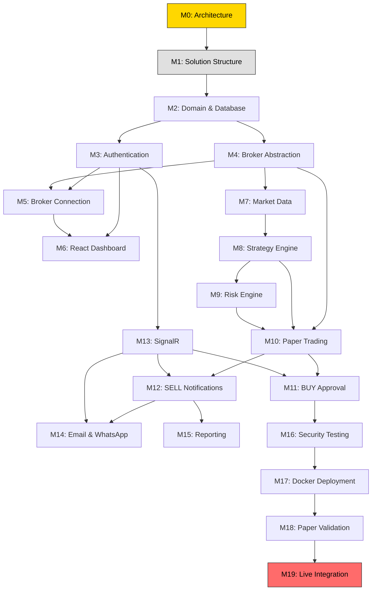

# Implementation Roadmap

> **Document Version:** 1.0  
> **Last Updated:** 2026-11-11  
> **Status:** Active � Milestone 2 Ready to Begin  

This document defines the milestone-by-milestone implementation plan for the Indian Stock Trading Platform. Each milestone includes deliverables, acceptance criteria, dependencies, and estimated complexity.

---

## Legend

| Symbol | Meaning        |
|--------|----------------|
| [ ]    | Not Started    |
| [~]    | In Progress    |
| [x]    | Complete       |

**Complexity Scale:**

| Size | Effort Estimate     | Description                                |
|------|---------------------|--------------------------------------------|
| S    | 1–2 days            | Small, well-defined task                   |
| M    | 3–5 days            | Moderate complexity, some unknowns         |
| L    | 1–2 weeks           | Large, multiple components                 |
| XL   | 2–3 weeks           | Very large, cross-cutting, high complexity |

---

## Current Focus

> [!IMPORTANT]
> **Active Milestone:** Milestone 13 — SignalR Notification System  
> **Current Task:** Full typed SignalR Hubs, group subscriptions, notification center & persistence  
> **Next Up:** Live Broker Deployment & Hardening (Milestone 16)

---

## Milestone 0: Environment Inspection and Architecture [x] Complete

**Complexity:** M  
**Dependencies:** None  
**Started:** 2026-11-11  

### Objective

Establish the complete architectural foundation before writing any implementation code. Inspect the development environment, document all architectural decisions, and present for user approval.

### Deliverables

- [ ] Inspect development environment (installed tools, versions, paths)
- [~] Create architecture documentation suite:
  - [x] `ARCHITECTURE.md` — System overview, layers, project structure
  - [x] `DATABASE_SCHEMA.md` — Entity definitions, relationships, indexes
  - [x] `API_SPECIFICATIONS.md` — All REST endpoints, request/response contracts
  - [x] `BROKER_INTEGRATION.md` — Adapter pattern, broker flows, credentials
  - [x] `TRADING_ENGINE.md` — Strategy engine, indicators, signal pipeline
  - [x] `NOTIFICATION_SYSTEM.md` — SignalR, email, WhatsApp, notification types
  - [x] `RISK_MANAGEMENT.md` — Risk rules, validation, kill switch
  - [~] `DEPLOYMENT.md` — Docker, CI/CD, production architecture
  - [~] `DECISIONS.md` — Architecture Decision Records
  - [~] `IMPLEMENTATION_ROADMAP.md` — This document
- [ ] Present documentation for user approval
- [ ] Incorporate user feedback

### Acceptance Criteria

- All 10 architecture documents are complete and internally consistent
- Documents cover all features described in project requirements
- User reviews and approves the architecture
- No implementation code written until approval received

---

## Milestone 1: Solution Structure and Foundation [x] Complete

**Complexity:** M  
**Dependencies:** Milestone 0 (approved)  
**Estimated Start:** After M0 approval  

### Objective

Create the .NET solution structure, configure all projects with correct references and dependencies, establish build tooling, and verify everything compiles.

### Deliverables

- [ ] Create .NET solution file (`TradingPlatform.sln`)
- [ ] Create project structure:
  - [ ] `src/TradingPlatform.Domain` — Class library (net10.0)
  - [ ] `src/TradingPlatform.Application` — Class library (net10.0)
  - [ ] `src/TradingPlatform.Infrastructure` — Class library (net10.0)
  - [ ] `src/TradingPlatform.API` — ASP.NET Core Web API (net10.0)
  - [ ] `src/TradingPlatform.Worker` — Worker Service (net10.0)
  - [ ] `tests/TradingPlatform.UnitTests` — xUnit test project
  - [ ] `tests/TradingPlatform.IntegrationTests` — xUnit test project
- [ ] Configure project references (enforce dependency rules):
  - [ ] Domain → no project references
  - [ ] Application → Domain
  - [ ] Infrastructure → Application, Domain
  - [ ] API → Application, Infrastructure, Domain
  - [ ] Worker → Application, Infrastructure, Domain
- [ ] Add `Directory.Build.props` (shared build properties, nullable, implicit usings)
- [ ] Add `.gitignore` (Visual Studio, .NET, Node.js, Docker, environment files)
- [ ] Add `.editorconfig` (coding style enforcement)
- [ ] Configure Serilog in API and Worker projects
- [ ] Configure basic dependency injection
- [ ] Add core NuGet packages:
  - [ ] Serilog + sinks
  - [ ] Npgsql.EntityFrameworkCore.PostgreSQL
  - [ ] Microsoft.AspNetCore.Authentication.JwtBearer
  - [ ] FluentValidation
  - [ ] xUnit, Moq, FluentAssertions
- [ ] Verify `dotnet build` succeeds with zero warnings
- [ ] Initial Git commit

### Acceptance Criteria

- `dotnet build TradingPlatform.sln` completes with 0 errors, 0 warnings
- `dotnet test` runs (even if no tests exist yet, the test projects build)
- Project reference graph enforces architectural layers
- Serilog outputs structured logs to console on API startup
- Git repository initialized with proper `.gitignore`

---

## Milestone 2: Domain Model and Database [x] Complete

**Complexity:** L  
**Dependencies:** Milestone 1  

### Objective

Implement all domain entities, configure EF Core DbContext with proper relationships, create the initial migration, and verify it applies to PostgreSQL running in Docker.

### Deliverables

- [ ] Implement domain entities (as defined in `DATABASE_SCHEMA.md`):
  - [ ] User, Role, UserRole
  - [ ] BrokerProvider, BrokerAccount, BrokerCredential
  - [ ] TradingAccount, AccountConfiguration
  - [ ] Instrument, InstrumentWatchlist
  - [ ] Strategy, StrategyVersion, StrategyStockUniverse
  - [ ] Signal, PendingTradeApproval
  - [ ] Order, OrderEvent, TradeExecution
  - [ ] Position, DailyPortfolioSnapshot
  - [ ] Notification, AuditLog, WorkerHeartbeat
- [ ] Implement base entity classes (BaseEntity, AuditableEntity)
- [ ] Implement enums (OrderSide, OrderType, OrderStatus, ApprovalStatus, etc.)
- [ ] Configure `TradingDbContext`:
  - [ ] Entity configurations (IEntityTypeConfiguration per entity)
  - [ ] Relationships and foreign keys
  - [ ] Indexes (as defined in schema doc)
  - [ ] Global query filters for tenant isolation
  - [ ] Value converters for enums and encrypted fields
- [ ] Create `docker-compose.dev.yml` for PostgreSQL
- [ ] Create initial EF Core migration
- [ ] Apply migration and verify schema
- [ ] Seed reference data:
  - [ ] BrokerProviders (Upstox, Zerodha, AngelOne, Mock)
  - [ ] Roles (Admin, User)
- [ ] Write unit tests for domain entities and value objects

### Acceptance Criteria

- `docker compose -f docker-compose.dev.yml up -d` starts PostgreSQL
- `dotnet ef database update` applies migration without errors
- All tables created with correct relationships and indexes
- Seed data present in database
- Unit tests pass for domain entity validation rules

---

## Milestone 3: Authentication and User Isolation [x] Complete

**Complexity:** L  
**Dependencies:** Milestone 2  

### Objective

Implement JWT-based authentication with refresh token rotation, password hashing, and verify tenant isolation via EF Core global query filters.

### Deliverables

- [ ] Implement `IAuthService` with registration and login
- [ ] Password hashing with BCrypt (or Argon2)
- [ ] JWT access token generation (15-minute expiry)
- [ ] Refresh token generation and rotation (7-day expiry)
- [ ] Refresh token storage in database (hashed)
- [ ] Token validation middleware
- [ ] `ICurrentUserService` — resolves UserId from JWT claims
- [ ] EF Core global query filters wired to `ICurrentUserService`
- [ ] Rate limiting middleware (ASP.NET Core built-in)
- [ ] Authorization policies:
  - [ ] `[Authorize]` on all protected endpoints
  - [ ] Role-based policies where applicable
- [ ] Auth API endpoints:
  - [ ] `POST /api/auth/register`
  - [ ] `POST /api/auth/login`
  - [ ] `POST /api/auth/refresh`
  - [ ] `POST /api/auth/logout`
  - [ ] `GET /api/auth/me`
- [x] Unit tests:
  - [ ] Password hashing roundtrip
  - [ ] JWT token generation and validation
  - [ ] Refresh token rotation (old token invalidated)
  - [ ] Tenant isolation (User A cannot see User B's data)

### Acceptance Criteria

- User can register, login, and receive JWT + refresh token
- Protected endpoints return 401 without valid token
- Refresh token rotation works (old token rejected after use)
- User A's queries never return User B's data (integration test)
- Rate limiting returns 429 on excessive requests

---

## Milestone 4: Broker Abstraction and Mock Adapters [x] Complete

**Complexity:** L  
**Dependencies:** Milestone 2  

### Objective

Implement the broker adapter abstraction layer and a fully functional MockBrokerAdapter for paper trading.

### Deliverables

- [ ] Define interfaces:
  - [ ] `IBrokerAdapter` — order placement, cancellation, status
  - [ ] `IBrokerAuthAdapter` — OAuth flows, token management
  - [ ] `IBrokerMarketDataAdapter` — quotes, candles, instruments
  - [ ] `IBrokerAdapterFactory` — resolves adapter by BrokerProvider
- [ ] Implement `MockBrokerAdapter`:
  - [ ] Simulated order execution with configurable latency
  - [ ] Simulated partial fills
  - [ ] Simulated slippage
  - [ ] Simulated order rejection scenarios
  - [ ] Mock market data generation
  - [ ] Mock instrument list (NSE top 50)
- [ ] Implement `BrokerAdapterFactory`
- [ ] Implement `CredentialEncryptionService` (AES-256-GCM)
- [x] Unit tests:
  - [ ] MockBrokerAdapter order lifecycle
  - [ ] Factory resolves correct adapter
  - [ ] Credential encryption roundtrip
  - [ ] Edge cases (timeout, rejection, partial fill)

### Acceptance Criteria

- MockBrokerAdapter can simulate: place order → fill → position update
- Factory returns MockBrokerAdapter for paper trading accounts
- Credentials encrypted at rest and decryptable for API calls
- All unit tests pass

---

## Milestone 5: Broker Connection Configuration [x] Complete

**Complexity:** M  
**Dependencies:** Milestone 3, Milestone 4  

### Objective

Build the API endpoints for managing broker connections, including OAuth flow orchestration and encrypted credential storage.

### Deliverables

- [x] API endpoints:
  - [ ] `GET /api/broker-providers` — list supported brokers
  - [ ] `POST /api/broker-accounts` — create broker account link
  - [ ] `GET /api/broker-accounts` — list user's broker accounts
  - [ ] `GET /api/broker-accounts/{id}/auth-url` — generate OAuth URL
  - [ ] `POST /api/broker-accounts/{id}/callback` — handle OAuth callback
  - [ ] `POST /api/broker-accounts/{id}/disconnect` — disconnect broker
  - [ ] `GET /api/broker-accounts/{id}/status` — connection status
- [ ] OAuth state parameter generation and validation
- [ ] Encrypted credential storage (access token, refresh token)
- [ ] Token refresh logic for expired broker tokens
- [ ] Connection status tracking (Connected, Disconnected, Expired, Error)
- [ ] Unit and integration tests

### Acceptance Criteria

- User can link a broker account (mock or real)
- OAuth flow generates valid auth URL with state parameter
- Credentials stored encrypted in database
- Connection status accurately reflects broker session state

---

## Milestone 6: React Dashboard and Account Management [x] Complete

**Complexity:** XL  
**Dependencies:** Milestone 3, Milestone 5  

### Objective

Initialize the React frontend project and build the core dashboard with authentication, broker management, and account configuration.

### Deliverables

- [x] Initialize React + Vite + TypeScript project
- [x] Configure project structure:
  - [x] `src/components/` — Reusable UI components
  - [x] `src/pages/` — Page-level components
  - [x] `src/hooks/` — Custom React hooks
  - [x] `src/services/` — API client layer
  - [x] `src/contexts/` — Auth context, notification context
  - [x] `src/types/` — TypeScript interfaces and types
- [x] Install and configure dependencies:
  - [x] React Router v7 for routing
  - [x] Axios or fetch wrapper for API calls
  - [x] Tailwind CSS or component library for styling
  - [x] `@microsoft/signalr` for real-time
  - [x] `vite-plugin-pwa` for PWA support
- [x] Implement pages:
  - [x] Login page (responsive)
  - [x] Registration page
  - [x] Dashboard layout (sidebar, header, content area)
  - [x] Broker connection management page
  - [x] Account configuration page
  - [x] Settings page
- [x] Implement core components:
  - [x] Navigation sidebar (collapsible on mobile)
  - [x] Header with user info and trading mode indicator
  - [x] Toast notification container
  - [x] Loading states and error boundaries
  - [x] Responsive data tables
- [x] Auth context (JWT storage, auto-refresh, redirect on 401)
- [ ] API client with interceptors (auth header, error handling)
- [ ] Mobile-first responsive design (breakpoints: 375px, 768px, 1024px, 1440px)
- [ ] PWA manifest and service worker setup
- [ ] ESLint and Prettier configuration

### Acceptance Criteria

- Login flow works end-to-end with API
- Dashboard renders on mobile (375px) and desktop (1440px)
- Broker connection page shows connected accounts
- JWT auto-refresh works transparently
- PWA installable on mobile browser
- Lighthouse mobile score > 80

---

## Milestone 7: Market Data and Instrument Services [x] Complete

**Complexity:** L  
**Dependencies:** Milestone 4  

### Objective

Build the market data layer for instrument management, historical data, and quote caching.

### Deliverables

- [x] Implement `IInstrumentService`:
  - [x] Instrument master data sync from broker
  - [x] Instrument search by symbol, name, exchange
  - [x] Watchlist management (create, add, remove)
- [x] Implement `IMarketDataService`:
  - [x] Historical OHLCV candle fetching
  - [x] Current quote retrieval
  - [x] Quote caching (in-memory, configurable TTL)
  - [x] Market status tracking (pre-open, open, closed)
- [x] API endpoints:
  - [x] `GET /api/instruments` — search instruments
  - [x] `GET /api/instruments/{id}/candles` — historical data
  - [x] `GET /api/instruments/{id}/quote` — current quote
  - [x] CRUD for watchlists
  - [x] `GET /api/market/status` — market hours status
- [x] Mock market data for paper trading:
  - [x] Synthetic price generation based on historical patterns
  - [x] Realistic bid-ask spreads
  - [x] Volume simulation
- [x] Unit tests for caching, market status, data transformations

### Acceptance Criteria

- Instrument search returns results from mock data
- Historical candles returned in OHLCV format
- Quote cache reduces redundant broker API calls
- Market status correctly identifies NSE trading hours and holidays

---

## Milestone 8: Strategy Engine and Technical Indicators [x] Complete

**Complexity:** XL  
**Dependencies:** Milestone 7  

### Objective

Build the technical indicator calculation engine, strategy definition system, and signal generation pipeline.

### Deliverables

- [x] Implement technical indicators (pure C# calculations):
  - [x] EMA (Exponential Moving Average) — multiple periods
  - [x] RSI (Relative Strength Index) — 14-period default
  - [x] MACD (Moving Average Convergence Divergence)
  - [x] VWAP (Volume Weighted Average Price)
  - [x] ATR (Average True Range)
  - [x] Bollinger Bands
  - [x] Support/Resistance levels
- [x] Implement strategy framework:
  - [x] `IStrategy` interface with `Evaluate()` method
  - [x] Strategy configuration (parameters as JSON)
  - [x] Strategy versioning (immutable versions)
  - [x] Strategy activation/deactivation per account
- [x] Implement signal generation:
  - [x] `SignalGenerationService` — runs strategies against market data
  - [x] Signal types: BUY, SELL, HOLD
  - [x] Signal strength and confidence scoring
  - [x] Signal persistence (all signals logged)
- [x] Stock universe management:
  - [x] Define which instruments a strategy monitors
  - [x] Scanning schedule configuration
- [x] API endpoints:
  - [x] CRUD for strategies
  - [x] Strategy configuration updates
  - [x] `GET /api/strategies/{id}/signals` — signal history
  - [x] `GET /api/indicators/{symbol}` — calculated indicator values
- [ ] Unit tests:
  - [x] Each indicator validated against known datasets
  - [x] Strategy evaluation with mock market data
  - [x] Signal generation pipeline

### Acceptance Criteria

- EMA, RSI, MACD calculations match reference implementations (within float precision)
- Strategy evaluates market data and generates BUY/SELL signals
- Signals persisted with full context (indicator values, strategy version)
- All indicator unit tests pass with known test vectors

---

## Milestone 9: Risk Engine [x] Complete

**Complexity:** L  
**Dependencies:** Milestone 8  

### Objective

Build the comprehensive risk management engine that validates every order before execution.

### Deliverables

- [x] Implement `IRiskValidationService`:
  - [x] Maximum position size (% of portfolio)
  - [x] Maximum open positions count
  - [x] Daily loss limit (% of portfolio)
  - [x] Per-trade risk limit
  - [x] Duplicate order detection (same symbol, same side, within time window)
  - [x] Market hours validation
  - [x] Instrument trading status check
  - [x] Margin requirement validation
  - [x] Price reasonableness check (deviation from LTP)
- [x] Implement kill switch:
  - [x] Manual kill switch toggle (immediately stops all new orders)
  - [x] Automatic kill switch on daily loss limit breach
  - [x] Kill switch status persisted and respected by Worker
- [x] Risk configuration:
  - [x] Per-account risk parameters
  - [x] Default risk parameters for new accounts
  - [x] API for viewing and updating risk configuration
- [x] Pre-order validation pipeline:
  - [x] Chain of risk validators executed in sequence
  - [x] All validation failures collected and returned
  - [x] Validation results logged for audit
- [x] API endpoints:
  - [ ] `GET /api/risk/config` — current risk configuration
  - [ ] `PUT /api/risk/config` — update risk parameters
  - [ ] `POST /api/risk/kill-switch` — toggle kill switch
  - [ ] `GET /api/risk/daily-summary` — daily risk metrics
- [x] Unit tests for every risk rule (pass and fail scenarios)

### Acceptance Criteria

- [x] Order exceeding position size limit is rejected with clear reason
- [x] Daily loss limit triggers automatic kill switch
- [x] Kill switch immediately prevents all new orders
- [x] Duplicate order detected and blocked
- [x] Risk validation results include all failures (not just first)
- [x] 100% unit test coverage on risk rules

---

## Milestone 10: Paper Trading and Order State Machine [x] Complete

**Complexity:** XL  
**Dependencies:** Milestone 4, Milestone 8, Milestone 9  

### Objective

Implement the complete order lifecycle, state machine, position tracking, and P&L calculation for paper trading.

### Deliverables

- [x] Implement order state machine:
  - [x] States: PendingApproval → Approved → Submitting → Submitted → PartiallyFilled → Filled → Completed
  - [x] Alternative states: Rejected, Cancelled, Failed, Expired
  - [x] State transition validation (only valid transitions allowed)
  - [x] State transition events recorded
- [ ] Implement `IOrderService`:
  - [x] Order creation from signal
  - [x] Order submission to broker adapter
  - [x] Order status updates from broker
  - [x] Order cancellation
- [x] Implement position tracking:
  - [x] Open position management (quantity, average price)
  - [x] Position update on fill
  - [x] Position close on full exit
- [x] Implement P&L calculation:
  - [x] Unrealized P&L (open positions vs current price)
  - [x] Realized P&L (closed trades)
  - [x] Trading cost estimation (brokerage, STT, GST, stamp duty, SEBI charges)
  - [x] Net P&L after all charges
- [ ] Implement `ITradeExecutionService`:
  - [x] Record trade executions with timestamps
  - [x] Link executions to orders
  - [x] Execution price and quantity tracking
- [ ] Worker service integration:
  - [ ] Market scanning loop (configurable interval)
  - [ ] Strategy evaluation trigger
  - [ ] Order processing pipeline
- [x] API endpoints:
  - [ ] `GET /api/orders` — order history with filters
  - [ ] `GET /api/orders/{id}` — order details with events
  - [ ] `DELETE /api/orders/{id}` — cancel order
  - [ ] `GET /api/positions` — open positions
  - [ ] `GET /api/portfolio/summary` — portfolio P&L summary
- [x] End-to-end paper trade test:
  - [ ] Signal generated → Order created → Approved → Filled → Position opened
  - [ ] Exit signal → Sell order → Filled → Position closed → P&L calculated

### Acceptance Criteria

- [x] Complete paper trade lifecycle works end-to-end
- [x] Order state machine rejects invalid transitions
- [x] P&L calculation includes all Indian market charges
- [x] Position tracking accurate across partial fills
- [x] State transitions logged as OrderEvent records

---

## Milestone 11: Two-Second BUY Rejection Workflow [x] Complete

**Complexity:** XL  
**Dependencies:** Milestone 10, Milestone 13 (SignalR)  

### Objective

Implement the signature BUY approval workflow with 2-second rejection window, server-side timer, and real-time UI notification.

### Deliverables

- [ ] Implement `PendingTradeApproval` lifecycle:
  - [x] Create approval record with server-side deadline
  - [ ] Deadline = `UtcNow + ApprovalTimeoutSeconds`
  - [ ] Status: Pending → Approved (timeout) / Rejected (user action)
- [x] Worker processing:
  - [x] Poll pending approvals at 200ms intervals during market hours
  - [x] Process expired approvals (deadline passed, status still Pending)
  - [x] Re-validate with risk engine before execution
  - [x] Update approval status and create order
- [x] SignalR notification:
  - [ ] Push `BuyApprovalRequested` event to user's SignalR group
  - [x] Include: symbol, quantity, price, deadline timestamp, approval ID
- [x] React UI:
  - [x] Toast notification with countdown timer
  - [x] Reject button (calls API to reject)
  - [x] Visual countdown (2 seconds)
  - [x] Auto-dismiss on timeout or rejection
  - [x] Sound/vibration alert (configurable)
- [x] API endpoints:
  - [ ] `POST /api/approvals/{id}/reject` — user rejects within window
  - [ ] `GET /api/approvals/pending` — list pending approvals
  - [ ] `GET /api/approvals` — approval history
- [x] Persistent approvals screen:
  - [x] Dashboard widget showing pending approvals
  - [x] History of recent approvals with outcomes
- [x] Edge case handling:
  - [x] Browser closed during countdown → Worker auto-executes
  - [x] Multiple approvals simultaneously
  - [x] Approval rejected at exact deadline (race condition handling)
  - [x] Worker restart with pending approvals in database
- [x] Unit and integration tests:
  - [x] Approval timeout processing
  - [x] Rejection within window
  - [x] Re-validation failure after timeout
  - [x] Concurrent approval processing

### Acceptance Criteria

- [x] BUY signal creates PendingTradeApproval in database
- [x] User sees toast with countdown in < 500ms (SignalR latency)
- [x] Rejection within 2 seconds prevents order execution
- [x] Timeout auto-executes after re-validation
- [x] Works correctly with browser closed
- [x] No duplicate execution on Worker restart

---

## Milestone 12: SELL Notifications and P&L [x] Complete

**Complexity:** L  
**Dependencies:** Milestone 10, Milestone 13  

### Objective

Implement comprehensive SELL execution notifications with P&L details, and build the trade history display.

### Deliverables

- [ ] SELL execution notification via SignalR:
  - [ ] Symbol, quantity, entry price, exit price
  - [ ] Gross P&L, charges breakdown, net P&L
  - [ ] Hold duration
  - [ ] Strategy that generated the exit signal
- [ ] Order status notifications:
  - [ ] Order submitted, filled, partially filled, rejected, cancelled
  - [ ] Each status change pushed via SignalR
- [ ] Stop-loss and target hit notifications:
  - [ ] Clear indication of which trigger caused the exit
  - [ ] P&L relative to original entry
- [ ] Dashboard P&L display:
  - [ ] Today's realized P&L
  - [ ] Today's unrealized P&L
  - [ ] Total portfolio value
  - [ ] Daily P&L chart
- [ ] Trade history page:
  - [ ] Filterable by date range, symbol, strategy, side
  - [ ] Sortable columns
  - [ ] Trade details expandable view
  - [ ] Export capability (CSV)

### Acceptance Criteria

- SELL notification includes complete P&L breakdown
- P&L calculations match manual verification
- Trade history displays all executed trades with correct details
- Filters and sorting work correctly

---

## Milestone 13: SignalR Notification System [x] Complete

**Complexity:** L  
**Dependencies:** Milestone 3  

### Objective

Build the complete SignalR real-time notification infrastructure.

### Deliverables

- [ ] Implement `TradingHub` (SignalR hub):
  - [ ] Authentication (JWT-based)
  - [ ] User-specific groups (per UserId)
  - [ ] Connection lifecycle management
  - [ ] Reconnection handling
- [ ] Implement `INotificationService`:
  - [ ] Send to specific user
  - [ ] Send to all connected clients (admin broadcast)
  - [ ] Notification type routing (toast, persistent, silent)
- [ ] Notification persistence:
  - [ ] All notifications stored in database
  - [ ] Read/unread status tracking
  - [ ] Notification preferences per user
- [ ] React notification center:
  - [ ] SignalR connection management (connect, reconnect, disconnect)
  - [ ] Toast notification display (auto-dismiss configurable)
  - [ ] Notification dropdown/panel with history
  - [ ] Unread count badge
  - [ ] Mark as read functionality
- [ ] Notification types:
  - [ ] BUY approval request (with countdown)
  - [ ] Order status change
  - [ ] SELL execution with P&L
  - [ ] Risk alert (limit approaching, kill switch)
  - [ ] System notification (maintenance, update)

### Acceptance Criteria

- SignalR connection established on dashboard load
- Notifications received in < 500ms from server event
- Automatic reconnection on connection loss
- Notification history persisted and retrievable
- Read/unread status tracked correctly

---

## Milestone 14: Email and WhatsApp Integrations [x] Complete

**Complexity:** L  
**Dependencies:** Milestone 12, Milestone 13  

### Deliverables

- [ ] Email provider abstraction (`IEmailService`)
- [ ] SMTP email sending with templates
- [ ] Email templates:
  - [ ] Daily trading report
  - [ ] Trade execution summary
  - [ ] Risk alert notification
  - [ ] Account security alerts
- [ ] WhatsApp Business API integration (`IWhatsAppService`)
- [ ] WhatsApp message templates (pre-approved)
- [ ] Daily report generation service:
  - [ ] Today's trades summary
  - [ ] P&L summary
  - [ ] Open positions
  - [ ] Risk metrics
- [ ] Notification channel routing:
  - [ ] User configures preferred channels (in-app, email, WhatsApp)
  - [ ] Critical alerts sent to all channels
  - [ ] Routine notifications follow user preference
- [ ] Delivery tracking and retry:
  - [ ] Track email/WhatsApp delivery status
  - [ ] Retry failed deliveries (max 3 attempts, exponential backoff)

### Acceptance Criteria

- Daily report email sent at configured time
- WhatsApp message delivered for trade executions
- User can configure notification channel preferences
- Failed deliveries retried automatically

---

## Milestone 15: Reporting and Analytics [ ] Not Started

**Complexity:** L  
**Dependencies:** Milestone 12  

### Deliverables

- [ ] Daily trading report generation
- [ ] Account summary dashboard:
  - [ ] Total portfolio value
  - [ ] Daily/weekly/monthly P&L
  - [ ] Win rate, average win/loss
  - [ ] Maximum drawdown
- [ ] Strategy performance analytics:
  - [ ] Per-strategy P&L
  - [ ] Signal accuracy (signals that resulted in profitable trades)
  - [ ] Risk-adjusted returns
- [ ] P&L analytics:
  - [ ] P&L by symbol
  - [ ] P&L by time period
  - [ ] Charges breakdown
  - [ ] P&L distribution chart
- [ ] Trade history with advanced filters:
  - [ ] Date range, symbol, strategy, side, outcome
  - [ ] Aggregations and grouping
- [ ] Export capabilities:
  - [ ] CSV export for trade history
  - [ ] PDF daily report (optional)

### Acceptance Criteria

- Dashboard shows accurate portfolio metrics
- Strategy performance metrics calculated correctly
- Reports generated and available via API and UI
- CSV export downloads correctly formatted file

---

## Milestone 16: Security and Recovery Testing [ ] Not Started

**Complexity:** L  
**Dependencies:** Milestone 11  

### Deliverables

- [ ] Cross-user access tests:
  - [ ] User A cannot access User B's orders, positions, accounts
  - [ ] User A cannot modify User B's strategies or configurations
  - [ ] Global query filter verification across all tenant entities
- [ ] Broker credential security tests:
  - [ ] Credentials encrypted at rest
  - [ ] Credentials not exposed in API responses
  - [ ] Credentials not logged (Serilog destructuring exclusion)
- [ ] Worker restart recovery tests:
  - [ ] Pending approvals processed correctly after restart
  - [ ] Orders in transient states reconciled
  - [ ] No duplicate order execution
- [ ] Order state recovery tests:
  - [ ] Orders in `Submitting` state recovered
  - [ ] Partial fills reconciled
  - [ ] Idempotency keys prevent duplicates
- [ ] Integration tests with Testcontainers:
  - [ ] Full order lifecycle against real PostgreSQL
  - [ ] Multi-user isolation scenario
  - [x] Concurrent approval processing
- [ ] Security header verification:
  - [ ] HTTPS enforcement
  - [ ] CORS configuration
  - [ ] Security response headers present
  - [ ] Rate limiting functional

### Acceptance Criteria

- Zero cross-tenant data leakage in tests
- Worker recovery tests pass without duplicate execution
- All security headers present in responses
- Integration tests pass against containerized PostgreSQL

---

## Milestone 17: Docker Deployment and Production Hardening [ ] Not Started

**Complexity:** L  
**Dependencies:** Milestone 16  

### Deliverables

- [ ] Dockerfiles:
  - [ ] `src/TradingPlatform.API/Dockerfile` (multi-stage)
  - [ ] `src/TradingPlatform.Worker/Dockerfile` (multi-stage)
  - [ ] `src/trading-frontend/Dockerfile` (multi-stage with Nginx)
- [ ] Docker Compose files:
  - [ ] `docker-compose.yml` (production)
  - [ ] `docker-compose.dev.yml` (development — DB only)
  - [ ] `.env.example` (template for production env)
- [ ] Host Nginx configuration:
  - [ ] HTTPS with Let's Encrypt
  - [ ] Reverse proxy to API and frontend
  - [ ] WebSocket upgrade for SignalR
  - [ ] Security headers, rate limiting, gzip
- [ ] Health check endpoints:
  - [ ] `GET /health` — database, broker, worker checks
  - [ ] Worker heartbeat implementation
- [ ] Structured logging configuration:
  - [ ] JSON output for production
  - [ ] Log level configuration via environment
  - [ ] Sensitive data exclusion
- [ ] Database operations scripts:
  - [ ] `scripts/backup.sh` — daily backup
  - [ ] `scripts/restore.sh` — restore from backup
  - [ ] `scripts/health-check.sh` — monitoring script
- [ ] Deployment scripts:
  - [ ] `scripts/deploy.sh` — pull, build, deploy
  - [ ] Rollback procedure documented

### Acceptance Criteria

- `docker compose up --build` starts all 4 containers
- Health endpoint returns healthy status
- HTTPS working with valid certificate
- Backup and restore scripts functional
- Production environment variables documented

---

## Milestone 18: Extended Paper Trading Validation [ ] Not Started

**Complexity:** L  
**Dependencies:** Milestone 17  

### Deliverables

- [ ] Multi-day paper trading simulation:
  - [ ] Run strategies against historical data
  - [ ] Verify order lifecycle across market open/close
  - [ ] Validate P&L calculations over multiple sessions
- [ ] Strategy backtesting with historical data:
  - [ ] Replay historical candles through strategy engine
  - [ ] Generate backtest reports (P&L, drawdown, win rate)
  - [ ] Compare backtest results with paper trading results
- [ ] Edge case testing:
  - [ ] Market open/close boundary orders
  - [ ] Circuit breaker and halt scenarios
  - [ ] High volatility scenarios
  - [ ] Multiple simultaneous signals
- [ ] Performance testing:
  - [ ] API response time under load
  - [ ] Worker processing latency
  - [ ] SignalR message delivery time
  - [ ] Database query performance
- [ ] Monitoring setup:
  - [ ] External uptime monitoring configured
  - [ ] Alert webhooks functional
  - [ ] Log aggregation working (optional Seq)

### Acceptance Criteria

- Paper trading runs for 5+ simulated trading days without errors
- Backtest results are consistent and reproducible
- API p95 response time < 200ms for standard operations
- Worker processes pending approvals within 500ms of deadline
- All monitoring and alerting functional

---

## Milestone 19: Broker Live Integration [ ] Not Started

**Complexity:** XL  
**Dependencies:** Milestone 18  

> [!CAUTION]
> This milestone involves **real money**. It must not begin until all previous milestones are complete, tested, and validated through extended paper trading.

### Deliverables

- [ ] Verify official broker API documentation:
  - [ ] Upstox API v2 documentation review
  - [ ] Zerodha Kite Connect API documentation review
  - [ ] API rate limits and usage policies documented
- [ ] Implement real broker adapters:
  - [ ] `UpstoxBrokerAdapter` — full `IBrokerAdapter` implementation
  - [ ] `ZerodhaBrokerAdapter` — full `IBrokerAdapter` implementation
  - [ ] OAuth flow with real broker endpoints
  - [ ] Order placement, modification, cancellation
  - [ ] Order status polling and WebSocket feeds
  - [ ] Position and holdings retrieval
- [ ] Test with broker sandbox/test accounts:
  - [ ] Order lifecycle in sandbox environment
  - [ ] Edge case handling (rejects, timeouts, partial fills)
  - [ ] Rate limit compliance
- [ ] Compliance and regulatory review:
  - [ ] Verify automated trading is permitted by broker ToS
  - [ ] SEBI regulations for algorithmic trading
  - [ ] Risk disclosure requirements
- [ ] Explicit user authorization:
  - [ ] User must acknowledge live trading risks
  - [ ] User must explicitly enable live mode per account
  - [ ] Confirmation dialog before first live trade

### Acceptance Criteria

- Live broker adapter passes same tests as MockBrokerAdapter
- OAuth flow completes with real broker credentials
- Order placed and filled in broker sandbox
- Reconciliation correctly syncs broker state with local state
- User authorization flow prevents accidental live enablement
- All compliance requirements documented and addressed

---

## Progress Tracking

| Milestone | Title                                      | Size | Status      | Started    | Completed  |
|-----------|--------------------------------------------|------|-------------|------------|------------|
| M0        | Environment Inspection and Architecture    | M    | [~] Active  | 2026-11-11 | —          |
| M1        | Solution Structure and Foundation          | M    | [ ] Pending | —          | —          |
| M2        | Domain Model and Database                  | L    | [ ] Pending | —          | —          |
| M3        | Authentication and User Isolation          | L    | [ ] Pending | —          | —          |
| M4        | Broker Abstraction and Mock Adapters       | L    | [ ] Pending | —          | —          |
| M5        | Broker Connection Configuration            | M    | [ ] Pending | —          | —          |
| M6        | React Dashboard and Account Management     | XL   | [ ] Pending | —          | —          |
| M7        | Market Data and Instrument Services        | L    | [ ] Pending | —          | —          |
| M8        | Strategy Engine and Technical Indicators   | XL   | [ ] Pending | —          | —          |
| M9        | Risk Engine                                | L    | [ ] Pending | —          | —          |
| M10       | Paper Trading and Order State Machine      | XL   | [ ] Pending | —          | —          |
| M11       | Two-Second BUY Rejection Workflow          | XL   | [ ] Pending | —          | —          |
| M12       | SELL Notifications and P&L                 | L    | [ ] Pending | —          | —          |
| M13       | SignalR Notification System                | L    | [ ] Pending | —          | —          |
| M14       | Email and WhatsApp Integrations            | L    | [ ] Pending | —          | —          |
| M15       | Reporting and Analytics                    | L    | [ ] Pending | —          | —          |
| M16       | Security and Recovery Testing              | L    | [ ] Pending | —          | —          |
| M17       | Docker Deployment and Production Hardening | L    | [ ] Pending | —          | —          |
| M18       | Extended Paper Trading Validation          | L    | [ ] Pending | —          | —          |
| M19       | Broker Live Integration                    | XL   | [ ] Pending | —          | —          |

---

## Dependency Graph

---

## Risk Register

| Risk | Impact | Probability | Mitigation |
|------|--------|-------------|------------|
| Broker API changes or deprecation | High | Medium | Adapter pattern isolates changes; monitor API changelogs |
| EF Core migration conflicts | Medium | Low | Single developer; test migrations before production apply |
| SignalR scaling limits | Medium | Low | Redis backplane planned for Phase 3 scaling |
| Docker Desktop licensing changes | Low | Low | Podman as alternative; Linux containers on WSL2 |
| SEBI regulatory changes for algo trading | High | Medium | Advisory-only AI; manual approval for BUY; compliance review in M19 |
| PostgreSQL performance with large datasets | Medium | Low | Partitioning strategy; read replicas planned for scaling |

---

## Notes

- This roadmap is a living document updated as milestones are completed
- Milestone estimates may be revised based on actual progress
- Dependencies may be partially parallelized where components are independent
- User approval gates are enforced between major phases

---

*Last updated during Milestone 0 — Architecture Documentation Phase*
