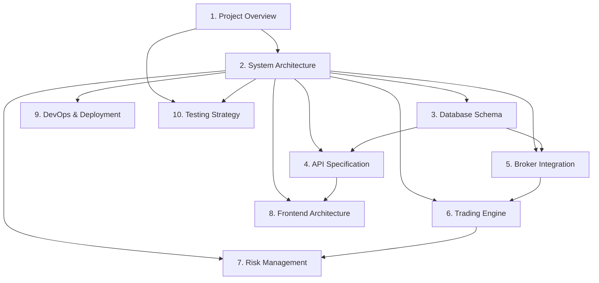

# Project Overview — Automated Indian Stock Trading Platform

> **Document ID**: DOC-001  
> **Version**: 1.0  
> **Last Updated**: 2026-11-11  
> **Author**: Principal Software Architect  
> **Status**: Approved  

---

## Table of Contents

- [1. Project Vision](#1-project-vision)
- [2. Problem Statement](#2-problem-statement)
- [3. Key Features Summary](#3-key-features-summary)
- [4. Technology Stack](#4-technology-stack)
- [5. Architecture Summary](#5-architecture-summary)
- [6. Target Users](#6-target-users)
- [7. Development Environment Summary](#7-development-environment-summary)
- [8. Prerequisites & Recommendations](#8-prerequisites--recommendations)
- [9. Constraints and Assumptions](#9-constraints-and-assumptions)
- [10. Document Index](#10-document-index)

---

## 1. Project Vision

### 1.1 Mission Statement

Build a **production-ready, broker-independent, automated stock trading platform** for the Indian equity markets (NSE/BSE). The platform executes configurable trading strategies with full safety controls, real-time monitoring, and comprehensive risk management — removing the emotional and logistical burden of manual trading while keeping the human operator firmly in control of critical decisions.

### 1.2 Core Principles

| Principle | Description |
|---|---|
| **Broker Independence** | The platform abstracts broker APIs behind a unified interface. Switching from Upstox to Zerodha (or adding a new broker) requires only a new adapter — zero changes to strategy logic, risk management, or the UI. |
| **Safety First** | Paper trading is the default mode. Live trading requires explicit opt-in. Every BUY order passes through a **2-second rejection window** where the operator can cancel it before execution. No order bypasses the risk management engine. |
| **Configuration over Code** | Trading strategies, position sizing rules, indicator parameters, market hours, and risk limits are all driven by configuration (database + JSON). Adding a new strategy variant should not require recompilation. |
| **Observable by Default** | Every decision the system makes — from signal generation to order placement to rejection — is logged with full context. Real-time dashboards, SignalR push notifications, and end-of-day reports ensure the operator always knows what happened and why. |
| **Expandable to Multi-User** | The initial deployment serves a single trader. However, the data model, authentication layer, and tenant isolation are designed from day one to support multiple users without a rewrite. |

### 1.3 Scope

**In Scope:**

- Automated intraday and swing trading on NSE equity cash segment
- Integration with Upstox and Zerodha broker APIs (initial phase)
- Technical indicator-based strategy engine (VWAP, EMA, RSI, MACD, ATR, and composites)
- AI/ML-assisted market analysis as an advisory overlay (not autonomous)
- Real-time portfolio dashboard with PWA support
- Paper trading (simulated) and live trading modes
- Daily P&L reports via email and WhatsApp
- Risk management with per-trade, per-day, and per-portfolio limits
- Docker-based deployment to Ubuntu VPS

**Out of Scope (Phase 1):**

- Futures & Options (F&O) segment trading
- Algorithmic HFT (high-frequency trading) — the platform targets retail-speed execution
- Multi-exchange arbitrage
- Direct market data feed (we rely on broker-provided WebSocket feeds)
- Mobile native apps (the PWA serves mobile users)
- Commercial multi-user SaaS (requires SEBI RIA/RA registration)

### 1.4 Success Criteria

| Metric | Target |
|---|---|
| Order execution latency (platform-side) | < 500ms from signal to API call |
| Strategy backtest accuracy vs. live | > 95% signal match |
| System uptime during market hours | 99.5% (permits ~1.5 min downtime/day) |
| Paper trading stability | 30 consecutive trading days without unhandled errors |
| BUY rejection window reliability | 100% — every BUY must wait for the 2-second window |
| Daily report delivery | Within 30 minutes of market close |

---

## 2. Problem Statement

### 2.1 The Manual Trading Challenge

Manual stock trading on Indian markets presents several persistent challenges for retail traders:

1. **Emotional Decision-Making**: Fear and greed override rational analysis. A trader who backtested a VWAP crossover strategy with a 2:1 reward-to-risk ratio will often deviate from it mid-session — cutting winners short or holding losers hoping for reversal.

2. **Execution Speed**: Indian market sessions (09:15–15:30 IST) demand constant screen attention. A trader monitoring 15–20 stocks for entry signals cannot physically react to simultaneous triggers across multiple instruments within acceptable time windows.

3. **Inconsistent Risk Management**: Stop-loss discipline is the single biggest predictor of long-term profitability. Manual stop-loss placement is prone to "just a little more" adjustments that systematically erode capital.

4. **Broker Lock-In**: Most retail traders build their workflows around a single broker's tools and interface. Migrating to a better-priced or more reliable broker becomes a high-friction decision, discouraging optimization.

5. **Lack of Post-Trade Analysis**: Without structured logging and reporting, traders have no systematic way to evaluate strategy performance, identify patterns in their losses, or quantify the actual edge of their approach.

6. **Scalability of Attention**: A human trader effectively manages 5–10 active positions. Scaling to 20+ instruments with different strategies and timeframes is operationally impossible without automation.

### 2.2 Why Existing Solutions Fall Short

| Solution Category | Limitations |
|---|---|
| **Broker-provided algo platforms** (Streak, Zerodha Sentinel) | Limited strategy complexity, no custom indicators, tied to single broker, no paper trading parity |
| **Third-party algo platforms** (Tradetron, AlgoTest) | Monthly subscription costs, strategy logic lives on third-party servers, limited control over execution timing |
| **Open-source frameworks** (Lean/QuantConnect, Backtrader) | Python-centric (latency), poor Indian broker integration, no built-in UI/notification system, steep learning curve |
| **Custom scripts** (Python + broker SDK) | Fragile, no risk management framework, no UI, no observability, single-broker, maintenance burden |

### 2.3 Our Solution

This platform addresses every limitation above by providing:

- A **unified broker abstraction** that decouples strategy logic from execution venue
- A **configuration-driven strategy engine** that executes with machine consistency
- A **mandatory risk management layer** that cannot be bypassed or overridden at execution time
- A **2-second BUY rejection window** that preserves human oversight without sacrificing speed
- **Structured logging and daily reports** that enable systematic post-trade analysis
- A **paper trading mode** that mirrors live execution with full fidelity, enabling safe strategy validation

---

## 3. Key Features Summary

### 3.1 Multi-Broker Support

| Feature | Details |
|---|---|
| **Initial Brokers** | Upstox v2 API, Zerodha Kite Connect v3 |
| **Broker Abstraction** | Unified `IBrokerAdapter` interface for authentication, order management, portfolio queries, and market data streaming |
| **Authentication** | OAuth 2.0 flow with secure token storage (encrypted at rest), automatic token refresh |
| **Order Types** | Market, Limit, Stop-Loss (SL), Stop-Loss Market (SL-M) |
| **Failover** | If the primary broker API is unreachable for > 30 seconds, halt new orders and alert the operator (no automatic failover to a different broker) |
| **Extensibility** | Adding a new broker requires implementing `IBrokerAdapter` — no changes to core platform code |

### 3.2 Strategy Engine

The strategy engine is the core decision-making component. It evaluates market data against configured rules and emits trading signals.

**Strategy Types:**

| Type | Description | Holding Period | Example |
|---|---|---|---|
| **Intraday** | Positions opened and squared off within the same session | Minutes to hours | VWAP pullback, Opening Range Breakout |
| **Swing** | Positions held across sessions | 2–15 trading days | EMA crossover with RSI confirmation |
| **Scalping** | Ultra-short-duration trades (future phase) | Seconds to minutes | Not implemented in Phase 1 |

**Signal Generation Flow:**

```
Market Data Tick
    → Indicator Calculation (VWAP, EMA, RSI, MACD, ATR)
    → Strategy Rule Evaluation
    → Signal Emission (BUY / SELL / HOLD)
    → Risk Check (position size, capital limit, daily loss limit)
    → Order Request (if approved)
    → [BUY only] 2-Second Rejection Window
    → Order Execution via Broker Adapter
```

### 3.3 Technical Indicators

All indicators are computed in-process using streaming tick data. No external indicator services are used.

| Indicator | Full Name | Primary Use | Configuration Parameters |
|---|---|---|---|
| **VWAP** | Volume Weighted Average Price | Intraday fair value reference, mean reversion signals | Reset period (daily), standard deviation bands (1σ, 2σ) |
| **EMA** | Exponential Moving Average | Trend direction, crossover signals | Period (9, 21, 50, 200 configurable), source (close, high, low) |
| **RSI** | Relative Strength Index | Overbought/oversold conditions | Period (14 default), overbought threshold (70), oversold threshold (30) |
| **MACD** | Moving Average Convergence Divergence | Trend momentum, signal line crossovers | Fast period (12), slow period (26), signal period (9) |
| **ATR** | Average True Range | Volatility measurement, dynamic stop-loss placement | Period (14 default), multiplier for stop-loss (1.5x, 2x, 3x) |
| **SuperTrend** | SuperTrend (ATR-based) | Trend-following with built-in stop-loss levels | ATR period (10), multiplier (3.0) |
| **Bollinger Bands** | Bollinger Bands | Volatility squeeze detection, mean reversion | Period (20), standard deviations (2.0) |

### 3.4 AI-Assisted Analysis (Advisory Only)

> [!IMPORTANT]
> The AI module is strictly **advisory**. It does not place orders, modify strategies, or override risk management decisions. It provides analysis that the human operator reviews.

| Capability | Description |
|---|---|
| **Sentiment Analysis** | Scans financial news headlines for sentiment scores on tracked instruments |
| **Pattern Recognition** | Identifies chart patterns (double top/bottom, head & shoulders) from historical OHLCV data |
| **Strategy Suggestions** | Recommends parameter adjustments based on recent market regime (trending vs. ranging) |
| **Risk Alerts** | Flags unusual volatility, volume spikes, or correlation breakdowns that may affect open positions |
| **Implementation** | Runs as a background service; results are displayed in the dashboard and included in daily reports |

### 3.5 The 2-Second BUY Rejection Window

This is a **critical safety feature** unique to this platform.

**How it works:**

1. The strategy engine emits a BUY signal that passes all risk checks.
2. Instead of immediate execution, the order enters a **2-second hold state**.
3. A real-time notification is pushed to the operator's dashboard via SignalR (and optionally to mobile via push notification).
4. The notification displays: instrument, quantity, price, strategy name, and a **REJECT** button.
5. If the operator clicks REJECT within 2 seconds, the order is cancelled. The rejection is logged with a reason field.
6. If the 2-second window expires without rejection, the order is automatically submitted to the broker.
7. SELL and square-off orders are **not** subject to this window — they execute immediately to protect capital.

**Configuration:**

```json
{
  "BuyRejectionWindow": {
    "Enabled": true,
    "WindowDurationMs": 2000,
    "AutoApproveInPaperMode": true,
    "NotificationChannels": ["SignalR", "PushNotification"],
    "RequireExplicitApprovalAboveQuantity": 500
  }
}
```

### 3.6 Real-Time Notifications & Reporting

| Channel | Technology | Use Case |
|---|---|---|
| **Dashboard Push** | SignalR WebSocket | Order events, signal alerts, risk warnings, rejection window prompts |
| **Email Reports** | SMTP (SendGrid/Mailgun) | End-of-day P&L summary, weekly performance report, error digests |
| **WhatsApp Alerts** | Twilio WhatsApp API / WhatsApp Business API | Critical alerts (daily loss limit hit, system errors, order failures) |
| **Browser Notifications** | Web Push API (PWA) | BUY rejection window prompts when dashboard is not in focus |

**Daily Report Contents:**

- Date and market session summary (Nifty/BankNifty performance)
- All trades executed with entry/exit prices, quantity, P&L, and strategy attribution
- Total realized P&L, unrealized P&L (swing positions), brokerage + charges estimate
- Risk metrics: max drawdown for the day, capital utilization, win rate
- Strategy performance breakdown
- AI advisory notes (if enabled)
- System health metrics (uptime, API call counts, error counts)

### 3.7 Risk Management Engine

The risk management engine is a **mandatory pipeline stage** — every order must pass through it before reaching the broker adapter.

| Risk Control | Description | Default Value |
|---|---|---|
| **Per-Trade Capital Limit** | Maximum capital deployed in a single trade | ₹50,000 |
| **Per-Trade Loss Limit** | Maximum loss allowed on a single position before forced exit | ₹1,000 |
| **Daily Loss Limit** | Aggregate loss threshold; all trading halts for the day when hit | ₹5,000 |
| **Weekly Loss Limit** | Aggregate loss threshold; all trading halts for the week when hit | ₹15,000 |
| **Max Open Positions** | Maximum number of concurrent open positions | 5 |
| **Max Capital Utilization** | Percentage of total capital that can be deployed at any time | 60% |
| **Position Size Calculator** | Dynamic sizing based on ATR and account equity | ATR-based, 1% risk per trade |
| **Instrument Concentration** | Maximum percentage of capital in a single instrument | 25% |
| **Sector Concentration** | Maximum percentage of capital in a single sector | 40% |
| **Market Hours Enforcement** | No new orders outside 09:15–15:15 IST (configurable buffer before close) | 15 minutes before close |
| **Circuit Breaker** | Halt all trading if 3 consecutive stop-losses hit within 30 minutes | Enabled |
| **Overnight Risk Check** | For swing positions, verify stop-losses are in place before market open | Enabled |

### 3.8 Paper Trading & Live Trading Modes

| Aspect | Paper Trading | Live Trading |
|---|---|---|
| **Market Data** | Real-time from broker WebSocket | Real-time from broker WebSocket |
| **Order Execution** | Simulated (filled at market price + slippage model) | Real execution via broker API |
| **Portfolio Tracking** | Virtual portfolio in database | Real portfolio from broker + local tracking |
| **P&L Calculation** | Simulated with estimated brokerage/charges | Real with actual brokerage/charges |
| **Risk Management** | Fully active (same rules as live) | Fully active |
| **BUY Rejection Window** | Configurable (auto-approve or manual) | Always active |
| **Default Mode** | ✅ Enabled by default | ❌ Disabled by default |
| **Activation** | Automatic | Requires explicit config change + restart |

### 3.9 Responsive PWA Web UI

The frontend is a **Progressive Web App** built with React and TypeScript. It is designed to work on desktop browsers and mobile devices with a responsive layout.

**Key Dashboard Panels:**

| Panel | Description |
|---|---|
| **Portfolio Overview** | Current positions, unrealized P&L, capital utilization gauge |
| **Live Orders** | Active orders with status, pending rejection window orders highlighted |
| **Trade Log** | Chronological list of all executed trades with full details |
| **Strategy Monitor** | Active strategies with current signals, indicator values, and recent decisions |
| **Market Watch** | Tracked instruments with real-time prices, VWAP, and volume |
| **P&L Chart** | Intraday equity curve, daily/weekly/monthly P&L bar charts |
| **Risk Dashboard** | Current risk utilization vs. limits, daily loss meter, circuit breaker status |
| **System Health** | API connectivity status, WebSocket health, background job status, error log |
| **AI Insights** | Advisory panel showing sentiment, pattern recognition, and strategy suggestions |
| **Settings** | Strategy configuration, risk parameters, broker credentials, notification preferences |

---

## 4. Technology Stack

### 4.1 Backend

| Component | Technology | Version | Purpose |
|---|---|---|---|
| **Runtime** | .NET | 10.0 LTS | Primary application runtime |
| **Language** | C# | 13 | Backend language |
| **Web Framework** | ASP.NET Core | 10.0 | REST API, SignalR hubs, authentication |
| **ORM** | Entity Framework Core | 10.0 | Database access, migrations, query building |
| **Database** | PostgreSQL | 17.x | Primary data store (via Docker) |
| **Caching** | In-Memory Cache / Redis (future) | — | Hot data caching (indicator values, session state) |
| **Logging** | Serilog | 4.x | Structured logging to console, file, and Seq (optional) |
| **Real-Time** | SignalR | 10.0 | WebSocket push to frontend (orders, alerts, rejection window) |
| **Job Scheduling** | Quartz.NET | 3.x | Scheduled tasks (report generation, token refresh, EOD processes) |
| **HTTP Client** | `HttpClient` + Polly | 8.x | Broker API calls with retry, circuit breaker, timeout policies |
| **Authentication** | ASP.NET Identity + JWT | 10.0 | User authentication and authorization |
| **Validation** | FluentValidation | 11.x | Request and configuration validation |
| **Mapping** | Mapperly | 4.x | Source-generated DTO mapping |
| **Testing** | xUnit + Moq + FluentAssertions | Latest | Unit, integration, and strategy backtesting |
| **API Docs** | Scalar / OpenAPI | Latest | Interactive API documentation |

### 4.2 Frontend

| Component | Technology | Version | Purpose |
|---|---|---|---|
| **Library** | React | 19.x | UI component library |
| **Language** | TypeScript | 5.x | Type-safe frontend development |
| **Build Tool** | Vite | 6.x | Fast development server, optimized production builds |
| **State Management** | Zustand | 5.x | Lightweight global state |
| **Data Fetching** | TanStack Query | 5.x | Server state management, caching, background sync |
| **Real-Time** | @microsoft/signalr | 10.x | SignalR client for WebSocket communication |
| **Charts** | Lightweight Charts (TradingView) | 4.x | Candlestick charts, equity curves, indicator overlays |
| **UI Framework** | Tailwind CSS + shadcn/ui | Latest | Responsive design, accessible components |
| **Routing** | React Router | 7.x | Client-side routing |
| **PWA** | Workbox | 7.x | Service worker, offline support, push notifications |
| **Forms** | React Hook Form + Zod | Latest | Form state management and validation |

### 4.3 Infrastructure

| Component | Technology | Version | Purpose |
|---|---|---|---|
| **Containerization** | Docker | 29.x | Application and database containers |
| **Orchestration** | Docker Compose | 5.x | Multi-container development and deployment |
| **Reverse Proxy** | Nginx | 1.27.x | TLS termination, static file serving, API proxying |
| **TLS Certificates** | Let's Encrypt + Certbot | Latest | Free automated HTTPS certificates |
| **Production Server** | Ubuntu VPS | 24.04 LTS | Cloud deployment target |
| **CI/CD** | GitHub Actions | — | Automated build, test, and deployment pipeline |
| **Monitoring** | Health checks + Serilog + Seq | — | Application health and log aggregation |
| **Backup** | pg_dump + cron | — | Daily PostgreSQL database backups |

### 4.4 External Services

| Service | Provider | Purpose | Required |
|---|---|---|---|
| **Broker API** | Upstox / Zerodha | Market data, order execution, portfolio | Yes |
| **Email Delivery** | SendGrid or Mailgun | Daily reports, alerts | Yes |
| **WhatsApp Messaging** | Twilio or WhatsApp Business API | Critical alerts, daily P&L summary | Optional |
| **AI/ML Models** | Local (ONNX) or OpenAI API | Sentiment analysis, pattern recognition | Optional |
| **DNS** | Cloudflare or any provider | Domain management | Yes (production) |

---

## 5. Architecture Summary

### 5.1 Architectural Style: Modular Monolith + Worker Service

The platform follows a **modular monolith** architecture — a single deployable unit with strictly enforced module boundaries — paired with a separate **worker service** for background processing.

**Why Modular Monolith (not Microservices)?**

| Factor | Modular Monolith | Microservices |
|---|---|---|
| **Deployment Complexity** | Single container | Multiple containers, service mesh, message broker |
| **Development Speed** | Fast iteration, single codebase | Slower, cross-service coordination |
| **Operational Overhead** | Low (ideal for solo developer) | High (requires dedicated DevOps) |
| **Data Consistency** | Single database, ACID transactions | Eventual consistency, saga patterns |
| **Performance** | In-process method calls | Network calls between services |
| **Resource Requirements** | Low (fits i3 + 12GB dev machine) | High (multiple containers running simultaneously) |
| **Future Migration** | Modules can be extracted to services later | Already distributed |

For a personal trading platform maintained by a single developer and deployed on a modest VPS, the modular monolith is the correct choice. The module boundaries ensure that if the platform grows to require microservices in the future, the extraction is straightforward.

### 5.2 Module Breakdown

```
TradingPlatform (Solution)
│
├── TradingPlatform.Api              → ASP.NET Core Web API + SignalR Hubs
│                                       Entry point, controllers, middleware, auth
│
├── TradingPlatform.Worker           → .NET Worker Service (separate process)
│                                       Strategy execution, market data streaming,
│                                       indicator computation, signal generation
│
├── TradingPlatform.Core             → Domain models, interfaces, enums, events
│                                       Zero dependencies on infrastructure
│
├── TradingPlatform.Application      → Business logic, CQRS handlers, validators
│                                       Orchestrates domain operations
│
├── TradingPlatform.Infrastructure   → EF Core DbContext, repositories, external APIs
│                                       Broker adapters, email/WhatsApp services
│
├── TradingPlatform.Strategies       → Strategy definitions, indicator calculations
│                                       Backtesting engine
│
├── TradingPlatform.RiskManagement   → Risk rules, position sizing, circuit breakers
│                                       Mandatory order validation pipeline
│
├── TradingPlatform.Notifications    → SignalR, email, WhatsApp, push notifications
│                                       Report generation
│
├── TradingPlatform.AI               → Sentiment analysis, pattern recognition
│                                       Advisory-only analysis module
│
├── TradingPlatform.Web              → React PWA frontend (separate build)
│                                       Served via Nginx or Kestrel in development
│
└── TradingPlatform.Tests            → Unit tests, integration tests, backtests
                                        Strategy validation suite
```

### 5.3 High-Level Data Flow

```
┌─────────────────────────────────────────────────────────────────────┐
│                        WORKER SERVICE                               │
│                                                                     │
│  Broker WebSocket ──→ Market Data ──→ Indicator Engine              │
│                        Streaming       (VWAP, EMA, RSI, ...)        │
│                                              │                      │
│                                              ▼                      │
│                                     Strategy Engine                 │
│                                     (Rule Evaluation)               │
│                                              │                      │
│                                              ▼                      │
│                                     Signal (BUY/SELL/HOLD)          │
│                                              │                      │
│                                              ▼                      │
│                                     Risk Management                 │
│                                     (Validate & Size)               │
│                                              │                      │
│                                              ▼                      │
│                                     Order Request                   │
│                                              │                      │
└──────────────────────────────────────────────┼──────────────────────┘
                                               │
                    ┌──────────────────────────┼──────────────┐
                    │          API SERVICE     │              │
                    │                          ▼              │
                    │               [BUY? 2s Window]          │
                    │               SignalR ──→ Dashboard     │
                    │                    │                     │
                    │              REJECT? ──→ Cancel & Log   │
                    │              APPROVE ──→ Broker Adapter  │
                    │                              │          │
                    │                              ▼          │
                    │                    Broker API Call       │
                    │                              │          │
                    │                              ▼          │
                    │                    Order Confirmation    │
                    │                    ──→ Database          │
                    │                    ──→ SignalR (UI)      │
                    │                    ──→ Notifications     │
                    └─────────────────────────────────────────┘
```

### 5.4 Communication Patterns

| Pattern | Where Used | Implementation |
|---|---|---|
| **In-Process Events** | Between modules within the monolith | MediatR notifications or .NET `Channel<T>` |
| **Background Queue** | Worker ↔ API communication | `System.Threading.Channels` (in-memory) |
| **WebSocket** | Server → Client real-time updates | SignalR |
| **REST API** | Client → Server commands and queries | ASP.NET Core controllers |
| **Database Polling** | Fallback for cross-process state | PostgreSQL with `LISTEN/NOTIFY` |

---

## 6. Target Users

### 6.1 Primary User (Phase 1)

| Attribute | Description |
|---|---|
| **Profile** | Individual retail trader on Indian stock markets |
| **Technical Level** | Software developer comfortable with configuration files, Docker, and command-line tools |
| **Trading Experience** | Intermediate — understands technical analysis, indicator-based strategies, and risk management concepts |
| **Instruments** | NSE equity cash segment (large-cap and mid-cap stocks) |
| **Capital Range** | ₹1,00,000 – ₹10,00,000 |
| **Time Commitment** | Reviews dashboard 2–3 times during market hours; reviews daily reports in the evening |
| **Devices** | Desktop browser (primary), mobile browser (monitoring) |

### 6.2 Multi-User Expansion (Phase 2 — Future)

The architecture supports future expansion to multiple users with the following provisions:

| Capability | Design Decision |
|---|---|
| **User Isolation** | Each user has independent broker credentials, strategies, portfolios, and risk limits |
| **Data Model** | All core entities include a `UserId` foreign key from day one |
| **Authentication** | ASP.NET Identity with JWT tokens supports multiple user accounts |
| **Authorization** | Role-based access control (Admin, Trader, Viewer) is modeled but not enforced until Phase 2 |
| **Resource Limits** | Per-user rate limiting and resource quotas are designed but not activated |
| **Billing** | Not implemented — multi-user commercial operation requires SEBI registration first |

> [!WARNING]
> Operating a multi-user automated trading platform commercially in India requires registration with the Securities and Exchange Board of India (SEBI) as a Research Analyst (RA) or Registered Investment Adviser (RIA), depending on the nature of the service. This platform must **not** be offered to other users for compensation without obtaining the appropriate SEBI registration.

---

## 7. Development Environment Summary

### 7.1 Installed Tools

| Tool | Required Version | Installed Version | Status | Notes |
|---|---|---|---|---|
| **.NET SDK** | 10.0+ | 10.0.404 | ✅ OK | LTS release, confirmed building successfully |
| **Visual Studio** | 2026 | Community 2026 (v18.12) | ✅ OK | Full .NET 10 support, C# 13 features enabled |
| **Node.js** | 20.0+ | 26.13.0 | ✅ OK | Required for React frontend build |
| **npm** | 9.0+ | 11.15.0 | ✅ OK | Package management for frontend |
| **Git** | 2.30+ | 2.31.1 | ✅ OK | Version control |
| **Docker Desktop** | 24.0+ | 29.9.3 | ✅ OK | Container runtime for PostgreSQL and deployment |
| **Docker Compose** | 2.20+ | 5.7.0 | ✅ OK | Multi-container orchestration |
| **PostgreSQL** | 17.x | Not installed locally | ✅ OK | Will run exclusively via Docker container |
| **VS Code** | Any | Not installed | ℹ️ Optional | Visual Studio is the primary IDE; VS Code is not required |

### 7.2 Additional .NET SDKs Present

| SDK Version | Status |
|---|---|
| 5.0.302 | Legacy — not used by this project |
| 8.0.300 | Available — not targeted but may be useful for tools |
| 10.0.404 | **Active — project target** |
| 11.0.100 | Preview — not used; we target the LTS release |

### 7.3 Operating System

| Property | Value |
|---|---|
| **OS** | Windows 10 |
| **Build** | 19045 |
| **Architecture** | x64 |

---

## 8. Prerequisites & Recommendations

### 8.1 Development Machine Specifications

| Resource | Current | Minimum Recommended | Notes |
|---|---|---|---|
| **CPU** | Intel i3-4030U @ 1.90GHz (2 cores, 4 threads) | 2 cores | Sufficient for development. Build times will be longer than on a modern CPU. |
| **RAM** | 12 GB | 8 GB | Adequate. Docker + Visual Studio + PostgreSQL container will use ~6-8 GB during development. |
| **Disk** | ~71 GB free on E: | 30 GB free | Sufficient for project, Docker images, and database. |
| **Network** | Required | Stable broadband | Needed for NuGet/npm packages, broker API testing, and Docker image pulls. |

> [!NOTE]
> The development machine (i3-4030U, 12 GB RAM) is **sufficient for development and paper trading** but is **not suitable for production deployment**. Production should use a properly provisioned VPS — see Section 8.3.

### 8.2 PostgreSQL via Docker

PostgreSQL will **not** be installed locally. It runs as a Docker container with the following configuration:

```yaml
# docker-compose.dev.yml (excerpt)
services:
  postgres:
    image: postgres:17-alpine
    container_name: tradingplatform-db
    environment:
      POSTGRES_DB: tradingplatform
      POSTGRES_USER: tp_admin
      POSTGRES_PASSWORD: ${DB_PASSWORD}  # From .env file, never committed
    ports:
      - "5432:5432"
    volumes:
      - pgdata:/var/lib/postgresql/data
    restart: unless-stopped
    healthcheck:
      test: ["CMD-SHELL", "pg_isready -U tp_admin -d tradingplatform"]
      interval: 10s
      timeout: 5s
      retries: 5

volumes:
  pgdata:
```

**Advantages of Docker-based PostgreSQL:**

- No local installation or Windows service management
- Consistent version across development and production
- Easy database reset: delete volume and recreate
- Isolated from other local databases
- Same image used in CI/CD pipeline

### 8.3 Production VPS Recommendations

| Resource | Minimum | Recommended | Notes |
|---|---|---|---|
| **CPU** | 2 vCPUs | 4 vCPUs | Strategy computation is CPU-bound during market hours |
| **RAM** | 4 GB | 8 GB | PostgreSQL + .NET runtime + Docker overhead |
| **Disk** | 40 GB SSD | 80 GB SSD | Database growth, log storage, Docker images |
| **OS** | Ubuntu 22.04 LTS | Ubuntu 24.04 LTS | Long-term support, good Docker integration |
| **Network** | 1 Gbps | 1 Gbps | Low latency to broker API servers (prefer Mumbai/India region) |
| **Location** | India (Mumbai) | India (Mumbai) | Minimize latency to NSE/BSE and broker data centers |

**Recommended VPS Providers:**

| Provider | Product | Approximate Cost (Monthly) |
|---|---|---|
| DigitalOcean | Droplet (4 vCPU, 8 GB) | ₹3,500–4,000 |
| Hetzner Cloud | CPX31 (4 vCPU, 8 GB) | ₹2,500–3,000 |
| AWS Lightsail | 8 GB instance | ₹3,000–3,500 |
| Linode (Akamai) | Dedicated 8 GB | ₹3,500–4,000 |

### 8.4 Broker API Prerequisites

| Broker | Requirements | Cost |
|---|---|---|
| **Upstox** | Upstox Developer account, registered app, API key + secret | Free (API access included with trading account) |
| **Zerodha** | Kite Connect subscription, API key + secret | ₹2,000/month for Kite Connect |

> [!TIP]
> Start development and paper trading with Upstox (free API access). Add Zerodha integration once the platform is stable and the investment in the Kite Connect subscription is justified.

---

## 9. Constraints and Assumptions

### 9.1 Hard Constraints

| Constraint | Description | Rationale |
|---|---|---|
| **Paper Trading by Default** | The platform ships with `TradingMode: Paper` in all configurations. Live trading requires explicit configuration change. | Prevents accidental real-money trading during development and testing. |
| **Live Trading Disabled in Development** | The `Development` and `Testing` environment configurations hard-block live trading regardless of user configuration. | Defense in depth — even if someone accidentally sets `TradingMode: Live`, the environment guard prevents execution. |
| **No Real Broker Credentials in Source Control** | API keys, secrets, and tokens are stored in environment variables or encrypted user secrets. `.gitignore` includes all credential files. | Security — credentials must never appear in Git history. |
| **BUY Rejection Window Cannot Be Disabled in Live Mode** | The 2-second BUY rejection window is architecturally enforced for live trading. Configuration can change the duration (minimum 1 second) but cannot disable it. | Safety — ensures human oversight of every capital deployment. |
| **Risk Management Cannot Be Bypassed** | Every order passes through the risk management pipeline. There is no API endpoint or configuration that allows bypassing risk checks. | Capital preservation — the risk engine is the last line of defense. |
| **Market Hours Enforcement** | No new orders are accepted outside configured market hours (default: 09:15–15:15 IST). Square-off orders are exempt. | Prevents after-hours order placement that could execute at unfavorable opening prices. |

### 9.2 Assumptions

| Assumption | Description | Impact if Invalid |
|---|---|---|
| **Broker API Availability** | Broker APIs (Upstox, Zerodha) are available with documented rate limits during market hours. | Platform cannot execute trades; paper trading remains functional with simulated data. |
| **WebSocket Stability** | Broker WebSocket feeds provide continuous tick data during market hours with < 5-second reconnection on disconnect. | Indicator calculations may become stale; the system pauses strategy evaluation during data gaps. |
| **Single Timezone** | All operations assume IST (UTC+05:30). Market hours, scheduling, and timestamps are IST-based. | Must be refactored if international market support is added. |
| **Equity Cash Only** | Phase 1 supports only NSE equity cash segment. No F&O, commodity, or currency derivatives. | Strategy engine and risk management are not designed for derivative instruments in this phase. |
| **Single Active Session** | The operator accesses the platform from one device at a time. Multiple simultaneous sessions are supported but the BUY rejection window notification is broadcast to all sessions. | If no session is active, BUY orders auto-approve after the rejection window. |
| **Docker Always Available** | Docker Desktop is running during development. The production server has Docker installed. | PostgreSQL is unavailable; the application cannot start without a database connection. |

### 9.3 Regulatory Considerations

| Requirement | Description | Status |
|---|---|---|
| **Personal Use** | Using automated trading for personal accounts is permitted under SEBI regulations. | ✅ Compliant |
| **Algo Trading Registration** | SEBI requires algo trading registration for brokers providing algo facilities. As a retail user using broker APIs, the platform operates within the broker's algo framework. | ✅ Compliant (retail use) |
| **Research Analyst (RA)** | Providing trading signals or recommendations to others for compensation requires SEBI RA registration. | ⚠️ Required before multi-user expansion |
| **Investment Adviser (RIA)** | Managing or advising on others' portfolios requires SEBI RIA registration. | ⚠️ Required before multi-user expansion |
| **Data Privacy** | If multi-user, must comply with India's Digital Personal Data Protection Act (DPDPA) 2023. | 📋 Planned for Phase 2 |
| **Tax Reporting** | Platform should generate reports compatible with Indian income tax filing (capital gains, STT, etc.). | 📋 Planned feature |

### 9.4 Performance Constraints

| Metric | Constraint | Notes |
|---|---|---|
| **Tick Processing Throughput** | Must handle 50 ticks/second across all subscribed instruments | Typical load for 15–20 instruments on broker WebSocket |
| **Indicator Recalculation** | Must complete within 10ms per tick per instrument | Ensures real-time signal generation |
| **API Response Time** | Dashboard API endpoints must respond within 200ms (p95) | Acceptable user experience for web UI |
| **Database Write Throughput** | Must sustain 100 writes/second during peak trading | Trade logs, tick snapshots, order updates |
| **Memory Budget** | Worker service must stay under 1 GB RSS | Allows headroom for API service and PostgreSQL on 4 GB VPS |

---

## 10. Document Index

This project is documented across 10 comprehensive architecture documents. Each document serves a specific purpose and audience.

| # | Document | Filename | Description |
|---|---|---|---|
| 1 | **Project Overview** | `PROJECT_OVERVIEW.md` | This document. Vision, scope, features, technology stack, environment setup, constraints. The starting point for understanding the platform. |
| 2 | **System Architecture** | `SYSTEM_ARCHITECTURE.md` | Detailed architectural design — module decomposition, component diagrams, data flow, communication patterns, deployment topology, and the rationale behind every major architectural decision. |
| 3 | **Database Schema** | `DATABASE_SCHEMA.md` | Complete PostgreSQL schema design — entity-relationship diagrams, table definitions with column types and constraints, indexes, seed data, migration strategy, and multi-tenancy data isolation patterns. |
| 4 | **API Specification** | `API_SPECIFICATION.md` | Full REST API reference — all endpoints with request/response schemas, authentication flow, error codes, rate limiting, versioning strategy, and SignalR hub method contracts. |
| 5 | **Broker Integration** | `BROKER_INTEGRATION.md` | Broker adapter architecture — `IBrokerAdapter` interface design, Upstox and Zerodha implementation details, OAuth flow, WebSocket market data handling, order lifecycle, error handling, and adding new brokers. |
| 6 | **Trading Engine** | `TRADING_ENGINE.md` | Strategy engine internals — indicator computation pipeline, strategy rule evaluation, signal generation, the 2-second BUY rejection window implementation, paper vs. live execution, and backtesting framework. |
| 7 | **Risk Management** | `RISK_MANAGEMENT.md` | Risk management engine — rule definitions, position sizing algorithms, circuit breakers, daily/weekly loss limits, portfolio concentration limits, and the mandatory validation pipeline architecture. |
| 8 | **Frontend Architecture** | `FRONTEND_ARCHITECTURE.md` | React PWA design — component hierarchy, state management with Zustand, SignalR integration, charting with TradingView Lightweight Charts, responsive design, offline capability, and build/deployment pipeline. |
| 9 | **DevOps & Deployment** | `DEVOPS_DEPLOYMENT.md` | Infrastructure and CI/CD — Docker containerization, docker-compose configurations (dev/staging/prod), Nginx reverse proxy, TLS with Let's Encrypt, GitHub Actions pipelines, database backup strategy, monitoring, and alerting. |
| 10 | **Testing Strategy** | `TESTING_STRATEGY.md` | Quality assurance plan — unit testing patterns, integration testing with Testcontainers, strategy backtesting framework, paper trading validation, performance benchmarks, and the pre-go-live checklist. |

### Document Dependencies



### Reading Order

1. **Start here** → Project Overview (this document)
2. **Understand the structure** → System Architecture
3. **Pick your focus area** → Any of documents 3–9 based on what you're working on
4. **Before deploying** → Testing Strategy + DevOps & Deployment

---

## Appendix A: Glossary

| Term | Definition |
|---|---|
| **ATR** | Average True Range — a volatility indicator measuring the average range between high and low prices over a period |
| **Broker Adapter** | A module that implements the `IBrokerAdapter` interface to translate platform commands into broker-specific API calls |
| **Circuit Breaker** | A safety mechanism that halts all trading when a predefined loss threshold is hit within a time window |
| **EMA** | Exponential Moving Average — a trend-following indicator that gives more weight to recent prices |
| **EOD** | End of Day — refers to processes that run after market close (P&L calculation, report generation) |
| **IST** | Indian Standard Time (UTC+05:30) — the timezone for all market operations |
| **MACD** | Moving Average Convergence Divergence — a momentum indicator showing the relationship between two EMAs |
| **Modular Monolith** | An architectural pattern where a single deployable application is organized into loosely coupled, well-defined modules |
| **NSE** | National Stock Exchange of India — the primary stock exchange targeted by this platform |
| **OHLCV** | Open, High, Low, Close, Volume — the standard data points for a price candle |
| **Paper Trading** | Simulated trading using real market data but virtual money, used for strategy validation |
| **PWA** | Progressive Web App — a web application that provides native app-like experience with offline support and push notifications |
| **RSI** | Relative Strength Index — a momentum oscillator measuring the speed and magnitude of price changes |
| **SEBI** | Securities and Exchange Board of India — the regulatory authority for securities markets in India |
| **SignalR** | A .NET library for real-time web communication via WebSocket with automatic fallback |
| **SL-M** | Stop-Loss Market — an order type that triggers a market order when the stop price is hit |
| **Square Off** | Closing an open position by executing the opposite trade (sell to close a buy, buy to close a short sell) |
| **STT** | Securities Transaction Tax — a tax levied on securities transactions in India |
| **Swing Trading** | A strategy that holds positions for multiple days to capture medium-term price movements |
| **VWAP** | Volume Weighted Average Price — the average price weighted by volume, used as an intraday fair value benchmark |
| **Worker Service** | A .NET background service that runs continuously, handling market data streaming and strategy execution |

---

## Appendix B: Revision History

| Version | Date | Author | Changes |
|---|---|---|---|
| 1.0 | 2026-11-11 | Principal Software Architect | Initial document creation |

---

> **Next Document**: [System Architecture](SYSTEM_ARCHITECTURE.md) — Detailed architectural design, module decomposition, and deployment topology.
