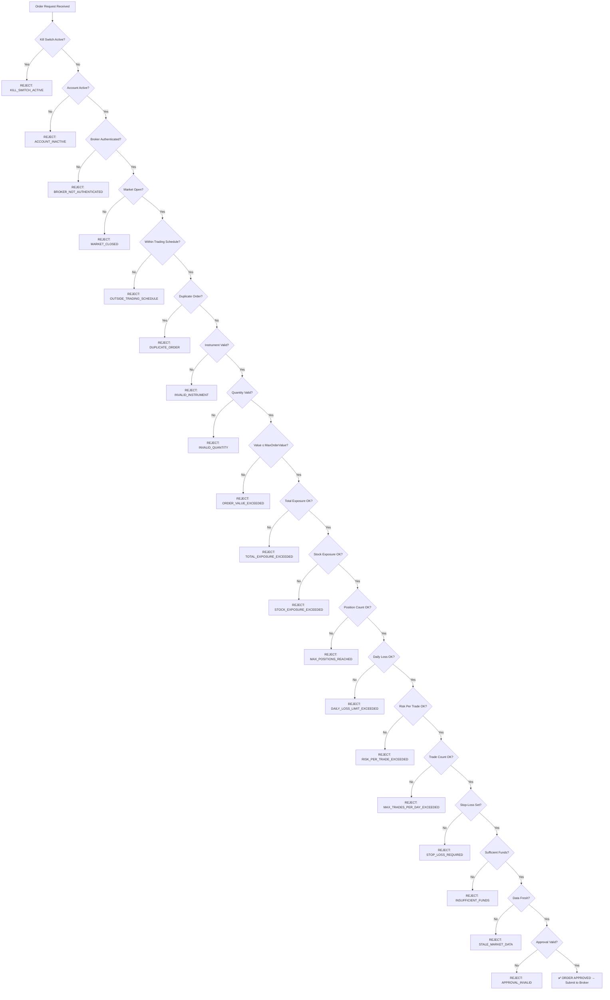

# Risk Management Engine

> **Document Version:** 1.0
> **Last Updated:** 2026-11-11
> **Status:** Production Specification

## Table of Contents

- [Overview](#overview)
- [Risk Engine Architecture](#risk-engine-architecture)
- [Configurable Risk Parameters](#configurable-risk-parameters)
- [Pre-Order Validation Checklist](#pre-order-validation-checklist)
- [Daily Loss Tracking](#daily-loss-tracking)
- [Duplicate Order Prevention](#duplicate-order-prevention)
- [Error Recovery Safety](#error-recovery-safety)
- [Risk Snapshots](#risk-snapshots)
- [Kill Switch Implementation](#kill-switch-implementation)

---

## Overview

The Risk Management Engine is the **single most critical safety component** in the trading platform.
It acts as a mandatory gate between strategy/UI-generated orders and actual broker submission.
No order — whether originating from an automated strategy, manual UI action, or API call —
reaches the broker without passing every risk check. The engine is designed to protect the
trader's capital against runaway losses, coding errors, stale data, and accidental duplicate orders.

> [!CAUTION]
> The risk engine must **never** be bypassed. There is no admin override, no debug flag, and
> no feature toggle that allows an order to skip risk validation. Any code path that attempts
> to submit an order without passing through the risk engine is a **critical security defect**.

---

## Risk Engine Architecture

### Design Principles

| Principle | Description |
|---|---|
| **Independent Layer** | The risk engine is a standalone service/module — not embedded in strategy or UI code. |
| **Non-Bypassable** | The broker submission method is `internal`; only the risk engine can invoke it. |
| **All-Or-Nothing** | All risk checks are AND conditions. A single failure rejects the entire order. |
| **Fail-Closed** | Any exception or ambiguity during risk evaluation results in order rejection. |
| **Auditable** | Every check result is logged. Every rejection includes a machine-readable reason code. |
| **Configurable** | All thresholds are per-account and modifiable at runtime without redeployment. |

### Architectural Position

```
┌──────────────────────────────────────────────────────────────────────┐
│                         Order Sources                                │
│   ┌─────────────┐   ┌─────────────┐   ┌──────────────────────────┐  │
│   │  Manual UI   │   │  Strategy   │   │  Square-Off Worker       │  │
│   │  (Approval)  │   │  Engine     │   │  (Intraday Close)        │  │
│   └──────┬───────┘   └──────┬──────┘   └────────────┬─────────────┘  │
│          │                  │                        │                │
│          └──────────────────┼────────────────────────┘                │
│                             ▼                                        │
│              ┌──────────────────────────────┐                        │
│              │     RISK MANAGEMENT ENGINE   │  ◄── All orders       │
│              │     (Pre-Order Validation)   │      must pass here   │
│              └──────────────┬───────────────┘                        │
│                             │                                        │
│                     ┌───────┴───────┐                                │
│                     │  Pass? / Fail │                                │
│                     └───────┬───────┘                                │
│                  ┌──────────┼──────────┐                             │
│                  ▼                     ▼                              │
│         ┌────────────────┐   ┌──────────────────┐                    │
│         │ Broker Gateway │   │ Rejection Logger │                    │
│         │ (Order Submit) │   │ (Audit + Alert)  │                    │
│         └────────────────┘   └──────────────────┘                    │
└──────────────────────────────────────────────────────────────────────┘
```

### Core Components

1. **`RiskEngine` Service** — Orchestrates all checks and returns a composite `RiskValidationResult`.
2. **`RiskParameterProvider`** — Loads account-specific risk configuration from `AccountConfigurations`.
3. **`PositionTracker`** — Provides current open positions, exposure, and P&L from the database.
4. **`MarketStateProvider`** — Determines if the market is open, provides last-known data timestamps.
5. **`DailyLossTracker`** — Maintains running realized + unrealized P&L per account per trading day.
6. **`DuplicateOrderDetector`** — Checks idempotency keys and existing pending/open orders.
7. **`KillSwitchMonitor`** — Reads system-level and account-level kill switch state.

### RiskValidationResult

Every risk evaluation produces a structured result:

```csharp
public class RiskValidationResult
{
    public bool IsApproved { get; init; }
    public string? RejectionReasonCode { get; init; }     // e.g., "DAILY_LOSS_LIMIT_EXCEEDED"
    public string? RejectionMessage { get; init; }         // Human-readable explanation
    public Dictionary<string, bool> CheckResults { get; init; } = new();
    public DateTime EvaluatedAtUtc { get; init; }
    public string AccountId { get; init; } = string.Empty;
    public string? OrderIdempotencyKey { get; init; }
}
```

When `IsApproved` is `false`, the `CheckResults` dictionary contains every check that was run
and whether it passed, allowing diagnostics to pinpoint exactly which rule(s) failed.

> [!IMPORTANT]
> The risk engine runs **synchronously** in the order submission pipeline. It must complete
> within milliseconds. All data it needs (positions, P&L, configuration) is either cached
> in-memory or pre-loaded at worker startup and incrementally updated. No cold database
> queries during hot-path validation.

---

## Configurable Risk Parameters

All risk parameters are stored in the `AccountConfigurations` table, keyed by `AccountId`.
They can be modified via the Admin API or the Settings UI. Changes take effect on the
next worker cycle (typically within seconds).

### Parameter Reference

| Parameter | Type | Default | Description |
|---|---|---|---|
| `MaxCapitalAllocation` | `decimal` | 100,000 | Maximum total capital the account is allowed to deploy across all positions. Orders that would push total deployed capital beyond this limit are rejected. |
| `MaxOrderValue` | `decimal` | 50,000 | Maximum value of any single order (`price × quantity`). Prevents fat-finger errors where a user accidentally enters an order 10× larger than intended. |
| `MaxPositions` | `int` | 5 | Maximum number of concurrent open positions. Once this limit is reached, only SELL orders (to close existing positions) are accepted. New BUY orders are rejected. |
| `MaxRiskPerTrade` | `decimal` | 2.0 | Maximum risk per trade as a percentage of total capital. Risk is calculated as `(entryPrice - stopLossPrice) × quantity`. If no stop-loss is set and `StopLossRequired` is false, this check uses a default risk assumption of 5%. |
| `DailyLossLimit` | `decimal` | 5,000 | Maximum combined realized + unrealized loss for the account in a single trading day. When this limit is reached, all trading is halted for that account until the next trading day. |
| `MaxExposurePerStock` | `decimal` | 30.0 | Maximum percentage of capital that can be concentrated in a single stock. Prevents over-concentration in one instrument. |
| `MaxExposureTotal` | `decimal` | 90.0 | Maximum total exposure across all positions as a percentage of capital. Keeps some capital in reserve. |
| `MaxTradesPerDay` | `int` | 20 | Maximum number of orders (buy + sell) the account can execute in a single trading day. Rate-limits hyperactive strategies or accidental order floods. |
| `StopLossRequired` | `bool` | `true` | When enabled, every BUY order must have an associated stop-loss price. Orders without a stop-loss are rejected. Strongly recommended for live trading. |
| `TradingScheduleStart` | `TimeOnly` | 09:15 | Earliest time (IST) at which orders can be submitted. Aligned with NSE/BSE market open. |
| `TradingScheduleEnd` | `TimeOnly` | 15:30 | Latest time (IST) at which new orders can be submitted. Aligned with NSE/BSE market close. |
| `IntraDaySquareOffTime` | `TimeOnly` | 15:10 | Time (IST) at which all intraday positions are force-closed. Set 20 minutes before market close to ensure execution before close. |
| `KillSwitchActive` | `bool` | `false` | When `true`, all trading is immediately halted. No orders of any kind are accepted. Existing pending orders should be cancelled. |
| `ApprovalDurationSeconds` | `int` | 2 | Duration in seconds that a pending BUY approval remains valid. The frontend shows a countdown during this window. |
| `AutoExecuteOnTimeout` | `bool` | varies | Whether to automatically execute a BUY order when the approval countdown expires without user cancellation. Default: `true` for paper trading, `false` for live trading. |

### Parameter Validation Rules

Parameters themselves are validated when saved to prevent misconfiguration:

```csharp
public class RiskParameterValidator
{
    public ValidationResult Validate(AccountRiskConfiguration config)
    {
        var errors = new List<string>();

        if (config.MaxCapitalAllocation <= 0)
            errors.Add("MaxCapitalAllocation must be positive.");

        if (config.MaxOrderValue <= 0 || config.MaxOrderValue > config.MaxCapitalAllocation)
            errors.Add("MaxOrderValue must be between 0 and MaxCapitalAllocation.");

        if (config.MaxPositions is < 1 or > 50)
            errors.Add("MaxPositions must be between 1 and 50.");

        if (config.MaxRiskPerTrade is <= 0 or > 100)
            errors.Add("MaxRiskPerTrade must be between 0% and 100%.");

        if (config.DailyLossLimit <= 0)
            errors.Add("DailyLossLimit must be positive.");

        if (config.MaxExposurePerStock is <= 0 or > 100)
            errors.Add("MaxExposurePerStock must be between 0% and 100%.");

        if (config.MaxExposureTotal is <= 0 or > 100)
            errors.Add("MaxExposureTotal must be between 0% and 100%.");

        if (config.MaxTradesPerDay is < 1 or > 500)
            errors.Add("MaxTradesPerDay must be between 1 and 500.");

        if (config.TradingScheduleStart >= config.TradingScheduleEnd)
            errors.Add("TradingScheduleStart must be before TradingScheduleEnd.");

        if (config.IntraDaySquareOffTime <= config.TradingScheduleStart
            || config.IntraDaySquareOffTime >= config.TradingScheduleEnd)
            errors.Add("IntraDaySquareOffTime must be within trading schedule.");

        if (config.ApprovalDurationSeconds is < 1 or > 30)
            errors.Add("ApprovalDurationSeconds must be between 1 and 30.");

        return errors.Count == 0
            ? ValidationResult.Success()
            : ValidationResult.Failure(errors);
    }
}
```

> [!TIP]
> When setting up a new account, start with conservative defaults and relax them only after
> observing strategy behavior in paper trading. The defaults above are intentionally cautious.

---

## Pre-Order Validation Checklist

Every order passes through the following checks **in order**. Execution is short-circuited
on the first failure (fail-fast), but for logging purposes, all checks are recorded in the
`CheckResults` dictionary.

### Check 1: Kill Switch Not Active

```
Check:   SystemConfigurations.KillSwitchActive == false
         AND AccountConfigurations.KillSwitchActive == false
Failure: KILL_SWITCH_ACTIVE
```

The system-level kill switch halts all accounts. The account-level kill switch halts only
that specific account. Both are checked. If either is active, the order is immediately rejected
without running further checks.

### Check 2: Account Active and Trading Enabled

```
Check:   Account.IsActive == true
         AND Account.TradingEnabled == true
Failure: ACCOUNT_INACTIVE or TRADING_DISABLED
```

An account can be deactivated by an admin or automatically (e.g., subscription expired).
Trading can be disabled independently from account status (e.g., during maintenance).

### Check 3: Broker Connection Authenticated

```
Check:   BrokerSession.IsAuthenticated == true
         AND BrokerSession.TokenExpiresAt > DateTime.UtcNow + buffer
Failure: BROKER_NOT_AUTHENTICATED or BROKER_TOKEN_EXPIRED
```

Verifies that the broker API session is live. The buffer (e.g., 5 minutes) prevents orders
from being submitted just as the token is about to expire.

### Check 4: Market Open

```
Check:   MarketCalendar.IsMarketOpen(instrument.Exchange, DateTime.Now)
Failure: MARKET_CLOSED
```

Checks the exchange-specific market calendar, accounting for holidays, weekends, and
special trading sessions. Uses IST (Indian Standard Time) for NSE/BSE.

### Check 5: Within Trading Schedule

```
Check:   TradingScheduleStart <= currentTimeIST <= TradingScheduleEnd
Failure: OUTSIDE_TRADING_SCHEDULE
```

Even if the market is open, the account's configured trading window may be narrower.
This allows users to restrict trading to specific hours (e.g., avoiding the volatile
first 15 minutes).

### Check 6: Not a Duplicate Order

```
Check:   No existing order with same IdempotencyKey in Pending/Submitted state
         AND duplicate-instrument-side check passes (if configured)
Failure: DUPLICATE_ORDER
```

See [Duplicate Order Prevention](#duplicate-order-prevention) for full details.

### Check 7: Instrument Valid and Active

```
Check:   Instrument exists in master data
         AND Instrument.IsActive == true
         AND Instrument is not in blocked list
Failure: INVALID_INSTRUMENT or INSTRUMENT_INACTIVE
```

Validates against the instrument master, which is refreshed daily from the broker/exchange.

### Check 8: Order Quantity Valid

```
Check:   Order.Quantity > 0
         AND Order.Quantity is a whole number (for equity)
         AND Order.Quantity <= instrument.MaxOrderQuantity (if defined)
Failure: INVALID_QUANTITY
```

### Check 9: Order Value Within Limit

```
Check:   (Order.Price * Order.Quantity) <= MaxOrderValue
         For MARKET orders: (LastTradedPrice * Order.Quantity * 1.05) <= MaxOrderValue
Failure: ORDER_VALUE_EXCEEDED
```

For MARKET orders, a 5% buffer is applied to the last traded price to account for slippage
and price movement between validation and execution.

### Check 10: Total Exposure Within Limit

```
Check:   (CurrentTotalExposure + OrderValue) / MaxCapitalAllocation * 100 <= MaxExposureTotal
Failure: TOTAL_EXPOSURE_EXCEEDED
```

CurrentTotalExposure is the sum of all open position values at their current market prices.

### Check 11: Per-Stock Exposure Within Limit

```
Check:   (CurrentExposureToStock + OrderValue) / MaxCapitalAllocation * 100 <= MaxExposurePerStock
Failure: STOCK_EXPOSURE_EXCEEDED
```

Prevents concentration risk in any single instrument.

### Check 12: Open Positions Count Within Limit

```
Check:   For new positions (buying a stock not currently held):
         CurrentOpenPositionCount < MaxPositions
Failure: MAX_POSITIONS_REACHED
```

SELL orders and orders that add to an existing position do not count against this limit.

### Check 13: Daily Loss Limit Not Exceeded

```
Check:   DailyRealizedPnL + DailyUnrealizedPnL > -(DailyLossLimit)
Failure: DAILY_LOSS_LIMIT_EXCEEDED
```

See [Daily Loss Tracking](#daily-loss-tracking) for how P&L is computed.

### Check 14: Risk Per Trade Within Limit

```
Check:   If StopLoss is set:
           riskAmount = (EntryPrice - StopLossPrice) * Quantity
           riskPercent = riskAmount / MaxCapitalAllocation * 100
           riskPercent <= MaxRiskPerTrade
         If StopLoss not set and StopLossRequired is false:
           Use assumed risk of 5% of order value
           assumedRisk <= MaxRiskPerTrade% of capital
Failure: RISK_PER_TRADE_EXCEEDED
```

### Check 15: Daily Trade Count Within Limit

```
Check:   TradesTodayCount < MaxTradesPerDay
Failure: MAX_TRADES_PER_DAY_EXCEEDED
```

Counts all orders submitted today (including cancelled and rejected ones), not just filled ones.

### Check 16: Stop-Loss Present (If Required)

```
Check:   If StopLossRequired == true AND Order.Side == BUY:
           Order.StopLossPrice != null AND Order.StopLossPrice > 0
           AND Order.StopLossPrice < Order.Price (for long positions)
Failure: STOP_LOSS_REQUIRED
```

### Check 17: Sufficient Funds Available

```
Check:   BrokerAccount.AvailableMargin >= OrderValue (for MARKET/LIMIT orders)
         OR BrokerAccount.AvailableCash >= OrderValue
Failure: INSUFFICIENT_FUNDS
```

This uses the last-known margin/cash from broker sync. For live trading, an additional
margin check is performed by the broker at order submission time.

### Check 18: Market Data Freshness

```
Check:   LastMarketDataTimestamp > (DateTime.UtcNow - StaleDataThreshold)
         StaleDataThreshold: typically 60 seconds for equity
Failure: STALE_MARKET_DATA
```

Prevents orders based on outdated prices. If the market data feed is down or delayed,
trading is halted until fresh data is available.

### Check 19: Pending Trade Approval Valid

```
Check:   PendingTradeApproval record exists for this order
         AND PendingTradeApproval.Status == Approved (or AutoApproved)
         AND PendingTradeApproval.ExpiresAt > DateTime.UtcNow
         AND PendingTradeApproval.CancelledAt == null
Failure: APPROVAL_INVALID or APPROVAL_EXPIRED or APPROVAL_CANCELLED
```

Every BUY order must go through the approval flow. The approval record links back to the
order request and has a configurable TTL (`ApprovalDurationSeconds`).

> [!WARNING]
> Never reorder or skip checks. The ordering is intentional: cheap checks (kill switch,
> account status) run first, expensive checks (broker margin query) run last. This
> minimizes latency on the most common rejection paths.

### Validation Summary Table

| # | Check | Rejection Code | Cost |
|---|---|---|---|
| 1 | Kill switch | `KILL_SWITCH_ACTIVE` | In-memory |
| 2 | Account active | `ACCOUNT_INACTIVE` | In-memory |
| 3 | Broker authenticated | `BROKER_NOT_AUTHENTICATED` | In-memory |
| 4 | Market open | `MARKET_CLOSED` | In-memory |
| 5 | Trading schedule | `OUTSIDE_TRADING_SCHEDULE` | In-memory |
| 6 | Duplicate order | `DUPLICATE_ORDER` | DB lookup |
| 7 | Instrument valid | `INVALID_INSTRUMENT` | Cached |
| 8 | Quantity valid | `INVALID_QUANTITY` | In-memory |
| 9 | Order value | `ORDER_VALUE_EXCEEDED` | In-memory |
| 10 | Total exposure | `TOTAL_EXPOSURE_EXCEEDED` | Cached |
| 11 | Stock exposure | `STOCK_EXPOSURE_EXCEEDED` | Cached |
| 12 | Position count | `MAX_POSITIONS_REACHED` | Cached |
| 13 | Daily loss | `DAILY_LOSS_LIMIT_EXCEEDED` | Cached |
| 14 | Risk per trade | `RISK_PER_TRADE_EXCEEDED` | In-memory |
| 15 | Trade count | `MAX_TRADES_PER_DAY_EXCEEDED` | Cached |
| 16 | Stop-loss present | `STOP_LOSS_REQUIRED` | In-memory |
| 17 | Sufficient funds | `INSUFFICIENT_FUNDS` | Cached/API |
| 18 | Data freshness | `STALE_MARKET_DATA` | In-memory |
| 19 | Approval valid | `APPROVAL_INVALID` | DB lookup |

---

## Daily Loss Tracking

### How P&L Is Computed

The daily loss tracker maintains a running total of profit and loss for each account
on each trading day.

```
DailyPnL = RealizedPnL + UnrealizedPnL

RealizedPnL = Sum of (SellPrice - BuyPrice) * Quantity for all closed trades today

UnrealizedPnL = Sum of (CurrentMarketPrice - EntryPrice) * Quantity for all open positions
```

### Warning and Halt Thresholds

| Threshold | Action |
|---|---|
| 80% of DailyLossLimit | **Warning**: Log warning, send notification to user via SignalR, UI shows amber alert. |
| 90% of DailyLossLimit | **Critical Warning**: Log critical, send urgent notification, UI shows red alert. Strategy may reduce position sizes. |
| 100% of DailyLossLimit | **Halt**: Set `DailyLossLimitReached = true` for the account. Reject all new BUY orders. Allow SELL orders (to close positions). Send notification. |

### Implementation Details

```csharp
public class DailyLossTracker
{
    private readonly ConcurrentDictionary<string, DailyPnLState> _accountPnL = new();

    public void UpdateRealizedPnL(string accountId, decimal pnl)
    {
        var state = _accountPnL.GetOrAdd(accountId, _ => new DailyPnLState());
        state.RealizedPnL += pnl;
        CheckThresholds(accountId, state);
    }

    public void UpdateUnrealizedPnL(string accountId, decimal unrealizedPnL)
    {
        var state = _accountPnL.GetOrAdd(accountId, _ => new DailyPnLState());
        state.UnrealizedPnL = unrealizedPnL; // Replaced, not added
        CheckThresholds(accountId, state);
    }

    public bool IsDailyLossLimitReached(string accountId)
    {
        return _accountPnL.TryGetValue(accountId, out var state)
            && state.IsHalted;
    }

    private void CheckThresholds(string accountId, DailyPnLState state)
    {
        var config = _configProvider.GetRiskConfig(accountId);
        var totalLoss = -(state.RealizedPnL + state.UnrealizedPnL);

        if (totalLoss >= config.DailyLossLimit)
        {
            state.IsHalted = true;
            _notifier.SendCritical(accountId, "Daily loss limit reached. Trading halted.");
            _logger.LogCritical("Account {AccountId} daily loss limit reached: {Loss}",
                accountId, totalLoss);
        }
        else if (totalLoss >= config.DailyLossLimit * 0.9m)
        {
            _notifier.SendUrgent(accountId, $"Daily loss at 90%: ₹{totalLoss:N2}");
        }
        else if (totalLoss >= config.DailyLossLimit * 0.8m)
        {
            _notifier.SendWarning(accountId, $"Daily loss at 80%: ₹{totalLoss:N2}");
        }
    }

    public void ResetForNewDay()
    {
        _accountPnL.Clear();
        _logger.LogInformation("Daily P&L state reset for all accounts.");
    }
}
```

### Daily Reset

The daily P&L state is reset at the start of each new trading day. The reset is triggered
by the worker's daily initialization routine, which runs before market open (typically
at 09:00 IST). The previous day's final P&L snapshot is persisted to the database before
reset for historical reporting.

---

## Duplicate Order Prevention

### Idempotency Keys

Every order request is assigned a unique idempotency key at the point of creation (UI or
strategy engine). The key is a combination of:

```
IdempotencyKey = SHA256(AccountId + InstrumentToken + Side + Quantity + Price + Timestamp_Rounded_To_Second)
```

Before submitting an order, the risk engine checks:

1. **Exact duplicate**: Is there an order with the same idempotency key in `Pending`,
   `Submitted`, or `Open` status? → Reject as `DUPLICATE_ORDER`.

2. **Logical duplicate** (configurable per account): Is there an existing `Pending` or `Open`
   BUY order for the same instrument and account? → Reject as `DUPLICATE_ORDER_SAME_INSTRUMENT`.

### Configuration

| Setting | Default | Description |
|---|---|---|
| `AllowMultipleBuysPerStock` | `false` | If `false`, only one open/pending BUY per instrument per account is allowed at a time. |
| `IdempotencyWindowSeconds` | 300 | How long idempotency keys are checked (5 minutes). Orders older than this window are not considered duplicates. |

### Why This Matters

Duplicate orders are one of the most common failure modes in trading systems. They can occur due to:

- User double-clicking the Buy button
- Strategy engine running multiple cycles before the first order is acknowledged
- Worker restarts causing re-processing of the same signal
- Network timeouts causing retries at the API layer

> [!NOTE]
> The idempotency check is performed **at the risk engine level**, not at the API level.
> This ensures that even internally-generated orders (from strategies or square-off workers)
> are protected against duplication.

---

## Error Recovery Safety

### Principle: Never Blind-Retry

The trading platform handles errors with a **conservative, verify-first** approach. When any
uncertainty exists about the state of an order, the system halts and reconciles before
taking further action.

### Scenario: Worker Restart

```
1. Worker process starts (or restarts after crash)
2. BEFORE processing any new signals or orders:
   a. Load all orders in "Submitted" or "Pending" state from database
   b. For each, query the broker API for current order status
   c. Update local state to match broker state:
      - If broker says "Executed" → mark as Filled, record trade
      - If broker says "Rejected" → mark as Rejected
      - If broker says "Not Found" → mark as Failed, flag for review
      - If broker says "Open" → leave as-is, monitor
   d. Reconcile positions: compare local position records with broker positions
   e. Log any discrepancies as CRITICAL alerts
3. Only after reconciliation is complete, resume normal operation
```

### Scenario: Network Timeout on Order Submission

```
1. Order submitted to broker API
2. HTTP request times out (no response received)
3. DO NOT retry the order submission
4. Instead:
   a. Mark order as "UNCERTAIN" in database
   b. Wait a configurable delay (e.g., 5 seconds)
   c. Query broker API for order status using the order reference
   d. If broker has the order → update state accordingly
   e. If broker does not have the order → mark as Failed, allow re-submission
   f. If broker query also times out → flag for MANUAL REVIEW
5. Send notification to user about the uncertain state
```

### Scenario: Broker API Error Response

```
1. Broker returns an error (e.g., 4xx, 5xx)
2. Log the full error (excluding any credential data)
3. Map broker error to internal rejection code:
   - "Insufficient margin" → INSUFFICIENT_FUNDS
   - "Invalid token" → BROKER_NOT_AUTHENTICATED (trigger re-auth)
   - "Order rejected by exchange" → EXCHANGE_REJECTED
   - "Rate limited" → BROKER_RATE_LIMITED (backoff and retry after delay)
4. Update order status in database
5. Notify user
6. For rate limiting: implement exponential backoff (1s, 2s, 4s, max 30s)
```

### Manual Review Queue

Orders that end up in an uncertain state are placed in a manual review queue:

```csharp
public class ManualReviewItem
{
    public string OrderId { get; init; }
    public string AccountId { get; init; }
    public string Reason { get; init; }     // "NETWORK_TIMEOUT", "STATE_MISMATCH", etc.
    public DateTime OccurredAtUtc { get; init; }
    public string? BrokerOrderRef { get; init; }
    public bool IsResolved { get; init; }
    public string? Resolution { get; init; } // "CONFIRMED_FILLED", "CONFIRMED_FAILED", etc.
    public string? ResolvedBy { get; init; }
    public DateTime? ResolvedAtUtc { get; init; }
}
```

> [!WARNING]
> Orders in the manual review queue must be resolved before the account can resume trading.
> The kill switch is automatically activated for the account when a manual review item is created.

---

## Risk Snapshots

### Purpose

Risk snapshots capture the complete risk state of an account at a point in time. They serve
as the basis for daily reports, compliance records, and post-market analysis.

### Snapshot Contents

```csharp
public class RiskSnapshot
{
    public string AccountId { get; init; }
    public DateTime SnapshotTimestampUtc { get; init; }
    public string TradingDay { get; init; }          // "2026-11-11"

    // Capital
    public decimal TotalCapital { get; init; }
    public decimal DeployedCapital { get; init; }
    public decimal AvailableCapital { get; init; }

    // Positions
    public int OpenPositionCount { get; init; }
    public decimal TotalExposurePercent { get; init; }
    public Dictionary<string, decimal> ExposureByStock { get; init; } = new();

    // P&L
    public decimal RealizedPnL { get; init; }
    public decimal UnrealizedPnL { get; init; }
    public decimal TotalPnL { get; init; }
    public decimal DailyLossLimitUsedPercent { get; init; }

    // Activity
    public int TradesExecutedToday { get; init; }
    public int OrdersRejectedToday { get; init; }
    public string? RejectionReasons { get; init; } // Most common rejection reasons

    // Risk State
    public bool IsDailyLossHalted { get; init; }
    public bool IsKillSwitchActive { get; init; }
    public string OverallRiskLevel { get; init; }  // "LOW", "MEDIUM", "HIGH", "HALTED"
}
```

### Snapshot Schedule

| Trigger | Frequency | Retention |
|---|---|---|
| Market open | Once at 09:15 IST | 90 days |
| Periodic during market | Every 15 minutes | 30 days |
| On each trade execution | Per event | 90 days |
| Market close | Once at 15:30 IST | Indefinite |
| On risk threshold breach | Per event | Indefinite |

### Risk Level Calculation

```
HALTED:  KillSwitch active OR DailyLossLimit reached
HIGH:    DailyLossUsed > 70% OR TotalExposure > 85% OR any single stock > 90% of its limit
MEDIUM:  DailyLossUsed > 40% OR TotalExposure > 60%
LOW:     All metrics within comfortable ranges
```

---

## Kill Switch Implementation

### Two-Level Kill Switch

The platform implements kill switches at two levels:

| Level | Storage | Scope | Use Case |
|---|---|---|---|
| **System** | `SystemConfigurations` table | All accounts, all strategies | Platform-wide emergency (e.g., exchange outage, critical bug discovered) |
| **Account** | `AccountConfigurations` table | Single account | Account-specific issue (e.g., runaway strategy, margin call, manual review required) |

### Activation Triggers

The kill switch can be activated by:

1. **Manual (UI)**: Admin or user clicks "Emergency Stop" button in the dashboard.
2. **API**: `POST /api/admin/kill-switch` (system) or `POST /api/accounts/{id}/kill-switch` (account).
3. **Automatic**: Triggered by the risk engine when certain conditions are met:
   - Daily loss limit reached → Account-level kill switch
   - Order in uncertain state → Account-level kill switch
   - Broker authentication failure after retries → Account-level kill switch
   - Multiple consecutive order rejections by exchange → Account-level kill switch
4. **Emergency Process**: Direct database update (last resort, for when the application is unresponsive).

### Kill Switch Behavior

When a kill switch is activated:

```
1. Immediately set KillSwitchActive = true in the appropriate table
2. Write audit log entry with timestamp, trigger reason, and who/what activated it
3. Cancel all pending/open orders for affected account(s)
4. Do NOT close existing positions (that requires separate square-off action)
5. Reject all new order requests
6. Send real-time notification via SignalR to connected clients
7. Send push notification / email alert (if configured)
8. Worker loop detects kill switch and enters "monitoring only" mode
```

> [!IMPORTANT]
> The kill switch does **not** automatically close positions. This is intentional.
> Force-closing positions during a market crash could lock in losses. The kill switch
> prevents new exposure while allowing the user to make informed decisions about
> existing positions.

### Kill Switch Deactivation

Deactivation requires:

1. The condition that triggered the kill switch must be resolved
2. Manual confirmation by the user or admin (no auto-deactivation)
3. Audit log entry recording deactivation with reason
4. If activated due to daily loss, it auto-resets at next trading day open (but still
   requires manual confirmation for live accounts)

### Audit Log Schema

```sql
CREATE TABLE kill_switch_audit_log (
    id              UUID PRIMARY KEY DEFAULT gen_random_uuid(),
    level           VARCHAR(10) NOT NULL,    -- 'SYSTEM' or 'ACCOUNT'
    account_id      UUID,                     -- NULL for system-level
    action          VARCHAR(15) NOT NULL,     -- 'ACTIVATED' or 'DEACTIVATED'
    trigger_source  VARCHAR(50) NOT NULL,     -- 'MANUAL_UI', 'API', 'RISK_ENGINE', 'EMERGENCY'
    reason          TEXT NOT NULL,
    triggered_by    VARCHAR(100),             -- User ID or 'SYSTEM'
    timestamp_utc   TIMESTAMP NOT NULL DEFAULT NOW(),
    metadata        JSONB                     -- Additional context
);

CREATE INDEX idx_ksa_account ON kill_switch_audit_log(account_id, timestamp_utc DESC);
CREATE INDEX idx_ksa_level ON kill_switch_audit_log(level, timestamp_utc DESC);
```

### Checking Kill Switch in Worker Loop

```csharp
public async Task ExecuteWorkerCycle(CancellationToken ct)
{
    // Check system-level kill switch FIRST
    if (await _killSwitchMonitor.IsSystemKillSwitchActive(ct))
    {
        _logger.LogWarning("System kill switch is active. Skipping cycle.");
        return;
    }

    foreach (var account in activeAccounts)
    {
        // Check account-level kill switch
        if (await _killSwitchMonitor.IsAccountKillSwitchActive(account.Id, ct))
        {
            _logger.LogWarning("Kill switch active for account {AccountId}. Skipping.",
                account.Id);
            continue;
        }

        // Process signals, evaluate strategies, submit orders...
        await ProcessAccountCycle(account, ct);
    }
}
```

---

## Appendix: Risk Check Flowchart



---

## Appendix: Recommended Default Configurations

### Paper Trading Account

| Parameter | Value | Rationale |
|---|---|---|
| MaxCapitalAllocation | ₹10,00,000 | Simulated capital for realistic paper testing |
| MaxOrderValue | ₹2,00,000 | Generous limit for paper trading experimentation |
| MaxPositions | 10 | Allow more positions for strategy testing |
| MaxRiskPerTrade | 3.0% | Slightly relaxed for learning |
| DailyLossLimit | ₹50,000 | 5% of capital |
| MaxExposurePerStock | 40% | Relaxed for concentrated strategy testing |
| MaxExposureTotal | 95% | Near-full deployment allowed |
| MaxTradesPerDay | 50 | High limit for strategy iteration |
| StopLossRequired | false | Flexible for experimentation |
| AutoExecuteOnTimeout | true | Auto-execute for faster paper trading |
| ApprovalDurationSeconds | 2 | Short approval window |

### Live Trading Account (Conservative)

| Parameter | Value | Rationale |
|---|---|---|
| MaxCapitalAllocation | ₹1,00,000 | Start small with real money |
| MaxOrderValue | ₹25,000 | Tight single-order cap |
| MaxPositions | 3 | Limited concurrent exposure |
| MaxRiskPerTrade | 1.5% | Conservative risk per trade |
| DailyLossLimit | ₹3,000 | 3% of capital — aggressive loss protection |
| MaxExposurePerStock | 25% | Strong diversification enforced |
| MaxExposureTotal | 75% | 25% always in reserve |
| MaxTradesPerDay | 10 | Prevent overtrading |
| StopLossRequired | true | Mandatory for every trade |
| AutoExecuteOnTimeout | false | Require explicit confirmation for real money |
| ApprovalDurationSeconds | 5 | Longer window for careful review |
