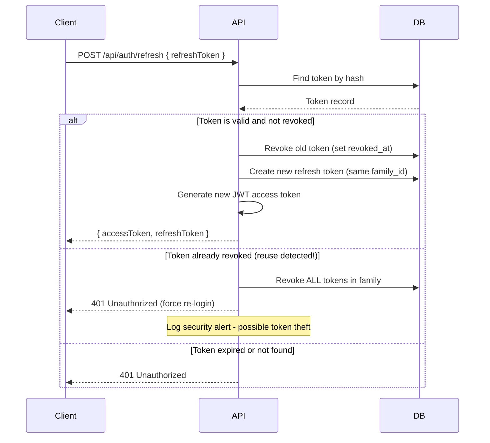

# Security Architecture

> **Document Version:** 1.0
> **Last Updated:** 2026-11-11
> **Status:** Production Specification
> **Classification:** Internal — Do Not Share Externally

## Table of Contents

- [Overview](#overview)
- [Authentication](#authentication)
- [Authorization](#authorization)
- [Broker Credential Security](#broker-credential-security)
- [API Security](#api-security)
- [Frontend Security](#frontend-security)
- [Infrastructure Security](#infrastructure-security)
- [Audit Logging](#audit-logging)
- [Data Protection](#data-protection)
- [Secrets Management](#secrets-management)
- [Dependency Security](#dependency-security)

---

## Overview

This document defines the security architecture for the Indian stock trading platform. Because
the platform handles real financial transactions, broker API credentials, and personal data,
security is not an afterthought — it is a foundational design constraint that influences every
architectural decision.

> [!CAUTION]
> Any code change that touches authentication, authorization, encryption, or broker credential
> handling **must** undergo a dedicated security review before merging. This includes changes
> to middleware, filters, EF Core query filters, and the encryption service.

### Security Principles

| Principle | Application |
|---|---|
| **Defense in Depth** | Multiple overlapping layers: authentication, authorization, input validation, encryption, network isolation. |
| **Least Privilege** | Users access only their own data. Services use minimal required permissions. |
| **Fail Closed** | Authentication/authorization failures result in access denial, never silent pass-through. |
| **No Security by Obscurity** | Security does not depend on hidden URLs, undocumented endpoints, or secret parameters. |
| **Audit Everything** | All security-relevant events are logged immutably with timestamps and actor identification. |
| **Encrypt Sensitive Data** | Broker credentials encrypted at rest. All transport over TLS. |

---

## Authentication

### JWT Access Tokens

The platform uses short-lived JWT access tokens for API authentication.

| Property | Value | Rationale |
|---|---|---|
| **Token Type** | Bearer JWT | Stateless, scalable, industry standard |
| **Lifetime** | 15 minutes | Short-lived to limit exposure window if token is compromised |
| **Signing Algorithm** | HS256 (HMAC-SHA256) | Symmetric signing suitable for single-issuer architecture |
| **Signing Key** | 256-bit key from environment variable | Never hardcoded. Rotated periodically. |
| **Issuer** | `trading-platform-api` | Validated on every request |
| **Audience** | `trading-platform-client` | Validated on every request |

#### JWT Claims

```json
{
  "sub": "user-uuid",
  "email": "user@example.com",
  "role": "User",
  "iat": 1700000000,
  "exp": 1700000900,
  "iss": "trading-platform-api",
  "aud": "trading-platform-client",
  "jti": "unique-token-id"
}
```

> [!NOTE]
> The `jti` (JWT ID) claim enables token revocation. When a user logs out or changes their
> password, their active `jti` values are added to a short-lived blacklist (Redis or in-memory
> cache with TTL matching the token lifetime).

#### Token Validation Middleware

```csharp
builder.Services.AddAuthentication(JwtBearerDefaults.AuthenticationScheme)
    .AddJwtBearer(options =>
    {
        options.TokenValidationParameters = new TokenValidationParameters
        {
            ValidateIssuer = true,
            ValidIssuer = "trading-platform-api",
            ValidateAudience = true,
            ValidAudience = "trading-platform-client",
            ValidateLifetime = true,
            ClockSkew = TimeSpan.FromSeconds(30), // Tight clock skew
            ValidateIssuerSigningKey = true,
            IssuerSigningKey = new SymmetricSecurityKey(
                Encoding.UTF8.GetBytes(configuration["Jwt:SigningKey"]!))
        };

        // Support SignalR token via query string
        options.Events = new JwtBearerEvents
        {
            OnMessageReceived = context =>
            {
                var accessToken = context.Request.Query["access_token"];
                var path = context.HttpContext.Request.Path;
                if (!string.IsNullOrEmpty(accessToken) && path.StartsWithSegments("/hubs"))
                {
                    context.Token = accessToken;
                }
                return Task.CompletedTask;
            }
        };
    });
```

### Refresh Tokens

Refresh tokens enable seamless token renewal without re-authentication.

| Property | Value |
|---|---|
| **Storage** | Database (`RefreshTokens` table) |
| **Lifetime** | 7 days |
| **Format** | Cryptographically random 256-bit value (Base64 encoded) |
| **Rotation** | Rotated on every use — old token invalidated, new token issued |
| **Revocation** | Revocable per-token or per-user (revoke all) |
| **Family Tracking** | Token family ID tracks lineage; reuse of rotated token revokes entire family |

#### Refresh Token Schema

```sql
CREATE TABLE refresh_tokens (
    id              UUID PRIMARY KEY DEFAULT gen_random_uuid(),
    user_id         UUID NOT NULL REFERENCES users(id) ON DELETE CASCADE,
    token_hash      VARCHAR(128) NOT NULL UNIQUE,  -- SHA256 hash, never store plaintext
    family_id       UUID NOT NULL,                  -- Token rotation family
    expires_at      TIMESTAMP NOT NULL,
    created_at      TIMESTAMP NOT NULL DEFAULT NOW(),
    revoked_at      TIMESTAMP,
    replaced_by_id  UUID REFERENCES refresh_tokens(id),
    created_by_ip   INET,
    user_agent      TEXT
);

CREATE INDEX idx_rt_user ON refresh_tokens(user_id);
CREATE INDEX idx_rt_token ON refresh_tokens(token_hash);
CREATE INDEX idx_rt_family ON refresh_tokens(family_id);
```

#### Token Rotation Flow



> [!WARNING]
> Refresh token reuse detection is critical. If a revoked refresh token is presented, it
> indicates that either the token was stolen or there is a replay attack in progress.
> The entire token family must be revoked, forcing the user to re-authenticate.

### Password Security

| Aspect | Implementation |
|---|---|
| **Hashing Algorithm** | bcrypt with work factor 12 (or Argon2id if available) |
| **Minimum Length** | 8 characters |
| **Complexity** | At least one uppercase, one lowercase, one digit |
| **Common Password Check** | Reject top 10,000 most common passwords |
| **Storage** | Only the hash is stored; plaintext is never persisted or logged |

```csharp
public class PasswordHasher
{
    private const int WorkFactor = 12;

    public string Hash(string password)
    {
        return BCrypt.Net.BCrypt.HashPassword(password, WorkFactor);
    }

    public bool Verify(string password, string hash)
    {
        return BCrypt.Net.BCrypt.Verify(password, hash);
    }
}
```

### Account Lockout

| Parameter | Value |
|---|---|
| Max failed attempts | 5 consecutive |
| Lockout duration | 15 minutes |
| Reset on success | Yes — counter resets after successful login |
| Notification | Email sent on lockout |

```csharp
public async Task<LoginResult> LoginAsync(string email, string password)
{
    var user = await _db.Users.FirstOrDefaultAsync(u => u.Email == email);

    if (user == null)
        return LoginResult.Failed("Invalid credentials."); // Generic message

    if (user.LockoutEndUtc > DateTime.UtcNow)
        return LoginResult.LockedOut(user.LockoutEndUtc.Value);

    if (!_passwordHasher.Verify(password, user.PasswordHash))
    {
        user.FailedLoginAttempts++;
        if (user.FailedLoginAttempts >= MaxFailedAttempts)
        {
            user.LockoutEndUtc = DateTime.UtcNow.AddMinutes(LockoutDurationMinutes);
            await _auditLogger.LogAsync("ACCOUNT_LOCKED", user.Id,
                $"Account locked after {MaxFailedAttempts} failed attempts.");
            // Send lockout notification email
        }
        await _db.SaveChangesAsync();
        return LoginResult.Failed("Invalid credentials."); // Same generic message
    }

    // Success
    user.FailedLoginAttempts = 0;
    user.LockoutEndUtc = null;
    user.LastLoginUtc = DateTime.UtcNow;
    await _db.SaveChangesAsync();

    var accessToken = _tokenService.GenerateAccessToken(user);
    var refreshToken = await _tokenService.GenerateRefreshToken(user);

    await _auditLogger.LogAsync("LOGIN_SUCCESS", user.Id);
    return LoginResult.Success(accessToken, refreshToken);
}
```

> [!IMPORTANT]
> Always return the same generic error message ("Invalid credentials") for both invalid
> email and invalid password. This prevents user enumeration attacks.

### Future: Multi-Factor Authentication (MFA)

MFA is planned for a future release. The design will support:

- TOTP (Time-based One-Time Password) via authenticator apps (Google Authenticator, Authy)
- Optional per-user enrollment
- Backup codes for recovery
- Required for high-risk actions (e.g., changing broker credentials, withdrawals)

---

## Authorization

### Role-Based Access Control

The platform implements two roles:

| Role | Permissions |
|---|---|
| **Admin** | Full access to all endpoints, all users' data, system configuration, kill switch management, user management |
| **User** | Access to own accounts, own trades, own configurations. No access to other users' data or system-level settings. |

#### Endpoint Authorization Matrix

| Endpoint Category | Admin | User | Notes |
|---|---|---|---|
| `GET /api/accounts` | All accounts | Own accounts only | Filtered by EF Core global query filter |
| `POST /api/orders` | Any account | Own accounts only | |
| `GET /api/trades` | All trades | Own trades only | |
| `PUT /api/configurations` | System + any account | Own account only | |
| `POST /api/admin/kill-switch` | ✅ | ❌ | System-level kill switch |
| `GET /api/admin/users` | ✅ | ❌ | User management |
| `POST /api/auth/register` | ✅ | ❌ | Only admin can create users (in current design) |

### Resource-Based Authorization

Beyond role checks, every data access is filtered by ownership:

```csharp
// EF Core Global Query Filter — applied automatically to ALL queries
protected override void OnModelCreating(ModelBuilder modelBuilder)
{
    // Get current user ID from HttpContext
    modelBuilder.Entity<Account>()
        .HasQueryFilter(a => a.UserId == _currentUserService.UserId || _currentUserService.IsAdmin);

    modelBuilder.Entity<Trade>()
        .HasQueryFilter(t => t.Account.UserId == _currentUserService.UserId || _currentUserService.IsAdmin);

    modelBuilder.Entity<Order>()
        .HasQueryFilter(o => o.Account.UserId == _currentUserService.UserId || _currentUserService.IsAdmin);

    modelBuilder.Entity<AccountConfiguration>()
        .HasQueryFilter(c => c.Account.UserId == _currentUserService.UserId || _currentUserService.IsAdmin);
}
```

> [!CAUTION]
> The global query filter is the **primary tenant isolation mechanism**. If it is accidentally
> removed or bypassed (e.g., using `IgnoreQueryFilters()`), it creates a critical data leak
> vulnerability. Any use of `IgnoreQueryFilters()` must be explicitly justified and reviewed.

### API Authorization Attributes

Every controller endpoint must have an explicit authorization attribute:

```csharp
[ApiController]
[Route("api/[controller]")]
[Authorize] // Base: requires authentication
public class AccountsController : ControllerBase
{
    [HttpGet]
    [Authorize(Roles = "User,Admin")]
    public async Task<IActionResult> GetAccounts() { ... }

    [HttpPost("{accountId}/kill-switch")]
    [Authorize(Roles = "Admin")]
    public async Task<IActionResult> ActivateKillSwitch(Guid accountId) { ... }
}
```

---

## Broker Credential Security

Broker API credentials (API key, API secret, access token, request token) are the most
sensitive data in the system. A compromised broker credential could allow unauthorized
trading on the user's real brokerage account.

### Encryption at Rest

| Aspect | Implementation |
|---|---|
| **Algorithm** | AES-256-GCM (authenticated encryption with associated data) |
| **Key Size** | 256 bits |
| **IV/Nonce** | 96-bit random nonce, unique per encryption operation |
| **Authentication Tag** | 128-bit tag appended to ciphertext |
| **Key Storage** | Environment variable `BROKER_ENCRYPTION_KEY` or key vault |
| **Key Location** | NEVER in database, NEVER in source code, NEVER in config files committed to git |

#### Encryption Service

```csharp
public class AesGcmEncryptionService : IEncryptionService
{
    private readonly byte[] _key;

    public AesGcmEncryptionService(IConfiguration configuration)
    {
        var keyBase64 = configuration["Security:EncryptionKey"]
            ?? throw new InvalidOperationException(
                "BROKER_ENCRYPTION_KEY environment variable is not set.");
        _key = Convert.FromBase64String(keyBase64);

        if (_key.Length != 32) // 256 bits
            throw new InvalidOperationException("Encryption key must be 256 bits.");
    }

    public string Encrypt(string plaintext)
    {
        var plaintextBytes = Encoding.UTF8.GetBytes(plaintext);
        var nonce = new byte[AesGcm.NonceByteSizes.MaxSize]; // 12 bytes
        RandomNumberGenerator.Fill(nonce);

        var ciphertext = new byte[plaintextBytes.Length];
        var tag = new byte[AesGcm.TagByteSizes.MaxSize]; // 16 bytes

        using var aesGcm = new AesGcm(_key, tag.Length);
        aesGcm.Encrypt(nonce, plaintextBytes, ciphertext, tag);

        // Concatenate: nonce + ciphertext + tag → Base64
        var result = new byte[nonce.Length + ciphertext.Length + tag.Length];
        nonce.CopyTo(result, 0);
        ciphertext.CopyTo(result, nonce.Length);
        tag.CopyTo(result, nonce.Length + ciphertext.Length);

        return Convert.ToBase64String(result);
    }

    public string Decrypt(string encryptedBase64)
    {
        var data = Convert.FromBase64String(encryptedBase64);

        var nonce = data[..12];
        var tag = data[^16..];
        var ciphertext = data[12..^16];

        var plaintext = new byte[ciphertext.Length];

        using var aesGcm = new AesGcm(_key, tag.Length);
        aesGcm.Decrypt(nonce, ciphertext, tag, plaintext);

        return Encoding.UTF8.GetString(plaintext);
    }
}
```

### Credential Handling Rules

| Rule | Enforcement |
|---|---|
| Never log credentials | Custom log sanitizer strips known credential field names |
| Never in error messages | Exception handlers sanitize before returning to client |
| Never sent to frontend | API responses exclude encrypted fields; frontend never sees raw broker keys |
| Decrypted only in memory | Decryption happens only in `BrokerService` immediately before API call |
| Zeroed after use | Plaintext byte arrays are cleared after use (defense in depth) |
| Not in URL parameters | Credentials are always in request body or headers, never in query strings |

### Key Rotation Procedure

When the encryption key needs to be rotated (periodically or after suspected compromise):

```
1. Generate a new 256-bit encryption key:
   $ openssl rand -base64 32

2. Set both old and new keys in environment:
   BROKER_ENCRYPTION_KEY=<new-key>
   BROKER_ENCRYPTION_KEY_OLD=<old-key>

3. Run the key rotation migration:
   - Read all encrypted credentials with old key
   - Re-encrypt with new key
   - Update database records
   - Verify decryption with new key works for all records

4. Remove old key from environment:
   unset BROKER_ENCRYPTION_KEY_OLD

5. Restart application

6. Audit log the rotation event (without key values)
```

> [!WARNING]
> Key rotation must be performed during non-trading hours. If the rotation fails midway,
> the old key must remain available to decrypt any records not yet re-encrypted.

---

## API Security

### HTTPS and Transport Security

```csharp
// Program.cs
if (!app.Environment.IsDevelopment())
{
    app.UseHsts(); // HTTP Strict Transport Security
}
app.UseHttpsRedirection();
```

HSTS header configuration:

```
Strict-Transport-Security: max-age=31536000; includeSubDomains; preload
```

### CORS Configuration

```csharp
builder.Services.AddCors(options =>
{
    options.AddPolicy("ProductionPolicy", policy =>
    {
        policy.WithOrigins(
                builder.Configuration["Cors:AllowedOrigin"]
                    ?? throw new InvalidOperationException("CORS origin not configured"))
            .AllowAnyHeader()
            .AllowAnyMethod()
            .AllowCredentials(); // Required for SignalR
    });
});
```

> [!IMPORTANT]
> Never use `AllowAnyOrigin()` in production. The allowed origin must be the exact
> frontend domain (e.g., `https://trading.yourdomain.com`).

### Rate Limiting

```csharp
builder.Services.AddRateLimiter(options =>
{
    // Global rate limit
    options.GlobalLimiter = PartitionedRateLimiter.Create<HttpContext, string>(context =>
        RateLimitPartition.GetFixedWindowLimiter(
            partitionKey: context.User?.FindFirst(ClaimTypes.NameIdentifier)?.Value
                          ?? context.Connection.RemoteIpAddress?.ToString()
                          ?? "anonymous",
            factory: _ => new FixedWindowRateLimiterOptions
            {
                PermitLimit = 100,
                Window = TimeSpan.FromMinutes(1),
                QueueLimit = 0
            }));

    // Stricter limit for authentication endpoints
    options.AddPolicy("AuthLimit", context =>
        RateLimitPartition.GetFixedWindowLimiter(
            partitionKey: context.Connection.RemoteIpAddress?.ToString() ?? "unknown",
            factory: _ => new FixedWindowRateLimiterOptions
            {
                PermitLimit = 10,
                Window = TimeSpan.FromMinutes(5),
                QueueLimit = 0
            }));

    // Stricter limit for order submission
    options.AddPolicy("OrderLimit", context =>
        RateLimitPartition.GetFixedWindowLimiter(
            partitionKey: context.User?.FindFirst(ClaimTypes.NameIdentifier)?.Value ?? "unknown",
            factory: _ => new FixedWindowRateLimiterOptions
            {
                PermitLimit = 30,
                Window = TimeSpan.FromMinutes(1),
                QueueLimit = 0
            }));

    options.RejectionStatusCode = StatusCodes.Status429TooManyRequests;
});
```

### Request Validation

All incoming requests are validated using FluentValidation:

```csharp
public class CreateOrderRequestValidator : AbstractValidator<CreateOrderRequest>
{
    public CreateOrderRequestValidator()
    {
        RuleFor(x => x.AccountId).NotEmpty();
        RuleFor(x => x.InstrumentToken).NotEmpty().MaximumLength(50);
        RuleFor(x => x.Side).IsInEnum();
        RuleFor(x => x.Quantity).GreaterThan(0).LessThanOrEqualTo(10000);
        RuleFor(x => x.Price).GreaterThan(0).When(x => x.OrderType == OrderType.Limit);
        RuleFor(x => x.StopLossPrice).GreaterThan(0)
            .LessThan(x => x.Price)
            .When(x => x.StopLossPrice.HasValue);
    }
}
```

### Security Headers

```csharp
app.Use(async (context, next) =>
{
    var headers = context.Response.Headers;
    headers["X-Content-Type-Options"] = "nosniff";
    headers["X-Frame-Options"] = "DENY";
    headers["X-XSS-Protection"] = "0"; // Modern approach: rely on CSP instead
    headers["Referrer-Policy"] = "strict-origin-when-cross-origin";
    headers["Permissions-Policy"] = "camera=(), microphone=(), geolocation=()";
    headers["Content-Security-Policy"] =
        "default-src 'self'; " +
        "script-src 'self'; " +
        "style-src 'self' 'unsafe-inline'; " +  // Required for some UI frameworks
        "img-src 'self' data:; " +
        "connect-src 'self' wss:; " +             // WebSocket for SignalR
        "frame-ancestors 'none';";

    await next();
});
```

### Input Sanitization

All string inputs are sanitized before processing:

- HTML tags are stripped (prevents stored XSS)
- SQL injection is prevented by using parameterized queries (EF Core default)
- Path traversal characters are rejected in file-related inputs
- Maximum string lengths are enforced at the validation layer

---

## Frontend Security

### Token Storage Strategy

| Option | Security | UX | Recommendation |
|---|---|---|---|
| **httpOnly Secure Cookie** | Best (immune to XSS) | Requires CSRF protection | ✅ Preferred for production |
| **In-Memory (JS variable)** | Good (lost on refresh) | Poor (re-login on every tab) | Good for high-security |
| **Secure localStorage** | Moderate (XSS risk) | Best (persists across tabs) | Acceptable with strong CSP |

The recommended approach is **httpOnly secure cookies** for the refresh token and
**in-memory storage** for the short-lived access token:

```
Refresh Token → httpOnly, Secure, SameSite=Strict cookie
Access Token  → In-memory JavaScript variable (lost on page refresh)
```

On page load, the frontend calls `/api/auth/refresh` using the cookie to obtain a
fresh access token. This provides the best balance of security and usability.

### Frontend Security Checklist

| Check | Implementation |
|---|---|
| No sensitive data in localStorage | Access tokens in memory only; refresh tokens in httpOnly cookies |
| No sensitive data in browser cache | `Cache-Control: no-store` on API responses with sensitive data |
| CSP headers enforced | Server sets Content-Security-Policy header on all responses |
| User input sanitized | All user inputs sanitized before rendering (React auto-escapes by default) |
| No `dangerouslySetInnerHTML` | Code review rule: never use without explicit security review |
| API calls use HTTPS only | Base URL configured with `https://` protocol |
| Error messages don't leak internals | Generic error messages to user; detailed errors only in server logs |
| Auto-logout on inactivity | Frontend timer triggers logout after 30 minutes of inactivity |

---

## Infrastructure Security

### Network Architecture

```
┌──────────────────────────────────────────────────────────────┐
│                        Internet                               │
│                           │                                   │
│                     ┌─────┴─────┐                             │
│                     │ Firewall  │                             │
│                     │ 80, 443   │                             │
│                     └─────┬─────┘                             │
│                           │                                   │
│              ┌────────────┴────────────┐                      │
│              │    Reverse Proxy        │                      │
│              │    (Nginx / Caddy)      │                      │
│              │    TLS Termination      │                      │
│              └────────────┬────────────┘                      │
│                           │ (internal network)                │
│          ┌────────────────┼────────────────┐                  │
│          │                │                │                   │
│   ┌──────┴──────┐  ┌─────┴──────┐  ┌─────┴──────┐           │
│   │  .NET API   │  │  React SPA │  │  Worker    │           │
│   │  Container  │  │  (static)  │  │  Container │           │
│   └──────┬──────┘  └────────────┘  └─────┬──────┘           │
│          │                                │                   │
│          └────────────┬───────────────────┘                   │
│                       │                                       │
│              ┌────────┴────────┐                              │
│              │   PostgreSQL    │                              │
│              │   (internal     │                              │
│              │    network only)│                              │
│              └─────────────────┘                              │
└──────────────────────────────────────────────────────────────┘
```

### Infrastructure Hardening Checklist

| Area | Requirement | Status |
|---|---|---|
| **PostgreSQL** | Not exposed on public interface. Listens on Docker internal network only. | Required |
| **PostgreSQL** | Strong password, not the default `postgres` user for the application. | Required |
| **PostgreSQL** | Separate DB user for the application with minimal permissions (no SUPERUSER). | Required |
| **Git Repository** | `.gitignore` includes `.env`, `appsettings.*.json` with secrets, `*.key`. | Required |
| **Git Repository** | No secrets ever committed to git history. Run `git-secrets` or similar scanning. | Required |
| **Docker** | Containers run as non-root user. | Required |
| **Docker** | Use specific image tags, not `latest`. | Required |
| **Docker** | Secrets passed via Docker secrets or environment variables, not build args. | Required |
| **VPS/Server** | SSH key-only authentication. Password login disabled. | Required |
| **VPS/Server** | SSH on non-standard port (optional additional hardening). | Recommended |
| **VPS/Server** | Firewall (ufw/iptables): only ports 80, 443, and SSH open. | Required |
| **VPS/Server** | Automatic security updates enabled (`unattended-upgrades`). | Required |
| **TLS** | TLS 1.2+ only. TLS 1.0 and 1.1 disabled. | Required |
| **TLS** | Certificate auto-renewal (Let's Encrypt + certbot or Caddy auto-HTTPS). | Required |
| **Backups** | Database backups encrypted at rest. | Required |
| **Backups** | Backup restoration tested periodically. | Required |

---

## Audit Logging

### Events That Must Be Logged

Every security-relevant action produces an immutable audit log entry:

#### Authentication Events

| Event | Data Captured |
|---|---|
| `LOGIN_SUCCESS` | User ID, IP address, user agent, timestamp |
| `LOGIN_FAILED` | Attempted email (hashed), IP address, failure reason |
| `ACCOUNT_LOCKED` | User ID, attempt count, lockout duration |
| `LOGOUT` | User ID, token revoked |
| `TOKEN_REFRESHED` | User ID, old token family, new token ID |
| `TOKEN_REUSE_DETECTED` | User ID, family ID, IP address (security alert) |
| `PASSWORD_CHANGED` | User ID (never log old or new password) |

#### Trading Events

| Event | Data Captured |
|---|---|
| `ORDER_SUBMITTED` | Order ID, account ID, instrument, side, quantity, price |
| `ORDER_APPROVED` | Order ID, approval ID, approval method (manual/auto) |
| `ORDER_REJECTED` | Order ID, rejection reason code, risk check details |
| `ORDER_CANCELLED` | Order ID, cancelled by (user/system), reason |
| `TRADE_EXECUTED` | Trade ID, order ID, fill price, fill quantity |
| `POSITION_OPENED` | Position ID, instrument, entry price, quantity |
| `POSITION_CLOSED` | Position ID, exit price, realized P&L |
| `SQUARE_OFF_TRIGGERED` | Account ID, positions affected, trigger reason |

#### Configuration Events

| Event | Data Captured |
|---|---|
| `CONFIG_CHANGED` | Config key, old value, new value, changed by user ID |
| `RISK_PARAM_UPDATED` | Account ID, parameter name, old value, new value |
| `KILL_SWITCH_ACTIVATED` | Level (system/account), trigger source, reason |
| `KILL_SWITCH_DEACTIVATED` | Level, deactivated by, reason |
| `BROKER_CREDENTIALS_UPDATED` | Account ID, updated by (never log credential values) |

#### Admin Events

| Event | Data Captured |
|---|---|
| `USER_CREATED` | New user ID, created by admin ID |
| `USER_DEACTIVATED` | User ID, deactivated by, reason |
| `ADMIN_ROLE_ASSIGNED` | Target user ID, assigned by |

### Audit Log Schema

```sql
CREATE TABLE audit_logs (
    id              UUID PRIMARY KEY DEFAULT gen_random_uuid(),
    event_type      VARCHAR(50) NOT NULL,
    user_id         UUID,
    account_id      UUID,
    ip_address      INET,
    user_agent      TEXT,
    details         JSONB NOT NULL,
    severity        VARCHAR(10) NOT NULL DEFAULT 'INFO',  -- INFO, WARNING, CRITICAL
    timestamp_utc   TIMESTAMP NOT NULL DEFAULT NOW()
);

-- Indexes for common queries
CREATE INDEX idx_audit_user ON audit_logs(user_id, timestamp_utc DESC);
CREATE INDEX idx_audit_type ON audit_logs(event_type, timestamp_utc DESC);
CREATE INDEX idx_audit_account ON audit_logs(account_id, timestamp_utc DESC);
CREATE INDEX idx_audit_severity ON audit_logs(severity, timestamp_utc DESC)
    WHERE severity IN ('WARNING', 'CRITICAL');
```

> [!IMPORTANT]
> The audit log table must be **append-only**. No `UPDATE` or `DELETE` operations are
> permitted on this table. The application database user should have only `INSERT` and
> `SELECT` permissions on `audit_logs`. This ensures immutability of the audit trail.

### Audit Logger Service

```csharp
public class AuditLogger : IAuditLogger
{
    private readonly AppDbContext _db;
    private readonly ICurrentUserService _currentUser;
    private readonly IHttpContextAccessor _httpContext;

    public async Task LogAsync(
        string eventType,
        Guid? userId = null,
        string? details = null,
        string severity = "INFO",
        Guid? accountId = null)
    {
        var entry = new AuditLog
        {
            EventType = eventType,
            UserId = userId ?? _currentUser.UserId,
            AccountId = accountId,
            IpAddress = _httpContext.HttpContext?.Connection.RemoteIpAddress?.ToString(),
            UserAgent = _httpContext.HttpContext?.Request.Headers.UserAgent.ToString(),
            Details = JsonSerializer.SerializeToDocument(new { message = details }),
            Severity = severity,
            TimestampUtc = DateTime.UtcNow
        };

        _db.AuditLogs.Add(entry);
        await _db.SaveChangesAsync();
    }
}
```

---

## Data Protection

### Tenant Isolation

All user data is isolated using EF Core global query filters (see [Authorization](#authorization)).
This ensures that a user can never access another user's:

- Accounts and account configurations
- Orders, trades, and positions
- Broker credentials
- Audit logs (except their own)
- Risk snapshots and P&L data

### Personal Data Protection

| Data Type | Protection |
|---|---|
| Email | Stored in plaintext (needed for login). Filtered by query filters. |
| Phone number | Stored in plaintext (future: for notifications). Filtered by query filters. |
| Password | bcrypt hash only. Plaintext never stored. |
| Broker API key | AES-256-GCM encrypted at rest. |
| Broker API secret | AES-256-GCM encrypted at rest. |
| Broker access token | AES-256-GCM encrypted at rest. |
| IP addresses | Logged in audit logs for security monitoring. |

### Data Deletion Capability

For future GDPR / data-protection compliance, the platform supports account deletion:

```
1. User requests account deletion via API or support
2. Admin confirms deletion request
3. System executes:
   a. Close all open positions (if any) — requires manual confirmation
   b. Revoke all refresh tokens
   c. Delete or anonymize:
      - Personal data (email, phone → anonymized hash)
      - Broker credentials (deleted)
      - Account configurations (deleted)
   d. Retain (anonymized) for regulatory compliance:
      - Trade history (anonymized user reference)
      - Audit logs (anonymized user reference)
   e. Mark user record as deleted
4. Audit log the deletion event
```

### Backup Encryption

- Database backups are encrypted using `gpg` or `age` before off-site storage
- Backup encryption key is stored separately from backup files
- Backup restoration is tested monthly
- Backup retention: 30 days for daily backups, 12 months for monthly backups

---

## Secrets Management

### Environment-Specific Strategies

| Environment | Strategy | Details |
|---|---|---|
| **Development** | `.env` files + `dotnet user-secrets` | `.env` file in project root (gitignored). User secrets for per-developer overrides. |
| **CI/CD** | Pipeline secrets | GitHub Actions secrets or GitLab CI variables. Never printed in logs. |
| **Staging** | Docker environment variables | Passed via `docker-compose.override.yml` (gitignored) or Docker secrets. |
| **Production** | Docker secrets + environment variables | Sensitive values as Docker secrets (mounted as files). Less sensitive as env vars. Optional vault integration. |

### Required Secrets Inventory

| Secret | Where Used | Rotation Frequency |
|---|---|---|
| `JWT_SIGNING_KEY` | API authentication | Every 6 months |
| `BROKER_ENCRYPTION_KEY` | Broker credential encryption | Every 12 months or on compromise |
| `DATABASE_CONNECTION_STRING` | PostgreSQL access | On password change |
| `POSTGRES_PASSWORD` | Database root password | Every 6 months |
| `CORS_ALLOWED_ORIGIN` | API CORS policy | On domain change |

### Rules for Secret Handling

```
✅ DO:
  - Store secrets in environment variables or secret managers
  - Use .env files for local development (and .gitignore them)
  - Use `dotnet user-secrets` for per-developer overrides
  - Rotate secrets on a regular schedule
  - Audit access to secret stores
  - Use separate secrets for each environment

❌ DON'T:
  - Hardcode secrets in source code
  - Commit secrets to git (even in "private" repos)
  - Log secrets (even at DEBUG level)
  - Pass secrets via URL query parameters
  - Share secrets via chat/email (use a secret manager)
  - Use the same secret across environments
```

### .gitignore Requirements

```gitignore
# Secrets and environment
.env
.env.*
!.env.example
appsettings.Development.json
appsettings.Production.json
*.key
*.pem
*.pfx

# User secrets
secrets.json
```

> [!TIP]
> Create a `.env.example` file with placeholder values (never real secrets) and commit it
> to git. This serves as documentation for required environment variables without exposing
> actual values.

---

## Dependency Security

### NuGet Package Management

#### Version Pinning

Pin exact versions for security-critical packages in `.csproj`:

```xml
<PackageReference Include="Microsoft.AspNetCore.Authentication.JwtBearer" Version="8.0.11" />
<PackageReference Include="BCrypt.Net-Next" Version="4.0.3" />
<PackageReference Include="Npgsql.EntityFrameworkCore.PostgreSQL" Version="8.0.11" />
<PackageReference Include="FluentValidation.AspNetCore" Version="11.3.0" />
```

#### Vulnerability Scanning

```bash
# Check for known vulnerabilities in NuGet packages
dotnet list package --vulnerable --include-transitive

# Output example:
# > Npgsql 8.0.1 has a known vulnerability (CVE-2024-XXXX)
#   Severity: High
#   Advisory: https://github.com/advisories/...
#   Fix: Update to >= 8.0.2
```

Run this check:
- On every CI/CD pipeline build
- Weekly as a scheduled pipeline job
- Before every production deployment

### npm Package Management

#### Version Pinning

Use `package-lock.json` and pin versions for security-critical frontend packages:

```json
{
  "dependencies": {
    "react": "18.2.0",
    "axios": "1.6.5",
    "@microsoft/signalr": "8.0.0"
  }
}
```

#### Vulnerability Scanning

```bash
# Check for known vulnerabilities in npm packages
npm audit

# Fix automatically where possible
npm audit fix

# Generate a detailed report
npm audit --json > audit-report.json
```

### Update Procedure

```
1. Review: Check for updates monthly
   - dotnet list package --outdated
   - npm outdated

2. Assess: For each update, evaluate:
   - Is it a security fix? (prioritize)
   - Is it a breaking change? (test thoroughly)
   - Is it a major version bump? (review changelog)

3. Test: Update in development first
   - Run full test suite
   - Test critical flows manually (login, order, trade)
   - Verify no regressions

4. Stage: Deploy to staging for 24-48 hours
   - Monitor for errors
   - Verify integrations (broker API, WebSocket)

5. Deploy: Roll out to production
   - During non-trading hours
   - With rollback plan ready

6. Document: Record what was updated and why
   - Update dependency audit log
   - Note any configuration changes required
```

### Prohibited Packages

The following categories of packages must never be used:

| Category | Reason |
|---|---|
| Packages with known unpatched CVEs | Direct security risk |
| Packages with no maintenance (>2 years no updates) | Likely to have undiscovered vulnerabilities |
| Packages that require disabling security features | Undermines security posture |
| Packages that phone home or collect telemetry without consent | Data privacy risk |
| Packages with overly permissive licenses for commercial use | Legal risk |

---

## Appendix: Security Review Checklist

Use this checklist for every PR that touches security-sensitive code:

```markdown
### Security Review Checklist

- [ ] No secrets or credentials in code, comments, or test fixtures
- [ ] All new endpoints have explicit `[Authorize]` attributes
- [ ] EF Core global query filters are not bypassed without justification
- [ ] User input is validated (FluentValidation or data annotations)
- [ ] Error responses do not leak internal details (stack traces, SQL, file paths)
- [ ] Broker credentials are never logged, even at DEBUG level
- [ ] New database queries use parameterized inputs (no string concatenation)
- [ ] Audit logging added for new security-relevant actions
- [ ] Rate limiting applied to new public endpoints
- [ ] CORS policy not relaxed
- [ ] No new `AllowAnonymous` without explicit justification
- [ ] Dependencies checked for known vulnerabilities
- [ ] Encryption used correctly (proper IV/nonce, authenticated encryption)
```
