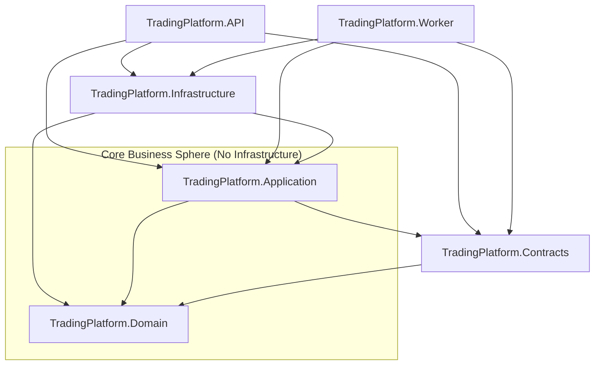
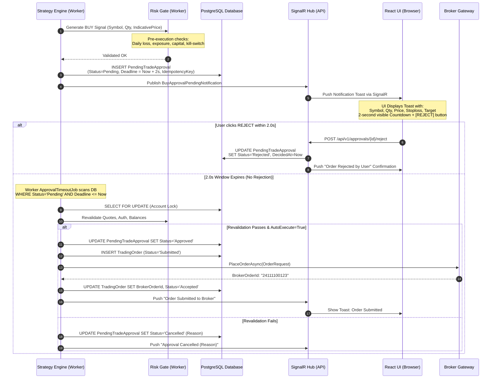

# System Architecture — Production-Ready Broker-Independent Trading Platform

> **Document ID**: DOC-002  
> **Version**: 1.0  
> **Last Updated**: 2026-11-11  
> **Author**: Principal Software Architect  
> **Status**: Ready for Review  

---

## Table of Contents

- [1. Architectural Vision & Style](#1-architectural-vision--style)
- [2. System Context & High-Level Architecture](#2-system-context--high-level-architecture)
- [3. Complete Solution Structure](#3-complete-solution-structure)
- [4. Layer Responsibilities & Project Decomposition](#4-layer-responsibilities--project-decomposition)
- [5. Dependency Flow & Clean Architecture Rules](#5-dependency-flow--clean-architecture-rules)
- [6. Key Architectural Patterns](#6-key-architectural-patterns)
- [7. Communication Patterns & Protocols](#7-communication-patterns--protocols)
- [8. Component Interaction & Core Workflows](#8-component-interaction--core-workflows)
- [9. Cross-Cutting Concerns](#9-cross-cutting-concerns)
- [10. Data Architecture & Persistence Topology](#10-data-architecture--persistence-topology)
- [11. Extensibility & Future Scaling Path](#11-extensibility--future-scaling-path)
- [12. Architecture Verification & Quality Attributes](#12-architecture-verification--quality-attributes)

---

## 1. Architectural Vision & Style

### 1.1 Architectural Pattern: Modular Monolith with Decoupled Background Worker

The platform is designed as a **Modular Monolith** with a dedicated, separately deployed **Background Processing Worker Service**.

```
+-----------------------------------------------------------------------------+
|                                MODULAR MONOLITH                              |
|                                                                             |
|  +---------------------------+        +----------------------------------+  |
|  |   TradingPlatform.API     |        |      TradingPlatform.Worker      |  |
|  |  (Web API, SignalR Hubs,  |        |    (Strategy Engine, Quartz,     |  |
|  |   Auth, Tenant Context)   |        |   Reconciliation, Market Feed)   |  |
|  +-------------+-------------+        +-----------------+----------------+  |
|                |                                        |                   |
|                +-------------------+--------------------+                   |
|                                    v                                        |
|                     +-----------------------------+                         |
|                     | TradingPlatform.Application |                         |
|                     | (Use Cases, CQRS, Interfaces|                         |
|                     |   Risk Engine, Orchestration|                         |
|                     +--------------+--------------+                         |
|                                    |                                        |
|                                    v                                        |
|                     +-----------------------------+                         |
|                     |   TradingPlatform.Domain    |                         |
|                     |  (Entities, Value Objects,  |                         |
|                     |   Domain Events, Invariants)|                         |
|                     +--------------+--------------+                         |
|                                    ^                                        |
|                +-------------------+--------------------+                   |
|                |                                        |                   |
|  +-------------+---------------+       +----------------+----------------+  |
|  | TradingPlatform.Infrastructure|     |    TradingPlatform.Contracts    |  |
|  | (EF Core, Broker Adapters,   |     |   (Shared DTOs, Event Models,   |  |
|  |  Security, Email, WhatsApp)  |     |      Serialization Types)       |  |
|  +-----------------------------+       +---------------------------------+  |
+-----------------------------------------------------------------------------+
```

### 1.2 Justification: Why Not Microservices Initially?

| Architectural Dimension | Microservices Overhead | Modular Monolith Advantage |
|---|---|---|
| **Deployment Complexity** | Multi-container orchestration (K8s/Nomad), service meshes, distributed ingress | Simple Docker Compose on Ubuntu VPS; 4 cohesive containers total |
| **Transaction Boundaries** | Distributed transactions (Saga/2PC), eventual consistency bugs, orphan orders | ACID database transactions via PostgreSQL for order state and approvals |
| **Network Latency** | Inter-service HTTP/gRPC hops (10–50 ms overhead per step) | In-process method calls (sub-microsecond), critical for risk evaluation |
| **Failure Modes** | Network partitions, cascading timeouts, partial state split-brains | Single process memory space per component with localized recovery loops |
| **Operational Cost** | Heavy RAM footprint (500 MB+ per microservice), requiring costly clusters | Runs efficiently within 4–8 GB RAM on modest hardware/VPS |
| **Team Cognitive Load** | Context switching across dozens of repos/pipelines | Single solution, single Git repository, unified CI/CD, shared contracts |

### 1.3 Future Extraction Path (Evolutionary Architecture)

Because all modules strictly communicate through interfaces defined in `TradingPlatform.Application` and contracts in `TradingPlatform.Contracts`, any internal boundary can be extracted into an independent microservice in the future if scale warrants:

1. **Market Data Service**: Can be split out if tick ingestion volume saturates worker CPU.
2. **Notification Service**: Can be offloaded to an AWS Lambda / Azure Function queue worker.
3. **Execution Gateway**: Can be containerized separately for multi-region deployment.

---

## 2. System Context & High-Level Architecture

```mermaid
flowchart TB
    subgraph Clients["Clients Layer"]
        Browser["Desktop & Mobile Web (PWA)"]
        MobileApp["Future Mobile App (React Native)"]
    end

    subgraph Edge["Edge & Security Layer"]
        Cloudflare["Cloudflare DNS & WAF"]
        HostNginx["Host Nginx Reverse Proxy (SSL / Let's Encrypt)"]
    end

    subgraph AppHost["Application Host (Docker Network)"]
        subgraph WebContainer["trading-frontend"]
            NginxFE["Nginx Static Host (Vite SPA)"]
        end

        subgraph ApiContainer["trading-api"]
            WebApi["ASP.NET Core 10 Web API"]
            SignalR["SignalR Real-time Hub"]
        end

        subgraph WorkerContainer["trading-worker"]
            WorkerHost[".NET 10 Worker Host"]
            Quartz["Quartz.NET Scheduler"]
            StrategyEngine["Strategy Evaluation Engine"]
            RiskEngine["Independent Risk Gate"]
            Reconciler["Order State Reconciler"]
        end

        subgraph DbContainer["trading-db"]
            Postgres[("PostgreSQL 17 (Timescale/Partitioned)")]
        end
    end

    subgraph External["External Ecosystem"]
        Upstox["Upstox API v2 & WebSocket"]
        Zerodha["Zerodha Kite Connect & Ticker"]
        WhatsAppAPI["Meta WhatsApp Cloud API"]
        SmtpRelay["SMTP / SendGrid Email Gateway"]
        AiProvider["Advisory AI (OpenAI / Claude / Gemini)"]
    end

    Browser --> Cloudflare
    MobileApp --> Cloudflare
    Cloudflare --> HostNginx
    HostNginx -->|/api/*| WebApi
    HostNginx -->|/hubs/* (WebSocket)| SignalR
    HostNginx -->|/* (Static)| NginxFE

    WebApi --> Postgres
    WebApi -.->|Real-time Events| SignalR
    SignalR --> Browser

    WorkerHost --> Postgres
    WorkerHost --> Upstox
    WorkerHost --> Zerodha
    WorkerHost --> WhatsAppAPI
    WorkerHost --> SmtpRelay
    WorkerHost --> AiProvider
```

---

## 3. Complete Solution Structure

```
TradingPlatform/
├── .editorconfig
├── .gitignore
├── Directory.Build.props                     # Global SDK, net10.0, Nullable, WarningsAsErrors
├── TradingPlatform.sln
│
├── src/
│   ├── TradingPlatform.Domain/               # Pure Domain Layer
│   │   ├── Common/                           # BaseEntity, ValueObject, IDomainEvent, AggregateRoot
│   │   ├── Entities/                         # User, BrokerConnection, TradingAccount, Position...
│   │   ├── Enums/                            # OrderStatus, OrderType, SignalType, BrokerCode...
│   │   ├── Events/                           # OrderCreatedEvent, OrderFilledEvent, BuySignalRaisedEvent...
│   │   ├── Exceptions/                       # DomainException, RiskViolationException...
│   │   └── ValueObjects/                     # Money, Symbol, Quantity, Price, TimeWindow...
│   │
│   ├── TradingPlatform.Application/          # Use Cases & Interfaces
│   │   ├── Common/                           # ICurrentUserService, IDateTimeProvider, Result<T>
│   │   ├── Interfaces/
│   │   │   ├── Adapters/                     # IBrokerAdapter, IBrokerAuthentication, IMarketDataProvider...
│   │   │   ├── Persistence/                  # ITradingDbContext, IRepository<T>
│   │   │   ├── Risk/                         # IRiskEvaluationEngine, IRiskRule
│   │   │   ├── Security/                     # ICredentialEncryptionService, ITokenService
│   │   │   ├── Services/                     # INotificationService, IEmailSender, IWhatsAppClient
│   │   │   └── Strategy/                     # ITradingStrategy, IIndicatorCalculator
│   │   ├── Features/                         # Vertical Slices (Commands / Queries)
│   │   │   ├── Accounts/                     # ConfigureAccount, GetAccounts, ToggleTradingMode
│   │   │   ├── Approvals/                    # CreateBuyApproval, RejectBuyApproval, ProcessApprovalTimeout
│   │   │   ├── Auth/                         # RegisterUser, LoginUser, RefreshToken, RevokeToken
│   │   │   ├── Brokers/                      # ConnectBroker, HandleOAuthCallback, DisconnectBroker
│   │   │   ├── Orders/                       # PlaceOrder, CancelOrder, GetOrderHistory
│   │   │   ├── Positions/                    # GetOpenPositions, ClosePosition
│   │   │   ├── Reports/                      # GenerateDailyReport, ExportTradeHistory
│   │   │   └── Strategies/                   # CreateStrategy, UpdateStrategyVersion, PauseStrategy
│   │   ├── Pipeline/                         # MediatR Behaviors (Validation, Logging, Performance)
│   │   └── Validators/                       # FluentValidation rule classes
│   │
│   ├── TradingPlatform.Infrastructure/       # External Implementations
│   │   ├── Adapters/
│   │   │   ├── BrokerFactory.cs              # Resolves adapter per BrokerConnection
│   │   │   ├── Mock/                         # MockBrokerAdapter for paper trading & CI
│   │   │   ├── Upstox/                       # UpstoxAdapter, UpstoxAuth, UpstoxMarketData...
│   │   │   └── Zerodha/                      # ZerodhaAdapter, ZerodhaAuth, ZerodhaMarketData...
│   │   ├── BackgroundJobs/                   # Quartz Job Definitions
│   │   ├── AI/                               # Pluggable AI Advisory Clients (Advisory Only)
│   │   ├── Notifications/                    # SmtpEmailService, WhatsAppCloudService
│   │   ├── Persistence/
│   │   │   ├── Configurations/               # EF Core IEntityTypeConfiguration classes
│   │   │   ├── Interceptors/                 # AuditInterceptor, TenantIsolationInterceptor
│   │   │   ├── Migrations/                   # EF Core Code-First Migrations
│   │   │   └── TradingDbContext.cs           # Main EF Core context
│   │   └── Security/                         # Aes256GcmCredentialEncryptor, JwtTokenService
│   │
│   ├── TradingPlatform.API/                  # ASP.NET Core Web Host
│   │   ├── Controllers/                      # REST API Endpoints
│   │   ├── Hubs/                             # SignalR NotificationHub
│   │   ├── Middleware/                       # ExceptionHandler, TenantScope, SecurityHeaders
│   │   ├── Services/                         # CurrentUserService, SignalRNotificationPublisher
│   │   ├── appsettings.json
│   │   ├── appsettings.Development.json
│   │   └── Program.cs                        # Minimal API bootstrapping & DI wireup
│   │
│   ├── TradingPlatform.Worker/               # .NET 10 Worker Host
│   │   ├── BackgroundServices/               # MarketDataStreamerService, HeartbeatWorker
│   │   ├── Jobs/                             # Quartz Jobs: StrategyRunJob, ApprovalTimeoutJob, SquareOffJob
│   │   ├── Listeners/                        # OrderExecutionEventListener
│   │   ├── appsettings.json
│   │   └── Program.cs                        # Worker Host initialization & DI
│   │
│   ├── TradingPlatform.Contracts/            # Shared DTOs & Events
│   │   ├── Dtos/                             # OrderDto, PositionDto, QuoteDto, AccountBalanceDto
│   │   ├── Events/                           # BuyApprovalPendingEvent, SellExecutedEvent
│   │   └── Requests/                         # PlaceOrderRequest, RejectApprovalRequest
│   │
│   ├── TradingPlatform.Tests/                # Unit Tests
│   │   ├── Application/                      # Use case & command handler tests
│   │   ├── Domain/                           # Entity invariants, Money & calculation tests
│   │   ├── Indicators/                       # EMA, VWAP, RSI, MACD calculation verification
│   │   ├── Risk/                             # Independent risk gate boundary checks
│   │   └── Strategy/                         # Strategy signal logic tests
│   │
│   └── TradingPlatform.IntegrationTests/     # Integration & E2E Tests
│       ├── Fixtures/                         # Testcontainers PostgreSQL, WebApplicationFactory
│       ├── Api/                              # End-to-end API tests with JWT
│       ├── Database/                         # Migration and query filter verification
│       └── Workflow/                         # 2-second BUY rejection simulated end-to-end
│
├── frontend/
│   └── trading-platform-web/                 # React 19+ TypeScript Vite App
│       ├── public/                           # Manifest, service worker, icons
│       ├── src/
│       │   ├── api/                          # Axios API clients, typed endpoints
│       │   ├── components/                   # Reusable UI widgets (cards, countdown, buttons)
│       │   ├── context/                      # AuthContext, NotificationContext, SignalRContext
│       │   ├── hooks/                        # useCountdownTimer, useOrders, usePositions
│       │   ├── layouts/                      # Responsive Shell, Mobile Nav, Sidebar
│       │   ├── pages/                        # Dashboard, Approvals, Orders, Positions, Settings
│       │   ├── types/                        # TypeScript models matching Contracts
│       │   └── App.tsx
│       ├── index.html
│       ├── package.json
│       ├── tsconfig.json
│       └── vite.config.ts
│
├── deployment/
│   ├── compose/
│   │   ├── docker-compose.yml                # Production Compose configuration
│   │   └── docker-compose.dev.yml            # Local development (Postgres only or full stack)
│   ├── nginx/
│   │   ├── host-nginx.conf                   # Host reverse proxy & SSL termination
│   │   └── frontend-nginx.conf               # Containerized static asset server
│   └── scripts/
│       ├── backup-db.sh                      # Encrypted DB backup script
│       ├── restore-db.sh                     # Disaster recovery script
│       └── deploy.sh                         # VPS zero-downtime rolling deployment
│
└── docs/                                     # Complete Architectural Documentation
```

---

## 4. Layer Responsibilities & Project Decomposition

### 4.1 `TradingPlatform.Domain` (Core Business Rules)
- **Zero Third-Party Invasiveness**: Relies only on .NET 10 BCL. No Entity Framework, no ASP.NET, no broker SDKs.
- **Aggregates & Entities**: `User`, `BrokerConnection`, `TradingAccount`, `PendingTradeApproval`, `TradingOrder`, `Position`, `StrategyDefinition`, `StrategyVersion`.
- **Value Objects**: Enforces immutable business values (`Money`, `Price`, `Quantity`, `Symbol`, `Percentage`). Prevents primitive obsession.
- **Domain Events**: Dispatches business events (`OrderSubmittedEvent`, `TradeExecutedEvent`, `RiskLimitExceededEvent`).
- **Invariants**: E.g., An order cannot transition from `Filled` to `Submitted`; Quantity must always be strictly positive.

### 4.2 `TradingPlatform.Application` (Orchestration & Use Cases)
- **Use Case Handlers**: Coordinates domain models, database queries, and external contracts.
- **Port Interfaces**:
  - `IBrokerAdapter` & `IBrokerAdapterFactory`
  - `IMarketDataProvider`, `IOrderExecutionService`, `IFundsProvider`, `IPositionProvider`
  - `IRiskEvaluationEngine`
  - `INotificationService`, `IEmailSender`, `IWhatsAppClient`
  - `ITradingDbContext`
- **Request Validation**: FluentValidation validators for all input DTOs.
- **Execution Orchestration**: Houses the 2-second BUY approval workflow state machine and timeout processor.

### 4.3 `TradingPlatform.Infrastructure` (Adapters & Technical Plumbing)
- **PostgreSQL & EF Core**: Configures fluent mappings, temporal tracking, global query filters for multi-tenant isolation, and database connection pooling.
- **Broker Integrations**:
  - `UpstoxAdapter`: Implements OAuth2 PKCE, v2 REST client, Protobuf WebSocket streamer.
  - `ZerodhaAdapter`: Implements Kite Connect session handshake, order placing, Kite Ticker binary WebSocket parser.
  - `MockBrokerAdapter`: High-fidelity paper trading engine with simulated fills, slippage, and latency.
- **Security Services**: `Aes256GcmCredentialEncryptor` for encrypting broker API keys and tokens before writing to disk.
- **External Communications**: Smtp / SendGrid transactional email and official Meta WhatsApp Cloud API client.
- **Advisory AI**: Pluggable clients providing corporate announcement sentiment summaries.

### 4.4 `TradingPlatform.API` (HTTP & Real-Time Gateway)
- **Authentication**: JWT validation with automatic refresh token rotation.
- **SignalR Hubs**: `NotificationHub` broadcasting instant buy approval toasts, order fills, and system alerts to authenticated user streams.
- **API Controllers**: Restful endpoints for UI interaction.
- **Middlewares**: Correlation ID tracking, global exception-to-RFC7807 problem details converter, rate limiting, and security headers.

### 4.5 `TradingPlatform.Worker` (Continuous Execution Engine)
- **Quartz.NET Schedulers**:
  - `StrategyRunJob`: Evaluates active trading strategies at configured candle close intervals.
  - `ApprovalTimeoutJob`: Monitors pending BUY approvals, triggers order submission if 2-second timer elapsed without user rejection.
  - `PositionMonitorJob`: Constantly checks stoploss / take-profit conditions against live quotes.
  - `IntradaySquareOffJob`: Enforces mandatory 3:15 PM IST market exit for all MIS positions.
  - `OrderReconciliationJob`: Reconciles internal state against broker order books after restarts or timeouts.
- **Market Data Streamers**: Persistent WebSocket worker that funnels ticks into candle aggregators.

---

## 5. Dependency Flow & Clean Architecture Rules



### Architectural Rules Enforced in CI:
1. **Rule 1**: `Domain` project has **0 dependencies** outside of the .NET Core base library.
2. **Rule 2**: `Application` depends **only** on `Domain` and `Contracts`. It never references `Infrastructure`, `API`, or external broker libraries.
3. **Rule 3**: `Infrastructure` implements interfaces defined in `Application`. Application code calls `IBrokerAdapter`, never `UpstoxAdapter` directly.
4. **Rule 4**: Neither `API` nor `Worker` contain domain trading logic. They serve as hosting shells configuring dependency injection.

---

## 6. Key Architectural Patterns

| Pattern | Platform Application | Benefit |
|---|---|---|
| **Adapter Pattern** | `IBrokerAdapter` wrapping Upstox, Zerodha, and Mock engines | Complete broker independence; switching or adding brokers requires zero core changes |
| **Strategy Pattern** | `ITradingStrategy` (Intraday Breakout, Swing EMA/RSI) | Strategies are modular, configuration-driven, and testable in isolation |
| **State Machine** | `TradingOrder` lifecycle (`Created` -> `PendingApproval` -> `Submitted` -> `Filled`) | Prevents invalid state jumps, eliminates duplicate execution, ensures auditability |
| **Outbox / Event Pattern** | Durable database event tables for domain state changes | Guarantees SignalR notifications and external webhooks are not lost on failure |
| **Idempotency Key Pattern** | UUID assigned at BUY signal creation; propagated to broker headers | Immune to network retries, double submits, and race conditions |
| **Circuit Breaker & Retry** | Polly policies configured on external broker HTTP calls | Gracefully handles broker outages, rate limits, and network blips |
| **Global Query Filters** | EF Core `HasQueryFilter(e => e.UserId == _currentUser.Id)` | Guaranteed tenant isolation at the ORM layer; cross-user data leakage impossible |

---

## 7. Communication Patterns & Protocols

```
+-------------------+      HTTPS / REST (JWT)       +-------------------+
|                   | ----------------------------> |                   |
|   React Web SPA   |                               |   ASP.NET API     |
|   (Client)        | <---------------------------- |   (Gateway)       |
|                   |      WSS / SignalR (Events)   |                   |
+-------------------+                               +---------+---------+
                                                              |
                                                   Shared DB  | Transactional
                                                   (Locks &   | State
                                                   Entities)  v
+-------------------+                               +-------------------+
|  Broker REST API  | <---------------------------- |                   |
|  (Upstox/Zerodha) |       HTTPS (Polly Retry)     |   .NET Worker     |
+-------------------+                               |   (Engine)        |
+-------------------+                               |                   |
|  Broker WebSocket | ----------------------------> |                   |
|  (Tick Streaming) |       Binary / Protobuf       +-------------------+
+-------------------+
```

1. **Client -> API**: RESTful JSON over HTTPS. Authenticated via short-lived JWT Bearer tokens.
2. **API -> Client**: Real-time push over WebSockets using SignalR. Channels are user-scoped (`Clients.User(userId).SendAsync(...)`).
3. **API <-> Worker**: Coordinated via PostgreSQL ACID transactions, optimistic concurrency row versions, and distributed account locks.
4. **Worker -> Brokers**:
   - Outbound REST over HTTPS protected by Polly resilience pipelines.
   - Inbound continuous market data over persistent broker WebSockets.

---

## 8. Component Interaction & Core Workflows

### 8.1 2-Second BUY Signal Approval Workflow



---

## 9. Cross-Cutting Concerns

### 9.1 Multi-Tenant Data Isolation
Tenant isolation is enforced universally:
1. Every user-owned entity implements `IMustHaveTenant` (`Guid UserId { get; set; }`).
2. EF Core `TradingDbContext` automatically applies query filters:
   ```csharp
   modelBuilder.Entity<TradingOrder>().HasQueryFilter(e => e.UserId == _currentUserService.UserId);
   ```
3. During save operations, an EF Core interceptor automatically stamps `UserId` from the ambient security context, preventing spoofing.

### 9.2 Structured Logging & Observability
- **Serilog** configured across API and Worker with JSON output formatting:
  - Context properties: `UserId`, `TradingAccountId`, `BrokerCode`, `CorrelationId`, `OrderId`.
- **Sensitive Masking**: Custom Serilog destructuring policy strips out `ApiKey`, `ApiSecret`, `AccessToken`, and `PasswordHash`.

### 9.3 Credential Encryption at Rest
- All broker API credentials and OAuth tokens stored in `BrokerConnections` are encrypted with **AES-256-GCM** using authenticated encryption.
- Key material is sourced exclusively from the environment variable `APP_ENCRYPTION_MASTER_KEY` and is never persisted to database tables.

---

## 10. Data Architecture & Persistence Topology

```
+--------------------------------------------------------------------------+
|                        PostgreSQL 17 Database                            |
|                                                                          |
|  +------------------------+  +------------------------+                  |
|  |     Users / Roles      |  |   BrokerConnections    |                  |
|  |     (Auth & Tenant)    |  |  (Encrypted Creds)     |                  |
|  +-----------+------------+  +-----------+------------+                  |
|              |                           |                               |
|              +-------------+-------------+                               |
|                            v                                             |
|              +------------------------+                                  |
|              |     TradingAccounts    |                                  |
|              | (Funds, Isolation, Mode|                                  |
|              +-------------+----------+                                  |
|                            |                                             |
|        +-------------------+-------------------+                         |
|        |                   |                   |                         |
|        v                   v                   v                         |
|  +------------+      +------------+      +------------+                  |
|  | Strategies |      |   Orders   |      | Positions  |                  |
|  | & Versions |      | & Approvals|      | (Live P&L) |                  |
|  +------------+      +-----+------+      +------------+                  |
|                            |                                             |
|                            v                                             |
|                      +------------+                                      |
|                      |   Audit &  |  <-- Partitioned by Month            |
|                      | OrderEvents|      (Append-Only Immutable Logs)    |
|                      +------------+                                      |
+--------------------------------------------------------------------------+
```

---

## 11. Extensibility & Future Scaling Path

```
Phase 1: Current Topology             Phase 2: Multi-User / Distributed Scale
(Single VPS, Docker Compose)          (High-Volume Trading Cluster)

[ Nginx + Let's Encrypt ]             [ Cloudflare CDN & Load Balancer ]
          |                                            |
[ API Container ]                     +----------------+----------------+
          |                           |                                 |
[ Worker Container ]                  v                                 v
          |                   [ API Replica 1 ]                 [ API Replica 2 ]
[ PostgreSQL 17 ]                             \                 /
                                               [ Redis Backplane ]
                                                       |
                                      +----------------+----------------+
                                      |                                 |
                                      v                                 v
                              [ Worker Partition A ]          [ Worker Partition B ]
                              (Accounts 001 - 500)            (Accounts 501 - 1000)
                                      |                                 |
                                      +----------------+----------------+
                                                       |
                                              [ PostgreSQL Cluster ]
                                              (Primary + Read Replicas)
```

---

## 12. Architecture Verification & Quality Attributes

| Quality Attribute | Architectural Provision | Verification Strategy |
|---|---|---|
| **Reliability** | Durable pending approval records; idempotent order keys | Worker crash simulation test during 2-second pending window |
| **Safety** | Independent risk engine executing directly prior to broker call | Unit test suite verifying all 19 pre-order checks |
| **Account Isolation** | Never pooling funds; EF Core global filters; independent broker adapters | Multi-tenant integration tests attempting cross-account access |
| **Observability** | Structured Serilog with correlation IDs; heartbeat tables | Synthetic health check endpoint `/health` validating DB and broker status |
| **Maintainability** | Clean architecture; dependency inversion; zero broker leak in domain | Roslyn architecture test rules asserting zero forbidden dependencies |

---

*End of Architecture Document. Refer to [Database Design](DATABASE_DESIGN.md) and [Trading Workflow](TRADING_WORKFLOW.md) for detailed sub-specifications.*
