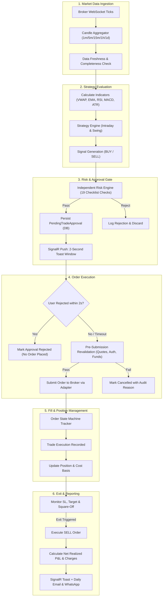
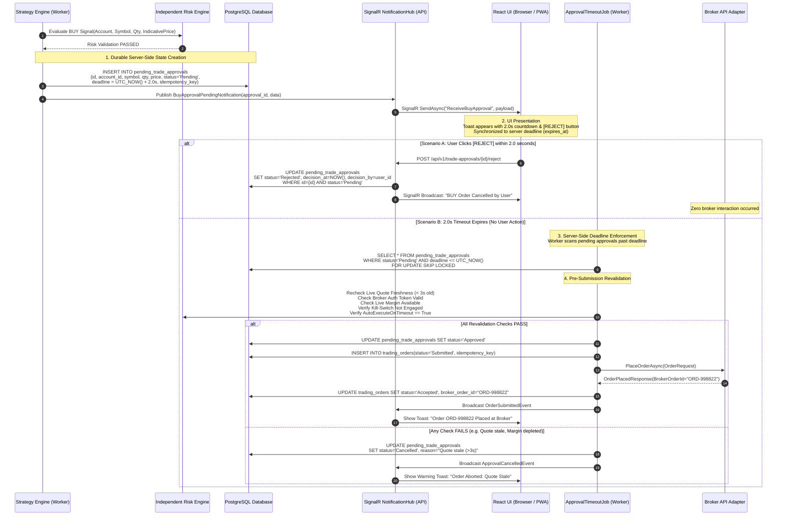
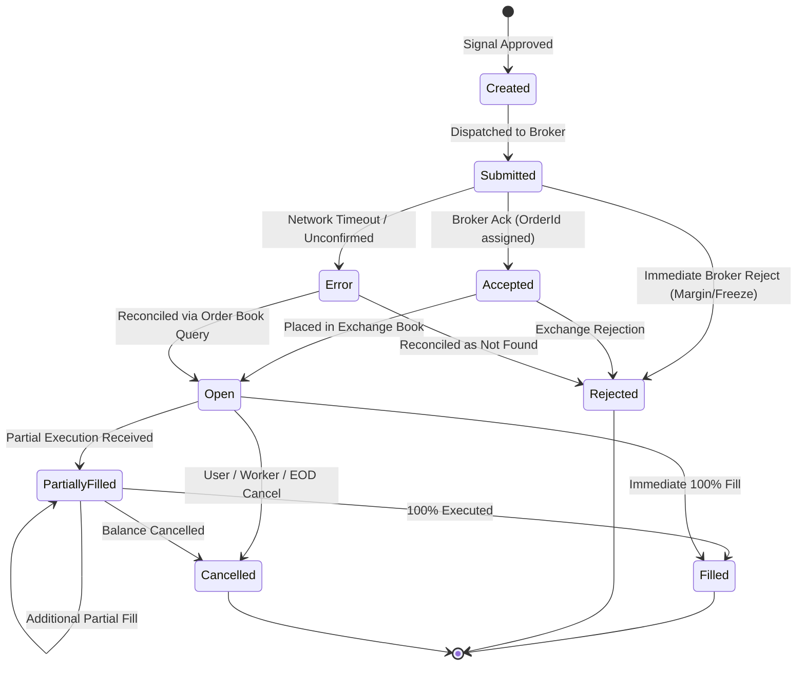
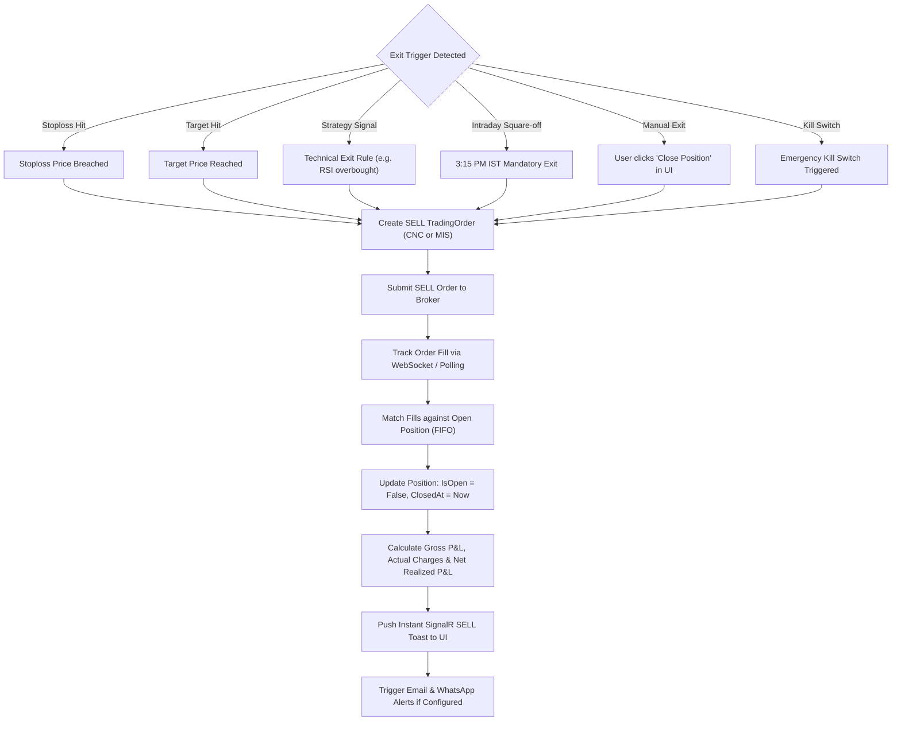
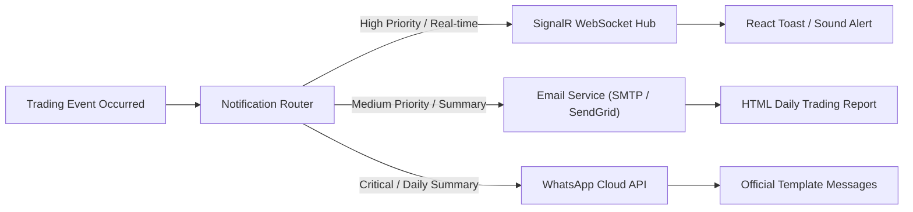

# Trading Workflow & Order Execution Engine

> **Document ID**: DOC-005  
> **Version**: 1.0  
> **Last Updated**: 2026-11-11  
> **Author**: Principal Software Architect  
> **Status**: Ready for Review  

---

## Table of Contents

- [1. End-to-End Trading Lifecycle Overview](#1-end-to-end-trading-lifecycle-overview)
- [2. The 2-Second BUY Rejection Workflow (Critical Path)](#2-the-2-second-buy-rejection-workflow-critical-path)
- [3. Order State Machine & Lifecycle Transitions](#3-order-state-machine--lifecycle-transitions)
- [4. SELL & Position Exit Workflow](#4-sell--position-exit-workflow)
- [5. P&L Calculation Engine & Indian Market Costs](#5-pl-calculation-engine--indian-market-costs)
- [6. Multi-Channel Notification Flow](#6-multi-channel-notification-flow)
- [7. Mandatory Intraday Square-Off (MIS)](#7-mandatory-intraday-square-off-mis)
- [8. Paper Trading Simulation Mechanics](#8-paper-trading-simulation-mechanics)
- [9. Kill Switch Mechanisms](#9-kill-switch-mechanisms)
- [10. Worker Processing Loop & Restart Recovery](#10-worker-processing-loop--restart-recovery)

---

## 1. End-to-End Trading Lifecycle Overview



---

## 2. The 2-Second BUY Rejection Workflow (Critical Path)

The 2-second user rejection window is a primary safety requirement of the platform. It provides an immediate human-in-the-loop veto before any automated BUY order enters the broker's matching engine, without indefinitely blocking the background worker.

### 2.1 Complete Architectural Sequence



### 2.2 Critical Invariants of the Rejection Window
1. **Server-Side Deadline Enforcement**: The countdown is governed strictly by the PostgreSQL `deadline` timestamp, never by a client-side JavaScript `setTimeout`. If the browser disconnects, the worker executes or expires the order precisely on schedule.
2. **Persistent Approvals Screen**: If the toast disappears or the user navigates away, active approvals remain visible and rejectable in the **Pending Approvals** dashboard view until the deadline passes.
3. **Idempotency Guarantee**: Every approval carries a unique UUID `IdempotencyKey`. Duplicate worker passes or network retries cannot produce duplicate broker orders.
4. **Execution Policy Guard**: Live accounts have `AutoExecuteOnTimeout = false` by default. Live orders will **never** auto-execute upon timeout unless the user explicitly enables that configuration with multi-step confirmation.

---

## 3. Order State Machine & Lifecycle Transitions



### 3.1 Order State Transition Table

| Current State | Target State | Triggering Condition | Required Action |
|---|---|---|---|
| `Created` | `Submitted` | HTTP POST sent to broker API endpoint | Assign outbound idempotency header |
| `Submitted` | `Accepted` | Broker returns HTTP 200 with `order_id` | Record `BrokerOrderId`, emit `OrderAcceptedEvent` |
| `Submitted` | `Rejected` | Broker returns HTTP 4xx/5xx or validation error | Set `StatusMessage`, emit `OrderRejectedNotification` |
| `Submitted` | `Error` | Network timeout / connection reset before response | Flag for immediate broker order book reconciliation |
| `Accepted` | `Open` | Broker WebSocket sends order status `OPEN` | Position watch registered |
| `Open` | `PartiallyFilled`| Broker sends fill update for `qty < total_qty` | Record partial execution, update average price |
| `Open` / `PartiallyFilled` | `Filled` | Total filled qty matches requested qty | Create/update `Position`, calculate entry cost basis |
| `Open` | `Cancelled` | Cancel request acknowledged by exchange | Release allocated reserved margin |

---

## 4. SELL & Position Exit Workflow

Positions are liquidated automatically or manually through a structured SELL workflow.



### 4.1 SELL Notification Schema (Instant SignalR Toast)

Whenever a SELL order is filled, the UI receives a rich payload:

```json
{
  "type": "SELL_EXECUTION",
  "data": {
    "symbol": "INFY",
    "companyName": "Infosys Limited",
    "brokerCode": "UPSTOX",
    "accountName": "Primary Upstox",
    "quantity": 50,
    "averageBuyPrice": 1820.50,
    "averageSellPrice": 1856.90,
    "grossPnL": 1820.00,
    "charges": {
      "brokerage": 40.00,
      "stt": 46.42,
      "exchangeCharges": 3.45,
      "gst": 7.82,
      "sebiFees": 0.09,
      "stampDuty": 0.00,
      "totalCharges": 97.78
    },
    "netPnL": 1722.22,
    "returnPercentage": 1.89,
    "exitReason": "TARGET_REACHED",
    "holdingDuration": "2h 45m",
    "strategyName": "Intraday Breakout v1.2"
  }
}
```

---

## 5. P&L Calculation Engine & Indian Market Costs

### 5.1 Realized vs. Unrealized P&L Formulas

$$\text{Unrealized Gross P&L} = (\text{Current Market Price} - \text{Average Buy Price}) \times \text{Open Quantity}$$

$$\text{Realized Gross P&L} = \sum_{i=1}^{n} (\text{Sell Price}_i - \text{Matched Buy Price}_i) \times \text{Quantity}_i$$

$$\text{Net Realized P&L} = \text{Realized Gross P&L} - \text{Total Regulatory \& Brokerage Charges}$$

### 5.2 Indian Equity Trading Cost Structure (NSE/BSE)

| Cost Component | Intraday (MIS) Equity | Delivery (CNC) Equity | Calculation Base |
|---|---|---|---|
| **Brokerage** | ₹20 per executed order or 0.05% (whichever is lower) | ₹0 (Discount brokers) or ₹20 | Per order |
| **STT (Securities Transaction Tax)** | 0.025% on Sell side only | 0.1% on both Buy and Sell sides | Turnover |
| **Exchange Transaction Charges** | 0.00325% (NSE) / 0.00375% (BSE) | 0.00325% (NSE) / 0.00375% (BSE) | Total Turnover (Buy + Sell) |
| **GST (Goods & Services Tax)** | 18% on (Brokerage + Exchange Charges + SEBI) | 18% on (Brokerage + Exchange Charges + SEBI) | Service fees |
| **SEBI Turnover Charges** | ₹10 per crore (0.0001%) | ₹10 per crore (0.0001%) | Total Turnover |
| **Stamp Duty** | 0.003% on Buy side only | 0.015% on Buy side only | Buy Turnover |
| **DP Charges** | ₹0 | ₹13.50 + GST per debit transaction | Per scrip per day on Sell |

---

## 6. Multi-Channel Notification Flow



### 6.1 Event Notification Routing Matrix

| Event Type | SignalR Toast | Email Digest | WhatsApp Alert | Actionable / Interactive |
|---|---|---|---|---|
| **BUY Pending Approval** | **Yes (2s Countdown)** | No | No | **Yes (REJECT Button)** |
| **BUY Rejection Confirmed** | Yes | No | No | No |
| **Order Submitted / Accepted**| Yes | No | No | No |
| **Order Filled (Buy)** | Yes | Yes (Daily) | No | No |
| **SELL Filled (With P&L)** | **Yes (Rich P&L Toast)**| Yes (Daily) | Yes (If configured) | No |
| **Stoploss Hit** | Yes (Alert Red) | Yes | Yes (Instant alert) | No |
| **Daily Loss Limit Warning** | Yes (Warning Orange)| Yes | Yes (Instant alert) | No |
| **Daily Loss Limit Breach** | **Yes (HALT Red)** | **Yes (Urgent)**| **Yes (Instant alert)** | No |
| **Broker Auth Expired** | Yes (Banner) | Yes (Urgent) | Yes (Instant alert) | Yes (Reconnect link) |
| **Daily Report (EOD)** | Notification Tab | **Yes (Full PDF/HTML)**| **Yes (Daily summary)**| No |

---

## 7. Mandatory Intraday Square-Off (MIS)

All intraday product trades (`MIS`) carry a regulatory and broker obligation to be fully closed before market close.

```
09:15 AM IST                  03:15 PM IST           03:20 PM IST          03:30 PM IST
     |                             |                      |                     |
     +-----------------------------+----------------------+---------------------+
     | Normal Intraday Trading     | Platform Auto Square | Broker RMS Auto     | Market Closes
     | New MIS orders allowed      | Off Initiated        | Square Off (Penalty)|
                                   | No new MIS orders    |
```

1. **3:10 PM IST**: Platform logs an impending square-off warning; blocks creation of new MIS BUY signals.
2. **3:15 PM IST**: Platform worker executes market SELL orders for all remaining open MIS positions across all accounts.
3. **3:20 PM IST**: Verification pass. Any unfilled square-off order is modified to aggressive market pricing to prevent broker RMS penalties (brokers typically levy ₹50+GST penalty per position auto-squared off by broker RMS).

---

## 8. Paper Trading Simulation Mechanics

Paper trading operates using the `MockBrokerAdapter` with realistic execution simulation:

1. **No External Calls**: Bypasses broker REST APIs and exchanges.
2. **Tick-Based Fills**: Fills orders against actual incoming market data prices.
3. **Configurable Slippage**: Applies realistic slippage models (e.g. 0.02% slippage on market orders) to prevent unrealistic backtest illusions.
4. **Isolated Virtual Ledger**: Balances, margin reserves, positions, and fees are tracked in the database identical to live trading, allowing seamless transition from paper to live with zero code differences.

---

## 9. Kill Switch Mechanisms

```
+-------------------------------------------------------------------------+
|                              KILL SWITCH                                |
|                                                                         |
|  [ SYSTEM-WIDE KILL SWITCH ]            [ ACCOUNT-LEVEL KILL SWITCH ]   |
|  - Halts ALL accounts                   - Halts specific broker account |
|  - Cancels all pending approvals        - Cancels account approvals     |
|  - Pauses all strategies                - Retains other accounts active |
|  - Option: Liquidate all open positions - Option: Liquidate account pos |
+-------------------------------------------------------------------------+
```

1. **Activation Channels**: REST API endpoint (`POST /api/v1/system/kill-switch`), React UI prominent emergency button, or automated risk rule (e.g. daily loss limit breach).
2. **Execution Effect**:
   - `AccountConfiguration.KillSwitchActive = true`
   - Immediately cancels all pending approvals in PostgreSQL.
   - Rejects any in-flight order submission.
   - Sends critical alert via SignalR, Email, and WhatsApp.

---

## 10. Worker Processing Loop & Restart Recovery

### 10.1 Background Worker Loop Cycle

Every background worker cycle follows a strict order of operations:

```
[ Worker Heartbeat Updated ]
            │
            ▼
[ Check Global System Kill Switch ] ──(If Active)──> [ Skip to Next Cycle ]
            │ (If Inactive)
            ▼
[ For Each Active Trading Account (Independently Isolated) ]
    ├─ 1. Check Account Kill Switch
    ├─ 2. Verify Broker OAuth Token (Refresh if < 15 min remaining)
    ├─ 3. Ingest Market Data Candles
    ├─ 4. Evaluate Strategy Signals
    ├─ 5. Process Expired Approvals (Submit or Cancel)
    ├─ 6. Monitor Open Positions (SL / Target / Trailing SL)
    ├─ 7. Execute Intraday Square-Off (if >= 3:15 PM IST)
    └─ 8. Reconcile Order States against Broker Book
```

### 10.2 Crash / Restart Recovery Procedure
When the worker process or container restarts:
1. **Startup Reconcile**: Before accepting any new signals, the worker queries each connected broker's live order book and position book.
2. **State Synchronization**: Any internal orders left in `Submitted` state are reconciled with the broker's real status.
3. **Pending Approval Cleanup**: Any `PendingTradeApproval` whose deadline expired while the worker was offline is automatically marked `Cancelled (Worker Restarted during Approval Window)` — preventing stale orders from executing minutes or hours later into altered market conditions.

---

*End of Trading Workflow Specification. Refer to [Risk Management](RISK_MANAGEMENT.md) for pre-order risk gate rules.*
